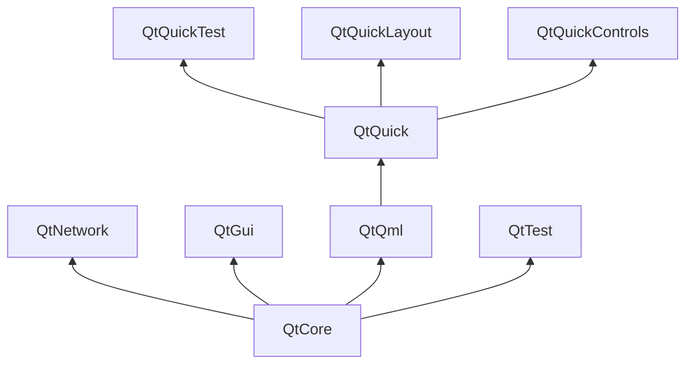

# Qt 构建块

Qt 6 由大量模块组成。一般而言，模块就是供开发者使用的库。某些模块是启用 Qt 的平台所必需的，它们构成了名为 *Qt 必备模块*（Qt Essentials Modules）的集合。另一些模块是可选的，构成了 *Qt 附加模块*（Qt Add-On Modules）。大多数开发者可能不需要使用后者，但了解它们很有好处，因为它们为常见难题提供了极有价值的解决方案。

## Qt 模块

Qt 必备模块是任何启用 Qt 的平台所必需的。它们为使用 Qt Quick 2 开发现代化 Qt 6 应用提供了基础。完整的模块列表见 [Qt 文档中的模块列表](https://doc.qt.io/qt-6/qtmodules.html#qt-essentials)。

## 核心必备模块

开始 QML 编程所需的最小 Qt 6 模块集合。

* **Qt Core**：供其他模块使用的核心非图形类。
* **Qt D-BUS**：在 Linux 上通过 D-Bus 协议进行进程间通信的类。
* **Qt GUI**：图形用户界面（GUI）组件的基类。包含 OpenGL。
* **Qt Network**：让网络编程更轻松、更易于移植的类。
* **Qt QML**：面向 QML 与 JavaScript 语言的类。
* **Qt Quick**：用于构建具有自定义用户界面的高度动态化应用的声明式框架。
* **Qt Quick Controls**：提供轻量级 QML 类型，用于为桌面、嵌入式和移动设备创建高性能的用户界面。这些类型采用简洁的样式架构，效率极高。
* **Qt Quick Layouts**：布局是用于在用户界面中排列基于 Qt Quick 2 的可视项的一类可视项。
* **Qt Quick Test**：面向 QML 应用的单元测试框架，其中测试用例以 JavaScript 函数的形式编写。
* **Qt Test**：用于对 Qt 应用和库进行单元测试的类。
* **Qt Widgets**：用 C++ 窗口部件扩展 Qt GUI 的类。

## Qt 附加模块

除了必备模块，Qt 还提供了面向特定用途的附加模块。许多附加模块要么功能已经完备、仅为向后兼容而保留，要么只适用于特定平台。这里列出了一些可用的附加模块，但请务必在 [Qt 文档的附加模块列表](https://doc.qt.io/qt-6/qtmodules.html#qt-add-ons) 以及下面的列表中熟悉所有这些模块。

* **网络**：Qt Bluetooth / Qt Network Authorization
* **UI 组件**：Qt Quick 3D / Qt Quick Timeline / Qt Charts / Qt Data Visualization / Qt Lottie Animation / Qt Virtual Keyboard
* **图形**：Qt 3D / Qt Image Formats / Qt OpenGL / Qt Shader Tools / Qt SVG / Qt Wayland Compositor
* **辅助**：Qt 5 Core Compatibility APIs / Qt Concurrent / Qt Help / Qt Print Support / Qt Quick Widgets / Qt SCXML / Qt SQL / Qt State Machine / Qt UI Tools / Qt XML

::: tip
由于这些模块不是发布版本的一部分，各模块的状态可能有所不同，这取决于活跃贡献者的数量以及测试的完善程度。
:::

## 支持的平台

Qt 支持多种平台，包括所有主流的桌面与嵌入式平台。借助 Qt 平台抽象（Qt Platform Abstraction），如有需要，将 Qt 移植到你自己的平台比以往任何时候都更容易。

在某个平台上测试 Qt 6 非常耗时。Qt Project 选出了一部分平台，构成参考平台集。这些平台经过系统测试的充分检验，以确保最佳质量。不过请记住，没有代码是零错误的。

# Qt Project

摘自 [Qt Wiki](http://wiki.qt.io/)：

> “Qt Wiki 是一个基于任人唯贤与共识、对 Qt 感兴趣的社区。任何同样感兴趣的人都可以加入这个社区，参与其决策过程，并为 Qt 的发展做出贡献。”

Qt Wiki 是 Qt 用户与贡献者分享见解的地方。它为其他用户参与贡献奠定了基础。最大的贡献者是 The Qt Company，它同时持有 Qt 的商业权利。

Qt 既有开源的一面，也有面向企业的商业一面。商业一面是为那些不能或不愿遵守开源许可证的公司准备的。如果没有商业授权，这些公司将无法使用 Qt，The Qt Company 也无法向 Qt Project 贡献如此多的代码。

全世界有许多公司以在各平台上使用 Qt 进行咨询和产品开发为生。也有许多开源项目和开源开发者依赖 Qt 作为主要的开发库。成为这个充满活力社区的一份子，使用这些出色的工具和库，感觉真的很棒。这会让你成为一个更好的人吗？也许吧 :-)

**参与贡献：http://wiki.qt.io/**
