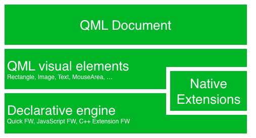
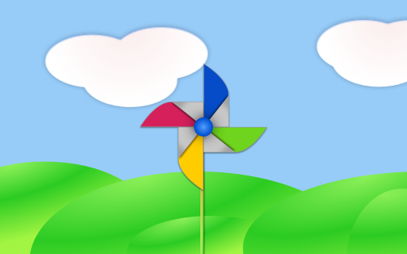
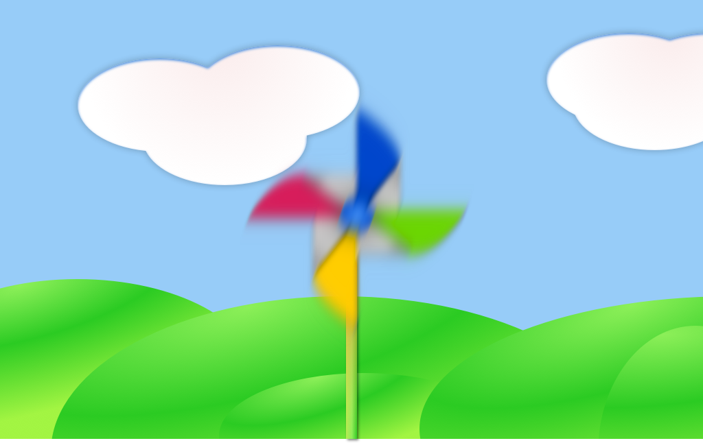

# Qt 6 简介

## Qt Quick

Qt Quick 是 Qt 6 中用户界面技术的统称。它在 Qt 4 中首次引入，如今已扩展至 Qt 6。Qt Quick 本身是多种技术的集合：

* QML：用户界面标记语言
* JavaScript：动态脚本语言
* Qt C++：高度可移植的增强型 C++ 库



与 HTML 类似，QML 也是一种标记语言。它由标签组成，在 Qt Quick 中这些标签称为类型，并用花括号括起来：`Item {}`。QML 从诞生起就是为创建用户界面而设计的，它追求速度，也便于开发者阅读。用户界面还可以用 JavaScript 代码进一步增强。借助 Qt C++，你可以用自己编写的原生功能轻松扩展 Qt Quick。简言之，声明式 UI 被称为前端（front-end），原生部分被称为后端（back-end）。这样，你就能把应用中计算密集的原生操作与用户界面部分分离开来。

在典型项目中，前端用 QML/JavaScript 开发。后端代码负责与系统对接并承担繁重的运算，使用 Qt C++ 开发。这让偏重设计的开发者与负责功能实现的开发者之间可以自然分工。通常，后端使用 Qt Test（Qt 的单元测试框架）进行测试，并导出供前端开发者使用。

## 理解用户界面

让我们用 Qt Quick 创建一个简单的用户界面，借此展示 QML 语言的一些特性。最终，我们将得到一个叶片可以旋转的纸风车。



我们从一个名为 `main.qml` 的空文档开始。我们所有的 QML 文件都以 `.qml` 为后缀。作为标记语言（与 HTML 类似），QML 文档需要有且只有一个根类型（root type）。在本例中，根类型是 `Image`，其宽度和高度基于背景图片的几何尺寸：

```qml
import QtQuick

Image {
    id: root
    source: "images/background.png"
}
```

由于 QML 不限制根类型的选择，我们把 `Image` 类型作为根，并将其 source 属性设置为背景图片。


::: tip
每个类型都有属性。例如，图片具有 `width` 和 `height` 属性，二者分别保存像素数。它还有其他属性，例如 `source`。由于图片类型的尺寸会自动根据图片大小得出，我们无需自行设置 `width` 和 `height` 属性。
:::

最标准的类型都位于 `QtQuick` 模块中，该模块通过 `.qml` 文件开头的 import 语句提供。

`id` 是一个特殊且可选的属性，它包含一个标识符，可用于在文档的其他地方引用与之关联的类型。注意：`id` 属性一经设置便无法更改，也不能在运行时设置。在本书中，约定用 `root` 作为根类型的 id，这样在较大的 QML 文档中引用最顶层类型时更可预期。

表示杆与风车的前景元素以独立图片的形式加入。


我们想把杆放在背景的水平中央，但在垂直方向上偏向下侧。同时把风车放在背景的正中间。

虽然这个入门示例只用到了图片类型，但随着学习的深入，你将创建由许多不同类型组成的、更加复杂的用户界面。

```qml
Image {
    id: root
    ...
    Image {
        id: pole
        anchors.horizontalCenter: parent.horizontalCenter
        anchors.bottom: parent.bottom
        source: "images/pole.png"
    }

    Image {
        id: wheel
        anchors.centerIn: parent
        source: "images/pinwheel.png"
    }
    ...
}
```

要把风车放在正中间，我们使用一个名为 `anchor` 的复杂属性。使用锚点可以指定父对象与同级对象之间的几何关系。例如，把我放到另一个类型的中心（`anchors.centerIn: parent`）。两端都有 left、right、top、bottom、centerIn、fill、verticalCenter 和 horizontalCenter 这些关系。自然地，当两个或更多锚点一起使用时，它们应当相互补充：例如，把一个类型的左边锚定到另一个类型的顶部就毫无意义。

对风车来说，锚定只需要一个简单的锚点。

::: tip
有时你会想做一些微调，例如让一个类型稍微偏离中心。这可以通过 `anchors.horizontalCenterOffset` 或 `anchors.verticalCenterOffset` 来实现。所有其他锚点也有类似的调整属性。完整的锚点属性列表请参阅文档。
:::

::: tip    
把图片作为根类型（即 `Image`）的子类型放置，体现了声明式语言的一个重要概念。你按照图层与分组的顺序描述用户界面的视觉外观：最顶层的图层（我们的背景图片）最先绘制，子图层随后在它上方、以包含它的类型的局部坐标系绘制。
:::

为了让这个示例更有趣一些，我们让场景具有交互性。思路是：当用户在场景中的某处按下鼠标时，旋转风车。

我们使用 `MouseArea` 类型，让它覆盖根类型的整个区域。

```qml
Image {
    id: root
    ...
    MouseArea {
        anchors.fill: parent
        onClicked: wheel.rotation += 90
    }
    ...
}
```

当用户在鼠标区域覆盖的范围内点击时，它会发出信号。你可以通过重写 `onClicked` 函数来连接这个信号。当信号被连接后，与之对应的函数会在该信号发出时被调用。在本例中，我们的意思是：当鼠标区域中发生点击时，`id` 为 `wheel` 的类型（即风车图片）应旋转 +90 度。

::: tip
这一技巧适用于所有信号，命名约定为 `on` 加上首字母大写的 `SignalName`。此外，所有属性在值发生变化时都会发出信号。对于这些信号，命名约定是：
:::

```js
    `on${property}Changed`
```

例如，若 `width` 属性发生变化，你可以用 `onWidthChanged: print(width)` 来观察它。

现在，每当用户点击时风车都会旋转，但旋转是一步跳到目标角度，而不是随时间平滑过渡。借助动画，我们可以实现平滑的运动。动画定义了一个属性的变化如何在一段时间内发生。为此，我们使用 `Animation` 类型中名为 `Behavior` 的属性。`Behavior` 会针对指定属性的每一次更改指定一个动画。换言之，每当该属性变化时，就会运行动画。这只是 QML 中实现动画的众多方式之一。

```qml
Image {
    id: root
    Image {
        id: wheel
        Behavior on rotation {
            NumberAnimation {
                duration: 250
            }
        }
    }
}
```

现在，每当风车的 rotation 属性变化时，都会通过时长为 250 毫秒的 `NumberAnimation` 生成动画。因此每次 90 度的转动耗时 250 毫秒，转动起来平滑而漂亮。



::: tip
你并不会真的看到风车变模糊。这仅仅表示它在旋转。（如果你有兴趣尝试，assets 文件夹里有一个模糊的风车图片。）
:::

现在风车看起来漂亮多了，表现也不错；同时，本例也让你对 Qt Quick 编程的基础有了一个简要的了解。

