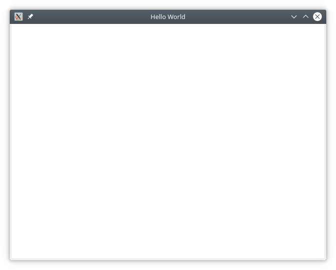

# Hello World

为了测试你的安装，我们将创建一个小型的 *hello world* 应用程序。请打开 Qt Creator，创建一个 Qt Quick UI 项目（`File ‣ New File or Project ‣ Other Project ‣ Qt Quick UI Prototype`），并将项目命名为 `HelloWorld`。

::: tip
Qt Creator IDE 允许你创建各种类型的应用程序。除非特别说明，我们始终使用 Qt Quick UI prototype（Qt Quick UI 原型）项目。对于正式的产品应用，通常更倾向于使用基于 `CMake` 的项目，但要快速做原型，这种类型更合适。
:::

::: tip
一个典型的 Qt Quick 应用程序由一个名为 QmlEngine 的运行时构成，它负责加载初始 QML 代码。开发者可以向该运行时注册 C++ 类型，以便与原生代码交互。这些 C++ 类型还可以打包进插件（plugin），然后通过 import 语句动态加载。`qml` 工具是一个现成的运行时，可以直接使用。在入门阶段，我们不会涉及开发的原生部分，只聚焦于 Qt 6 中 QML 相关的内容。这就是我们从原型项目开始的原因。
:::

Qt Creator 会为你创建若干文件。`HelloWorld.qmlproject` 文件是项目文件，保存着相关的项目配置。该文件由 Qt Creator 管理，请不要自行编辑它。

另一个文件 `HelloWorld.qml` 是我们的应用程序代码。先打开它，在继续阅读之前，试着理解这个应用程序做了什么。

```qml
// HelloWorld.qml

import QtQuick
import QtQuick.Window

Window {
    width: 640
    height: 480
    visible: true
    title: qsTr("Hello World")
}
```

`HelloWorld.qml` 程序是用 QML 语言编写的。我们将在下一章更深入地讨论 QML 语言。QML 将用户界面描述为一棵具有层次结构的元素树。本例中是一个 640 x 480 像素的窗口，窗口标题为“Hello World”。

要自己运行这个应用程序，请单击左侧的  Run（运行）工具，或在菜单中选择 Build > Run。

在后台，Qt Creator 会运行 `qml`，并把你的 QML 文档作为第一个参数传入。`qml` 应用程序解析该文档，并启动用户界面。你应该会看到类似这样的内容：



Qt 6 可以工作了！这意味着我们可以继续了。

::: tip
如果你是系统集成商，你会希望安装 Qt SDK，以获得最新的稳定 Qt 版本，同时还有一个针对你的特定设备目标、从源码编译的 Qt 版本。
:::

::: tip
从头构建

如果你想从命令行构建 Qt 6，首先需要获取一份代码仓库的副本并完成构建。请访问 Qt 的 wiki，了解如何从 git 构建 Qt 的最新说明。

编译成功后（外加 2 杯咖啡），Qt 6 就会出现在 `qtbase` 文件夹中。其实任何饮料都可以，不过我们建议用咖啡以获得最佳效果。

如果你想测试自己的编译结果，现在就可以用 Qt 6 自带的默认运行时运行这个示例：

    $ qtbase/bin/qml
:::
