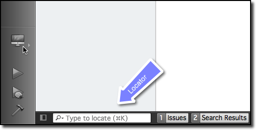
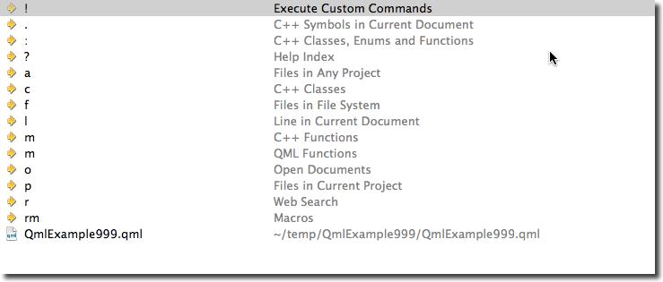

# Locator

Locator（定位器）是 Qt Creator 内的一个核心组件。它让开发者能够快速导航到源代码或帮助中的特定位置。按 `Ctrl+K` 即可打开 Locator。

一个弹窗会从左下角弹出，显示选项列表。如果你只想在项目中搜索某个文件，键入文件名的首字母即可。Locator 也接受通配符，因此 `\*main.qml` 同样有效。此外，你还可以为搜索添加前缀，以查找特定的内容类型。

请试一试。例如，要打开 QML 元素 Rectangle 的帮助，打开 Locator 并输入 `? rectangle`。输入过程中 Locator 会不断更新建议，直到你找到所需的参考条目。
