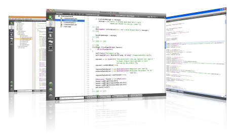

# Qt Creator 集成开发环境

Qt Creator 是 Qt 默认的集成开发环境（IDE）。它由 Qt 开发者编写，也为 Qt 开发者打造。该 IDE 在所有主流桌面平台上都可用，例如 Windows/Mac/Linux。我们已经见到过客户在嵌入式设备上使用 Qt Creator。Qt Creator 的用户界面精简高效，在提升开发者生产力方面尤为出色。Qt Creator 既可以用来运行你的 Qt Quick 用户界面，也可以用来编译 C++ 代码——无论目标是你的主机系统，还是借助交叉编译器的其他设备。

::: warning
请更新截图！
:::
