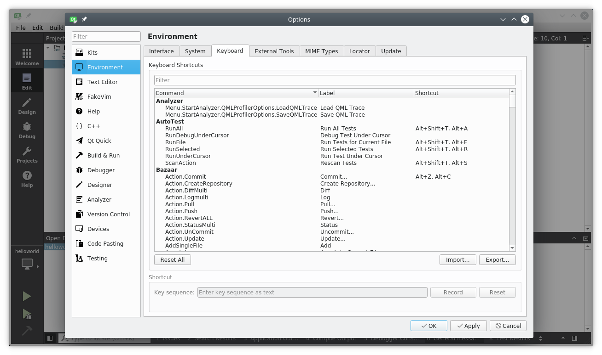

# 快捷键

快捷键是好用的编辑器与专业编辑器之间的差别。作为专业人士，你会在这个应用前度过数百小时。每一个能加快工作流的快捷键都至关重要。幸运的是，Qt Creator 的开发者们也是这么想的，他们为这个应用添加了足足数百个快捷键。

入门阶段我们收集了一些基本快捷键（Windows 记法）：

* `Ctrl+B` - 构建项目
* `Ctrl+R` - 运行项目
* `Ctrl+Tab` - 在打开的文档之间切换
* `Ctrl+K` - 打开 Locator
* `Esc` - 返回（按几次即可回到编辑器）
* `F2` - 跟进光标下的符号
* `F4` - 在头文件和源文件之间切换（仅对 C++ 代码有用）

文档中的 [Qt Creator 快捷键](http://doc.qt.io/qtcreator/creator-keyboard-shortcuts.html)列表。

## 配置快捷键

你可以在 Qt Creator 内通过设置对话框配置快捷键。

