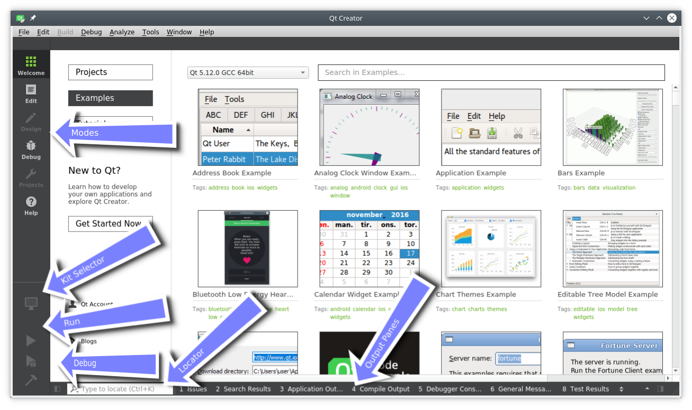

# 用户界面

启动 Qt Creator 时，迎接你的是 *Welcome*（欢迎）界面。在这里你能找到关于如何继续使用 Qt Creator 的最重要提示，以及最近使用的项目。你还会看到会话（session）列表，对你而言它可能是空的。会话是为快速访问而保存的一组项目和配置。当你手头有多个客户、多个较大的项目时，这一功能非常顺手。

在左侧，你会看到模式选择器。模式选择器涵盖了开发者工作流中的典型步骤。

* **欢迎模式（Welcome mode）**：便于你熟悉环境。
* **编辑模式（Edit mode）**：专注于代码。
* **设计模式（Design mode）**：专注于 UI 设计。
* **调试模式（Debug mode）**：获取正在运行的应用程序的相关信息。
* **项目模式（Projects mode）**：修改项目的运行与构建配置。
* **分析模式（Analyze mode）**：检测内存泄漏并进行性能分析。
* **帮助模式（Help mode）**：便捷访问 Qt 文档。

在模式选择器下方，是实际的项目配置选择器和运行/调试。

大多数时候你会停留在编辑模式，中央面板是代码编辑器。需要配置项目时，你会不时进入项目模式。然后按下 `Run`。Qt Creator 足够智能，会在运行前确保你的项目已完整构建。

底部是输出面板，用于显示问题、应用程序消息、编译消息及其他消息。
