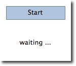
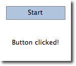

# 组件

组件是可复用的元素。QML 提供多种创建组件的方式。这里我们只看最简单的形式——基于文件的组件。基于文件的组件通过把一个 QML 元素放进文件、并给文件取一个元素名（例如 `Button.qml`）来创建。你可以像使用 Qt Quick 模块中的任何其他元素一样使用该组件。在我们的例子中，会在代码里写作 `Button { ... }`。

例如，让我们创建一个包含文本组件和鼠标区域的矩形。它看起来像一个简单的按钮，就我们的目的而言不必更复杂。

<<< @/docs/ch04-qmlstart/src/components/InlinedComponentExample.qml#button

界面大致如下。第一幅图中界面处于初始状态，第二幅图中按钮已被点击。






现在我们的任务是把按钮界面提取为一个可复用的组件。为此，我们应该考虑按钮可能的 API。你可以设想别人应当如何使用你的按钮。下面是我的想法：

```qml
// minimal API for a button
Button {
    text: "Click Me"
    onClicked: { /* do something */ }
}
```

我希望通过 `text` 属性设置文本，并实现自己的点击处理器。另外，我希望按钮有一个合理的初始尺寸，并且可以覆盖它（例如用 `width: 240`）。

为此我们创建一个 `Button.qml` 文件，把按钮界面复制进去。此外，我们需要在根级别导出用户可能想要修改的属性。

<<< @/docs/ch04-qmlstart/src/components/Button.qml#global

我们在根级别导出了 text 属性和 clicked 信号。通常把根元素命名为 root，以便于引用。我们使用了 QML 的 `alias` 特性，它可以把嵌套 QML 元素内部的属性导出到根级别，使其对外部世界可用。需要知道的是，只有根级别的属性才能被此文件之外的其他组件访问。

要使用新的 `Button` 元素，只需在文件中声明它。这样前面的例子就简化了一些。

<<< @/docs/ch04-qmlstart/src/components/ReusableComponentExample.qml#reusability

现在你可以在界面中随意使用任意多的按钮，只需写 `Button { ... }`。真正的按钮可能更复杂，例如在点击时提供反馈或显示更漂亮的装饰。

::: tip
如果愿意，你甚至可以更进一步，用 `Item` 作为根元素。这可以防止用户更改我们设计的按钮颜色，并让我们对导出的 API 有更多的控制。目标应当是导出最小的 API。实际上，这意味着我们需要把根 `Rectangle` 替换为 `Item`，并把矩形变成根 item 中的嵌套元素。

```qml
Item {
    id: root
    width: 116; height: 26

    property alias text: label.text
    signal clicked

    Rectangle {
        anchors.fill parent
        color: "lightsteelblue"
        border.color: "slategrey"
    }
    ...
}
```
:::

借助这一技术，很容易创建一整套可复用的组件。
