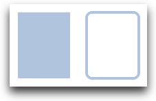
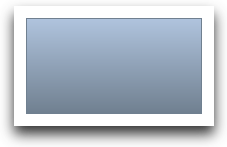
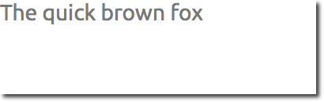
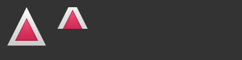
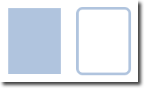
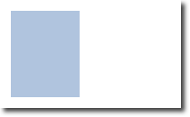

# 核心元素

元素可分为可视元素和非可视元素。可视元素（如 `Rectangle`）具有几何形状，通常在屏幕上呈现一块区域。非可视元素（如 `Timer`）提供通用功能，通常用来操作可视元素。

目前我们把重点放在基础可视元素上，例如 `Item`、`Rectangle`、`Text`、`Image` 和 `MouseArea`。不过，使用 Qt Quick Controls 2 模块，也可以用按钮、标签和滑块等标准平台组件来构建用户界面。

## Item 元素

`Item` 是所有可视元素的基础元素，所有其他可视元素都继承自 `Item`。它本身不绘制任何内容，但定义了所有可视元素共有的属性：

* **几何形状**——`x` 和 `y` 定义左上角位置，`width` 和 `height` 定义元素的范围，`z` 定义堆叠顺序，用于把元素提升到其自然顺序之上或之下。
* **布局处理**——`anchors`（left、right、top、bottom、垂直居中和水平居中）把元素相对于其他元素定位，可选的 `margins` 设置边距。
* **按键处理**——附加属性 `Key` 和 `KeyNavigation` 控制按键处理，而 `focus` 属性用于首先启用按键处理。
* **变换**——`scale` 和 `rotate` 变换，以及用于 *x,y,z* 变换的通用 `transform` 属性列表，还有 `transformOrigin` 原点。
* **视觉效果**——`opacity` 控制透明度，`visible` 显示/隐藏元素，`clip` 把绘制操作限制在元素边界内，`smooth` 提升渲染质量。
* **状态定义**——`states` 列表属性给出支持的状态列表，`state` 属性给出当前状态，`transitions` 列表属性为状态变化添加动画。

为了更好地理解这些不同属性，我们将在本章中结合所介绍的元素来讲解它们。请记住，这些基础属性在每个可视元素上都可用，且在这些元素之间的工作方式相同。

::: tip
`Item` 元素常被用作其他元素的容器，类似于 HTML 中的 *div* 元素。
:::

## Rectangle 元素

`Rectangle` 扩展了 `Item`，为其添加了填充色。此外它还支持由 `border.color` 和 `border.width` 定义的边框。要创建圆角矩形，可以使用 `radius` 属性。

```qml
Rectangle {
    id: rect1
    x: 12; y: 12
    width: 76; height: 96
    color: "lightsteelblue"
}
Rectangle {
    id: rect2
    x: 112; y: 12
    width: 76; height: 96
    border.color: "lightsteelblue"
    border.width: 4
    radius: 8
}
```



::: tip
有效的颜色值是 SVG 颜色名中的颜色（参见  [http://www.w3.org/TR/css3-color/#svg-color](http://www.w3.org/TR/css3-color/#svg-color)）。在 QML 中可以用不同方式给出颜色，但最常见的方式是 RGB 字符串（'#FF4444'）或颜色名（例如 'white'）。

可以用一些 JavaScript 创建随机颜色：

```qml
color: Qt.rgba( Math.random(), Math.random(), Math.random(), 1 )
```

:::

除填充色和边框外，矩形还支持自定义渐变：

```qml
Rectangle {
    id: rect1
    x: 12; y: 12
    width: 176; height: 96
    gradient: Gradient {
        GradientStop { position: 0.0; color: "lightsteelblue" }
        GradientStop { position: 1.0; color: "slategray" }
    }
    border.color: "slategray"
}
```



渐变由一系列渐变停止点定义。每个停止点有一个位置和一种颜色。位置标记在 y 轴上的位置（0 = 顶部，1 = 底部）。`GradientStop` 的颜色标记该位置处的颜色。

::: tip
未设置 *width/height* 的矩形将不可见。当你有多个矩形的宽（高）相互依赖、而组合逻辑出了问题时，常常会发生这种情况。要当心！
:::

::: tip
无法创建带角度的渐变。为此最好使用预先制作的图像。一种可能的做法是直接旋转带渐变的矩形，但要注意旋转后矩形的几何形状并不会改变，因此会引起混淆——元素的几何形状与可见区域并不一致。在作者看来，这种情况下使用专门设计的渐变图像确实更好。
:::

## Text 元素

要显示文本，可以使用 `Text` 元素。它最值得注意的属性是 `text` 属性，类型为 `string`。该元素根据给定的文本和所用字体计算其初始宽度和高度。可以用 font 属性组影响字体（例如 `font.family`、`font.pixelSize` 等）。要改变文本颜色，使用 `color` 属性即可。

```qml
Text {
    text: "The quick brown fox"
    color: "#303030"
    font.family: "Ubuntu"
    font.pixelSize: 28
}
```



可以用 `horizontalAlignment` 和 `verticalAlignment` 属性把文本对齐到各边和中心。要进一步增强文本渲染效果，可以使用 `style` 和 `styleColor` 属性，它们允许以轮廓、凸起和凹陷模式渲染文本。

对于较长的文本，你常常希望定义一个*截断*位置，如 *A very … long text*，这可以用 `elide` 属性实现。`elide` 属性允许把省略位置设置在文本的左侧、右侧或中间。

如果你不希望出现省略模式的“…”，但仍想看到完整文本，也可以用 `wrapMode` 属性让文本换行（仅在显式设置宽度时有效）：

```qml
Text {
    width: 40; height: 120
    text: 'A very long text'
    // '...' shall appear in the middle
    elide: Text.ElideMiddle
    // red sunken text styling
    style: Text.Sunken
    styleColor: '#FF4444'
    // align text to the top
    verticalAlignment: Text.AlignTop
    // only sensible when no elide mode
    // wrapMode: Text.WordWrap
}
```

`Text` 元素只显示给定的文本，它占用的其余空间是透明的。这意味着它不渲染任何背景装饰，因此如果需要，由你来提供合适的背景。

::: tip
请注意，`Text` 可视项的初始宽度取决于所设置的字体和文本字符串。未设置宽度且没有文本的 `Text` 元素将不可见，因为初始宽度为 0。
:::

::: tip
在布局 `Text` 元素时，通常需要区分“把文本在 `Text` 元素边界框内对齐”与“对齐元素边界框本身”。前者应使用 `horizontalAlignment` 和 `verticalAlignment` 属性，后者则应操作元素的几何形状或使用锚点。
:::

## Image 元素

`Image` 元素能够显示各种格式的图像（例如 `PNG`、`JPG`、`GIF`、`BMP`、`WEBP`）。*支持的图像格式完整列表请参阅 [Qt 文档](https://doc.qt.io/qt-6/qimagereader.html#supportedImageFormats)*。除了提供图像 URL 的 `source` 属性外，它还包含控制调整大小行为的 `fillMode`。

```qml
Image {
    x: 12; y: 12
    // width: 72
    // height: 72
    source: "assets/triangle_red.png"
}
Image {
    x: 12+64+12; y: 12
    // width: 72
    height: 72/2
    source: "assets/triangle_red.png"
    fillMode: Image.PreserveAspectCrop
    clip: true
}
```



::: tip
URL 可以是使用正斜杠的本地路径（ “./images/home.png” ）或网络链接（例如 “[http://example.org/home.png](http://example.org/home.png)”）。
:::

::: tip
`Image` 元素若使用 `PreserveAspectCrop`，还应启用裁剪，以避免图像数据被渲染到 `Image` 边界之外。默认情况下裁剪是关闭的（`clip: false`）。你需要启用裁剪（`clip: true`）把绘制限制在元素的边界矩形内。这可以用于任何可视元素，但[应节制使用](https://doc.qt.io/qt-6/qtquick-performance.html#clipping)。
:::

::: tip
使用 C++，你可以用 `QQuickImageProvider` 创建自己的图像提供者。这让你能够即时创建图像，并利用多线程图像加载。
:::

## MouseArea 元素

要与这些元素交互，通常会使用 `MouseArea`。它是一个矩形的不可见项，你可以在其中捕获鼠标事件。鼠标区域常与可视项一起使用，在用户与可视部分交互时执行命令。

```qml
Rectangle {
    id: rect1
    x: 12; y: 12
    width: 76; height: 96
    color: "lightsteelblue"
    MouseArea {
        id: area
        width: parent.width
        height: parent.height
        onClicked: rect2.visible = !rect2.visible
    }
}

Rectangle {
    id: rect2
    x: 112; y: 12
    width: 76; height: 96
    border.color: "lightsteelblue"
    border.width: 4
    radius: 8
}
```





::: tip
这是 Qt Quick 的一个重要方面：输入处理与视觉呈现是分离的。这让你可以向用户展示一个界面元素，而实际的交互区域可以更大。
:::

::: tip
更复杂的交互请参阅 [Qt Quick Input Handlers](https://doc.qt.io/qt-6/qtquickhandlers-index.html)。它们旨在取代 `MouseArea` 和 `Flickable` 之类的元素，提供更强的控制和灵活性。其理念是让每个处理器实例处理一个交互方面，而不是像以前那样把来自某一来源的所有事件都集中到单个元素中处理。
:::
