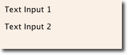
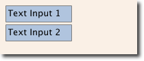
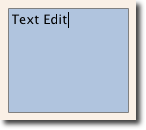
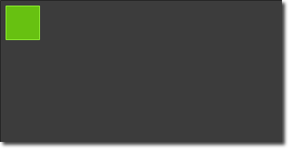

# 输入元素

我们已经使用 `MouseArea` 作为鼠标输入元素。接下来关注键盘输入。我们从文本编辑元素开始：`TextInput` 和 `TextEdit`。

## TextInput

`TextInput` 允许用户输入一行文本。该元素支持 `validator`、`inputMask` 和 `echoMode` 等输入约束。

```qml
// textinput.qml

import QtQuick

Rectangle {
    width: 200
    height: 80
    color: "linen"

    TextInput {
        id: input1
        x: 8; y: 8
        width: 96; height: 20
        focus: true
        text: "Text Input 1"
    }

    TextInput {
        id: input2
        x: 8; y: 36
        width: 96; height: 20
        text: "Text Input 2"
    }
}
```




用户可以在 `TextInput` 内部点击来改变焦点。要支持用键盘切换焦点，可以使用 `KeyNavigation` 附加属性。

```qml
// textinput2.qml

import QtQuick

Rectangle {
    width: 200
    height: 80
    color: "linen"

    TextInput {
        id: input1
        x: 8; y: 8
        width: 96; height: 20
        focus: true
        text: "Text Input 1"
        KeyNavigation.tab: input2
    }

    TextInput {
        id: input2
        x: 8; y: 36
        width: 96; height: 20
        text: "Text Input 2"
        KeyNavigation.tab: input1
    }
}
```

`KeyNavigation` 附加属性支持一组预设的导航键，绑定元素 id，在按下相应按键时切换焦点。

除闪烁的光标和输入的文本外，文本输入元素没有任何视觉呈现。为了让用户能把它识别为输入元素，需要一些视觉装饰；例如一个简单的矩形。把 `TextInput` 放进某个元素时，需要确保导出你希望他人能够访问的主要属性。

我们把这段代码移入自己的组件 `TLineEditV1` 中以便复用。

```qml
// TLineEditV1.qml

import QtQuick

Rectangle {
    width: 96; height: input.height + 8
    color: "lightsteelblue"
    border.color: "gray"

    property alias text: input.text
    property alias input: input

    TextInput {
        id: input
        anchors.fill: parent
        anchors.margins: 4
        focus: true
    }
}
```

::: tip
如果想完整导出 `TextInput`，可以用 `property alias input: input` 导出该元素。第一个 `input` 是属性名，第二个 input 是元素 id。
:::

然后我们重写 `KeyNavigation` 示例，改用新的 `TLineEditV1` 组件。

```qml
Rectangle {
    ...
    TLineEditV1 {
        id: input1
        ...
    }
    TLineEditV1 {
        id: input2
        ...
    }
}
```



试试用 Tab 键导航。你会发现焦点并没有切换到 `input2`。仅仅使用 `focus: true` 是不够的。问题在于，当焦点被转移到 `input2` 元素时，`TlineEditV1` 内部的顶层项（我们的 `Rectangle`）接收了焦点，却没有把焦点转发给 `TextInput`。为防止这种情况，QML 提供了 `FocusScope`。

## FocusScope

焦点作用域声明：当焦点作用域获得焦点时，最后一个带 `focus: true` 的子元素接收焦点。也就是说，它把焦点转发给最后请求焦点的子元素。我们将创建 TLineEdit 组件的第二个版本 TLineEditV2，使用焦点作用域作为根元素。

```qml
// TLineEditV2.qml

import QtQuick

FocusScope {
    width: 96; height: input.height + 8
    Rectangle {
        anchors.fill: parent
        color: "lightsteelblue"
        border.color: "gray"

    }

    property alias text: input.text
    property alias input: input

    TextInput {
        id: input
        anchors.fill: parent
        anchors.margins: 4
        focus: true
    }
}
```

我们的示例现在如下所示：

```qml
Rectangle {
    ...
    TLineEditV2 {
        id: input1
        ...
    }
    TLineEditV2 {
        id: input2
        ...
    }
}
```

现在按下 Tab 键可以成功地在两个组件之间切换焦点，且组件内正确的子元素获得焦点。

## TextEdit

`TextEdit` 与 `TextInput` 非常相似，支持多行文本编辑字段。它没有文本约束属性，因为这取决于查询文本的内容尺寸（`contentHeight`、`contentWidth`）。我们也创建了自己的组件 `TTextEdit`，提供编辑背景，并使用焦点作用域以更好地转发焦点。

```qml
// TTextEdit.qml

import QtQuick

FocusScope {
    width: 96; height: 96
    Rectangle {
        anchors.fill: parent
        color: "lightsteelblue"
        border.color: "gray"

    }

    property alias text: input.text
    property alias input: input

    TextEdit {
        id: input
        anchors.fill: parent
        anchors.margins: 4
        focus: true
    }
}
```

可以像使用 `TLineEdit` 组件一样使用它

```qml
// textedit.qml

import QtQuick

Rectangle {
    width: 136
    height: 120
    color: "linen"

    TTextEdit {
        id: input
        x: 8; y: 8
        width: 120; height: 104
        focus: true
        text: "Text Edit"
    }
}
```



## Keys 元素

附加属性 `Keys` 允许根据某些按键执行代码。例如，要移动和缩放一个方块，可以挂接上、下、左、右方向键来平移元素，用加号和减号键来缩放元素。

<<< @/docs/ch04-qmlstart/src/input/KeysExample.qml#global


