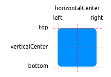
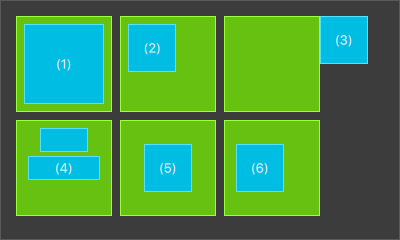

# 可视项的布局

QML 提供了一种使用锚点布局可视项的灵活方式。锚定的概念是 `Item` 的基础，所有可视 QML 元素都可用。锚点的作用如同契约，比相互冲突的几何修改更强。锚点表达的是相对关系；你总是需要一个相关的元素来与之锚定。



元素有 6 条主要锚线（`top`、`bottom`、`left`、`right`、`horizontalCenter`、`verticalCenter`）。此外还有 `baseline` 锚点，用于 `Text` 元素中的文本。每条锚线都带有一个偏移。对于 `top`、`bottom`、`left` 和 `right` 锚点，它们称为边距；对于 `horizontalCenter`、`verticalCenter` 和 `baseline`，它们称为偏移量。




* **(1)** 元素填满父元素。

    ```qml
    GreenSquare {
        BlueSquare {
            width: 12
            anchors.fill: parent
            anchors.margins: 8
            text: '(1)'
        }
    }
    ```
    


* **(2)** 元素与父元素左对齐。

    ```qml
    GreenSquare {
        BlueSquare {
            width: 48
            y: 8
            anchors.left: parent.left
            anchors.leftMargin: 8
            text: '(2)'
        }
    }
    ```


* **(3)** 元素的左边与父元素的右边对齐。

    ```qml
    GreenSquare {
        BlueSquare {
            width: 48
            anchors.left: parent.right
            text: '(3)'
        }
    }
    ```


* **(4)** 居中对齐的元素。`Blue1` 相对父元素水平居中。`Blue2` 也水平居中，不过是相对 `Blue1`，并且它的顶部与 `Blue1` 的底线对齐。

    ```qml
    GreenSquare {
        BlueSquare {
            id: blue1
            width: 48; height: 24
            y: 8
            anchors.horizontalCenter: parent.horizontalCenter
        }
        BlueSquare {
            id: blue2
            width: 72; height: 24
            anchors.top: blue1.bottom
            anchors.topMargin: 4
            anchors.horizontalCenter: blue1.horizontalCenter
            text: '(4)'
        }
    }
    ```


* **(5)** 元素在父元素中居中

    ```qml
    GreenSquare {
        BlueSquare {
            width: 48
            anchors.centerIn: parent
            text: '(5)'
        }
    }
    ```


* **(6)** 元素使用水平和垂直中心线在父元素中居中，并带有向左的偏移

    ```qml
    GreenSquare {
        BlueSquare {
            width: 48
            anchors.horizontalCenter: parent.horizontalCenter
            anchors.horizontalCenterOffset: -12
            anchors.verticalCenter: parent.verticalCenter
            text: '(6)'
        }
    }
    ```

## 隐藏的技巧

我们的方块被神奇地增强了拖拽功能。试试这个示例，拖动几个方块。你会看到 (1) 无法拖动，因为它四边都被锚定（不过你可以拖动 (1) 的父对象，因为它根本没有被锚定）。(2) 可以垂直拖动，因为只有左边被锚定。(3) 同样如此。(4) 只能垂直拖动，因为两个方块都水平居中。(5) 在父元素中居中，因此无法拖动。(6) 同样如此。拖动元素意味着改变它的 `x,y` 位置。由于锚定比设置 `x,y` 属性更强，拖动会受到已锚定线条的限制。我们稍后讨论动画时会看到这一效果。
