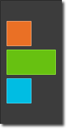
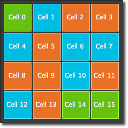

# 元素定位

有一批 QML 元素用于对可视项进行定位。这些元素称为定位器，Qt Quick 模块提供了以下几种：`Row`、`Column`、`Grid` 和 `Flow`。在下图中可以看到它们展示相同的内容。

::: tip
在深入细节之前，让我介绍几个辅助元素：红色、蓝色、绿色、较浅和较深的方块。这些组件各自包含一个 48x48 像素的着色矩形。作为参考，下面是 `RedSquare` 的源代码：
:::

<<< @/docs/ch04-qmlstart/src/positioners/RedSquare.qml#global

请注意 `Qt.lighter(color)` 的用法：基于填充色生成较浅的边框颜色。我们将在后续示例中使用这些辅助组件，使源代码更紧凑易读。请记住，每个矩形初始为 48x48 像素。

`Column` 元素把子项堆叠起来，排列成一列。`spacing` 属性可用于让各子元素之间保持距离。

<<< @/docs/ch04-qmlstart/src/positioners/ColumnExample.qml#global

`Row` 元素把子项并排放置，根据 `layoutDirection` 属性从左到右或从右到左排列。同样，`spacing` 用于分隔子项。

<<< @/docs/ch04-qmlstart/src/positioners/RowExample.qml#global

`Grid` 元素把子对象排列成网格。通过设置 `rows` 和 `columns` 属性，可以约束行数或列数。如果两者都不设置，另一方就根据子项数量计算。例如，把 rows 设为 3 并添加 6 个子项，将得到 2 列。`flow` 和 `layoutDirection` 属性用于控制项添加到网格中的顺序，`spacing` 控制分隔子项的间距。

<<< @/docs/ch04-qmlstart/src/positioners/GridExample.qml#global

最后一种定位器是 `Flow`。它按流的方式添加子项。流的方向由 `flow` 和 `layoutDirection` 控制。它可以横向流动，也可以从上到下流动；还可以从左到右或反向流动。项按流添加时，会根据需要换行或换列，形成新的行或列。要让流正常工作，它必须有宽度或高度。这可以直接设置，也可以通过锚点布局设置。

<<< @/docs/ch04-qmlstart/src/positioners/FlowExample.qml#global

与定位器配合使用的常见元素是 `Repeater`。它的工作方式类似 for 循环，在模型上迭代。最简单的情况下，模型只是一个提供循环次数的值。

<<< @/docs/ch04-qmlstart/src/positioners/RepeaterExample.qml#global

在这个 repeater 示例中，我们用了一些新的技巧。我们定义了自己的 `colorArray` 属性，它是一个颜色数组。repeater 创建一系列矩形（16 个，由模型定义）。每轮循环，它按 repeater 的子元素所定义的那样创建矩形。在矩形中，我们用 JS 数学函数选取颜色：`Math.floor(Math.random()*3)`。这给出 0..2 范围内的一个随机数，我们用它从颜色数组中选择颜色。如前所述，JavaScript 是 Qt Quick 的核心部分，因此标准库对我们可用。

repeater 会把 `index` 属性注入其中。它包含当前的循环索引（0、1、…、15）。我们可以据此基于索引做出自己的判断，在本例中则用 `Text` 元素把当前索引可视化。

::: tip
虽然 `index` 属性是动态注入到 Rectangle 中的，但良好的做法是把它声明为必需属性，以提高可读性并便于工具处理。这通过 `required property int index` 一行实现。
:::

::: tip
对较大型模型以及带动态委托的惯性视图的更高级处理，将在专门的模型-视图章节中介绍。Repeater 最适合用于呈现少量静态数据的场景。
:::
