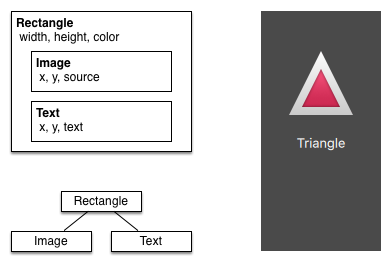

# QML 语法

QML 是一种声明式（declarative）语言，用于描述对象之间的关系。QtQuick 是构建在 QML 之上的框架，用于打造应用程序的用户界面。它把用户界面分解为更小的元素，这些元素可以组合成组件。QtQuick 描述这些用户界面元素的外观和行为。可以用 JavaScript 代码丰富这一用户界面描述，从而提供简单乃至更复杂的逻辑。从这个角度看，它沿袭了 HTML-JavaScript 的模式，但 QML 和 QtQuick 从设计之初就是用来描述用户界面的，而不是文本文档。

在最简单的形式下，QtQuick 让你创建元素的层次结构。子元素从父元素继承坐标系。`x,y` 坐标总是相对于父对象的。

::: tip
QtQuick 构建于 QML 之上。QML 语言本身只认元素、属性、信号和绑定。QtQuick 是构建在 QML 上的框架。借助默认属性，可以优雅地构建 QtQuick 元素的层次结构。
:::



让我们从一个简单的 QML 文件示例开始，解释其中的各种语法。

<<< @/docs/ch04-qmlstart/src/concepts/RectangleExample.qml#global

* `import` 语句导入一个模块。可以附加一个形如 `<major>.<minor>` 的可选版本号。
* 注释可以用 `//` 表示单行注释，或用 `/* */` 表示多行注释，与 C/C++ 和 JavaScript 中一样。
* 每个 QML 文件必须有且只有一个根元素，与 HTML 一样。
* 元素由其类型后跟 `{ }` 声明。
* 元素可以有属性，属性的形式为 `name: value`。
* QML 文档中的任意元素都可以通过其 `id`（一个不带引号的标识符）来访问。
* 元素可以嵌套，即父元素可以有子元素。可以使用 `parent` 关键字访问父元素。

使用 `import` 语句可以按名称导入 QML 模块。在 Qt5 中必须指定主版本号和次版本号（例如 `2.15`），而在 Qt6 中这是可选的。本书内容中省略这一可选版本号，因为通常你希望自动选择所选 Qt 构建套件中可用的最新版本。

::: tip
通常你需要通过 id 访问某个特定元素，或用 `parent` 关键字访问父元素。因此，良好的做法是用 `id: root` 把根元素命名为“root”。这样就不必操心 QML 文档中根元素叫什么名字了。
:::

::: tip
你可以在操作系统中通过命令行，使用 Qt Quick 运行时运行示例，如下所示：

    $ $QTDIR/bin/qml RectangleExample.qml

其中需要把 `$QTDIR` 替换为 Qt 安装路径。`qml` 可执行程序会初始化 Qt Quick 运行时并解释执行所提供的 QML 文件。

在 Qt Creator 中，可以打开相应的项目文件并运行文档 `RectangleExample.qml`。
:::

## 属性

元素通过元素名来声明，但通过使用属性或创建自定义属性来定义。属性是一对简单的键值，例如 `width: 100`、`text: 'Greetings'`、`color: '#FF0000'`。属性有明确定义的类型，并且可以有初始值。

```qml
Text {
    // (1) identifier
    id: thisLabel

    // (2) set x- and y-position
    x: 24; y: 16

    // (3) bind height to 2 * width
    height: 2 * width

    // (4) custom property
    property int times: 24

    // (5) property alias
    property alias anotherTimes: thisLabel.times

    // (6) set text appended by value
    text: "Greetings " + times

    // (7) font is a grouped property
    font.family: "Ubuntu"
    font.pixelSize: 24

    // (8) KeyNavigation is an attached property
    KeyNavigation.tab: otherLabel

    // (9) signal handler for property changes
    onHeightChanged: console.log('height:', height)

    // focus is need to receive key events
    focus: true

    // change color based on focus value
    color: focus ? "red" : "black"
}
```

下面逐一了解属性的各种特性：


* **(1)** `id` 是一种非常特殊的、类似属性的值，用于引用 QML 文件内部的元素（在 QML 中称为“文档”）。`id` 不是字符串类型，而是标识符，是 QML 语法的一部分。`id` 在文档内必须唯一，不能重置为其他值，也不能被查询。（它的行为很像 C++ 世界中的引用。）

* **(2)** 属性可以根据其类型设置为某个值。如果未给属性赋值，将选取一个初始值。关于属性初始值的更多信息，需要查阅相应元素的文档。

* **(3)** 属性可以依赖一个或多个其他属性。这称为*绑定*（binding）。被绑定的属性会在其依赖的属性变化时更新。它的工作方式如同契约：此例中 `height` 应当始终是 `width` 的两倍。

* **(4)** 向元素添加新属性使用 `property` 限定符，后接类型、名称和可选的初始值（`property <type> <name> : <value>`）。如果未给出初始值，则选取默认初始值。

::: tip
还可以用 `default` 关键字声明某个属性为默认属性。如果在元素内部创建了另一个元素而未显式绑定到某个属性，它就会绑定到默认属性。例如，添加子元素时就会用到这一点。如果子元素是可视元素，它们会自动添加到类型为 list 的默认属性 `children` 中。
:::

* **(5)** 声明属性的另一种重要方式是使用 `alias` 关键字（`property alias <name>: <reference>`）。`alias` 关键字允许我们把类型内部某个对象的属性或对象本身转发到外层作用域。稍后定义组件时，我们将使用这一技术把内部属性或元素 id 导出到根级别。属性别名不需要指定类型，它使用被引用属性或对象的类型。

* **(6)** `text` 属性依赖于类型为 int 的自定义属性 `times`。基于 `int` 的值会自动转换为 `string` 类型。该表达式本身是绑定的又一个例子，每当 `times` 属性变化时文本都会更新。


* **(7)** 有些属性是分组属性。当属性结构更复杂、相关属性应当归为一组时，就使用这一特性。分组属性的另一种写法是 `font { family: "Ubuntu"; pixelSize: 24 }`。


* **(8)** 有些属性属于元素类本身。这用于在应用程序中只出现一次的全局设置元素（例如键盘输入）。写法是 `<Element>.<property>: <value>`。


* **(9)** 对每个属性都可以提供一个信号处理器。该处理器在属性变化之后被调用。例如，这里我们希望在 height 每次变化时得到通知，并使用内置控制台向系统记录一条消息。

::: warning
元素 id 只应用于引用文档（例如当前文件）内部的元素。QML 提供一种称为“动态作用域”的机制：后加载的文档会覆盖先加载文档中的元素 ID。这使得在尚未被覆盖时引用先前加载文档的元素 ID 成为可能。这就像创建全局变量。遗憾的是，实践中这常常导致非常糟糕的代码——程序依赖于执行顺序。而且这一机制无法关闭。请谨慎使用；或者更好的做法是根本不要使用它。更好的方式是通过文档根元素上的属性，把你想对外提供的元素导出去。
:::

## 脚本

QML 和 JavaScript（也称 ECMAScript）是好朋友。在 *JavaScript* 一章中，我们将更详细地讨论这种共生关系。现在我们只是想让你意识到这一关系。

<<< @/docs/ch04-qmlstart/src/concepts/ScriptingExample.qml#text

* **(1)** 文本变化处理器 `onTextChanged` 会在每次因按下空格键而导致文本变化时打印当前文本。由于我们使用了由信号注入的参数，这里需要使用函数语法。也可以使用箭头函数（`(text) => {}`），但我们认为 `function(text) {}` 可读性更好。


* **(2)** 当文本元素接收到空格键（因为用户按下了键盘上的空格键）时，我们调用 JavaScript 函数 `increment()`。


* **(3)** 以 `function <name>(<parameters>) { ... }` 形式定义的 JavaScript 函数，它把计数器 `spacePresses` 加一。每当 `spacePresses` 递增时，被绑定的属性也会更新。

## 绑定

QML 的 `:`（绑定）与 JavaScript 的 `=`（赋值）之间的区别在于：绑定是一份契约，在绑定的生命周期内始终保持有效；而 JavaScript 赋值（`=`）是一次性的值赋值。

当属性上设置了新的绑定时，绑定的生命周期即告结束；甚至当向属性赋予 JavaScript 值时也会如此。例如，某个按键处理器把 text 属性设置为空字符串，就会破坏我们的递增显示：

<<< @/docs/ch04-qmlstart/src/concepts/ScriptingExample.qml#clear-binding{2}


按下 Esc 之后，再按空格键将不再更新显示，因为 `text` 属性先前的绑定（*text: “Space pressed: ” + spacePresses + ” times”*）已被销毁。

当你像本例这样存在相互冲突的属性修改策略时（通过绑定随属性递增而更新文本，以及通过 JavaScript 赋值清空文本），就不能使用绑定！你必须在两条属性修改路径上都使用赋值，因为赋值会销毁绑定（契约被破坏！）。
