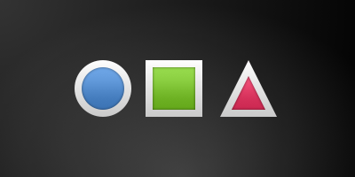
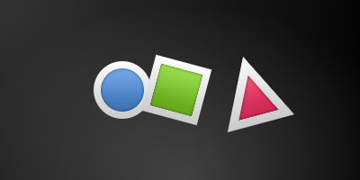
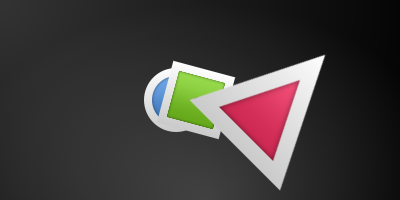

## 简单变换

变换操作对象的几何形状。QML Item 通常可以平移、旋转和缩放。这些操作有简单的形式，也有更高级的方式。

让我们从简单变换开始。下面的场景是我们的起点。

简单的平移通过改变 `x,y` 位置完成。旋转使用 `rotation` 属性完成，值以度为单位（0 .. 360）。缩放使用 `scale` 属性完成，值小于 1 表示元素缩小，`>1` 表示元素放大。旋转和缩放不会改变可视项的几何形状：`x,y` 和 `width/height` 并未改变，只有绘制指令被变换。

在展示示例之前，我想介绍一个小助手：`ClickableImage` 元素。`ClickableImage` 只是带鼠标区域的图像。这里有一条有用的经验法则——如果你已经把一段代码复制了三次，就把它提取成组件。

<<< @/docs/ch04-qmlstart/src/transformation/ClickableImage.qml#global

我们用可点击图像呈现三个对象（方框、圆、三角形）。每个对象在被点击时执行一次简单变换。点击背景会重置场景。

<<< @/docs/ch04-qmlstart/src/transformation/TransformationExample.qml#no-tests

圆每被点击一次就使 x 位置递增，方框每被点击一次就旋转。三角形每被点击一次就旋转并放大图像，以演示组合变换。对于缩放和旋转操作，我们设置 `antialiasing: true` 启用抗锯齿——出于性能原因它（裁剪属性 `clip` 也一样）是关闭的。在你自己的工作中，当图形出现光栅化的边缘时，就应当开启平滑处理。

::: tip
要在缩放图像时获得更好的视觉质量，建议缩小而不是放大。以较大的缩放因子放大会导致缩放伪影（图像模糊）。缩放图像时，应考虑使用 ``smooth: true``，以牺牲性能为代价启用更高质量的滤波。
:::

背景 `MouseArea` 覆盖整个背景并重置对象的值。

::: tip
代码中出现较早的元素堆叠顺序（称为 z-order）较低。如果你在 `circle` 上点击足够多次，会看到它移到了 `box` 下面。堆叠顺序也可以通过 Item 的 `z` 属性来操作。

这是因为 `box` 在代码中出现得更晚。同样的规律也适用于鼠标区域。代码中较晚的鼠标区域会覆盖较早的鼠标区域（从而抢走鼠标事件）。

请记住：*文档中元素的顺序很重要*。
:::
