# 动画

动画应用于属性变化。当属性值发生变化时，动画定义从一个值到另一个值的插值（interpolation）曲线。这些动画曲线在两个值之间创造出平滑的过渡。

一个动画由以下部分定义：一系列要做动画处理的目标属性、决定插值曲线的缓动（easing）曲线，以及持续时间。Qt Quick 中的所有动画都由同一个计时器控制，因此是同步的。这提升了动画的性能和视觉质量。

::: tip 动画通过值插值控制属性的变化方式

这是一个基本概念。QML 基于元素、属性和脚本。每个元素都提供了几十个属性，每个属性都在等待你为它添加动画。在本书中，你会看到这是一片精彩的舞台。

你会不自觉地看着某些动画，赞叹它们的美妙，也赞叹自己的创造天赋。那么请记住：*动画控制属性的变化，而每个元素都有几十个属性供你支配*。

**释放这股力量吧！**
:::

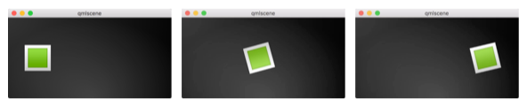

<<< @/docs/ch05-fluid/src/animation/AnimationExample.qml#global

上面的示例展示了一个应用于 `x` 和 `rotation` 属性的简单动画。每个动画的持续时间为 4000 毫秒（msec）。对 `x` 的动画将对象的 x 坐标逐渐移动到 240px。对 rotation 的动画从当前角度运行到 360 度。两个动画并行运行，并在点击 `MouseArea` 时启动。

你可以通过修改 `to` 和 `duration` 属性来试验这个动画，也可以再添加一个动画（例如作用于 `opacity`，甚至 `scale` 的动画）。**把它们组合起来，看起来就像对象正在消失在深空之中。试试看！**

## 动画元素

有多种动画元素类型，每一种都针对特定用例进行了优化。以下是最主要的几种动画：


* `PropertyAnimation` - 对属性值的变化进行动画处理

* `NumberAnimation` - 对 qreal 类型值的变化进行动画处理

* `ColorAnimation` - 对颜色值的变化进行动画处理

* `RotationAnimation` - 对旋转值的变化进行动画处理

除了这些基础且广泛使用的动画元素外，Qt Quick 还针对特定用例提供了更专门的动画：


* `PauseAnimation` - 为动画提供暂停

* `SequentialAnimation` - 允许动画顺序运行

* `ParallelAnimation` - 允许动画并行运行

* `AnchorAnimation` - 对锚点值的变化进行动画处理

* `ParentAnimation` - 对父对象值的变化进行动画处理

* `SmoothedAnimation` - 让属性平滑地跟踪一个值

* `SpringAnimation` - 让属性以类似弹簧的运动跟踪一个值

* `PathAnimation` - 使一个项沿一条路径运动

* `Vector3dAnimation` - 对 QVector3d 值的变化进行动画处理

稍后我们将学习如何创建动画序列。在处理更复杂的动画时，有时需要在动画进行期间更改某个属性或运行某个脚本。为此，Qt Quick 提供了动作元素（action elements），它们可以用在其他动画元素所能使用的任何地方：


* `PropertyAction` - 在动画过程中即时更改属性

* `ScriptAction` - 定义要在动画期间运行的脚本

本章将通过简短而聚焦的示例讨论主要的动画类型。

## 应用动画

动画可以通过几种方式来应用：


* **属性上的动画（Animation on property）** - 元素完全加载后自动运行

* **属性上的 Behavior（Behavior on property）** - 属性值发生变化时自动运行

* **独立动画（Standalone Animation）** - 当使用 `start()` 显式启动动画，或将 `running` 设置为 true（例如通过属性绑定）时运行

*稍后我们还将看到，如何在状态过渡中使用动画。*

## 可点击图片 V2

为了演示动画的用法，我们复用了前一章中的 ClickableImage 组件，并用一个 Text 元素扩展了它。

<<< @/docs/ch05-fluid/src/animation/ClickableImageV2.qml#global

为了把元素组织在图片下方，我们使用了一个 Column 定位器（positioner），并根据该 Column 的 childrenRect 属性计算宽度和高度。我们公开了文本属性、图片源属性以及一个 clicked 信号。我们还希望文本与图片同宽，并且能够自动换行。后者是通过 Text 元素的 `wrapMode` 属性实现的。

::: tip 父子几何依赖关系
由于几何依赖关系发生了反转（父对象的几何信息依赖子对象的几何信息），我们不能在 ClickableImageV2 上设置 `width`/`height`，因为这会破坏我们的 `width`/`height` 绑定。

如果一个项更像是其他项的容器，并且应当适应父对象的几何信息，那么应当优先让子项的几何信息依赖父对象的几何信息。
:::

### 上升的对象

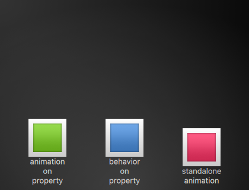

三个对象都处于相同的 y 坐标（`y=200`）。它们都需要移动到 `y=40`，各自采用不同的方法，具有不同的副作用和特性。

### 第一个对象

第一个对象使用 `Animation on <property>` 策略移动。动画会立即启动。

<<< @/docs/ch05-fluid/src/animation/AnimationTypesExample.qml#animation-on-property

点击某个对象时，它的 y 坐标会重置为起始位置，这一点适用于所有对象。对于第一个对象，只要动画还在运行，重置就不会产生任何效果。

这在视觉上可能造成干扰，因为在动画启动之前，y 坐标会在一瞬间被设为新值。*应当避免这种相互冲突的属性更改*。

### 第二个对象

第二个对象使用 `Behavior on` 动画来移动。这个 Behavior 会指示属性对每一次值变化进行动画处理。可以通过在 `Behavior` 元素上设置 `enabled: false` 来禁用它。

<<< @/docs/ch05-fluid/src/animation/AnimationTypesExample.qml#behavior-on

点击对象时它会开始移动（此时它的 y 坐标被设为 40）。再次点击没有影响，因为位置已经设定。

你可以尝试为 y 坐标使用一个随机值（例如 `40 + (Math.random() \* (205-40)`）。你会看到对象总是会动画到新位置，并调整速度，从而在动画持续时间所定义的 4 秒内到达目标位置。

### 第三个对象

第三个对象使用独立动画。该动画被定义为一个独立的元素，几乎可以放在文档中的任何位置。

<<< @/docs/ch05-fluid/src/animation/AnimationTypesExample.qml#standalone

点击会调用动画的 `start()` 函数来启动动画。每个动画都有 start()、stop()、resume() 和 restart() 函数。动画本身包含的信息比前面介绍的其他动画类型多得多。

我们需要定义 `target`（即要进行动画处理的元素）以及要进行动画处理的属性名。我们还需要定义 `to` 值；在本例中还需要 `from` 值，这样就可以重新启动动画。

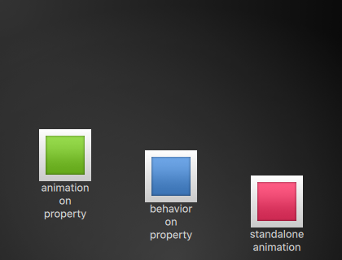

点击背景会将所有对象重置到初始位置。第一个对象无法重新启动，除非重新启动程序，触发元素的重新加载。

::: tip 控制动画的其他方式

启动/停止动画的另一种方式，是将某个属性绑定到动画的 `running` 属性。当由用户输入来控制属性时，这种方式特别有用：

```qml
NumberAnimation {
    // [...]
    // animation runs when mouse is pressed
    running: area.pressed
}
MouseArea {
    id: area
}
```
:::

## 缓动曲线

属性的值变化可以由动画控制。缓动属性可以影响属性变化的插值曲线。

到目前为止我们定义的所有动画都使用线性插值，因为动画的初始缓动类型是 `Easing.Linear`。用一个小图表最能直观地说明这一点：y 轴是要进行动画处理的属性，x 轴是时间（*duration*）。线性插值会从动画开始时的 `from` 值到动画结束时的 `to` 值画一条直线。因此，缓动类型决定了变化的曲线。

应当仔细选择缓动类型，使之与运动的对象自然契合。例如，当一个页面滑出时，它应当先缓慢滑出，然后获得动量，最终高速滑出，类似于翻书页的动作。

:::tip 不应过度使用动画。

与 UI 设计的其他方面一样，应当精心设计动画，让它支撑界面流程而不是主导界面。眼睛对运动的物体非常敏感，动画很容易分散用户的注意力。
:::

在下一个示例中，我们将试用一些缓动曲线。每条缓动曲线都显示为一张可点击的图片；点击后会在 `square` 动画上设置新的缓动类型，然后触发 `restart()`，以新的曲线运行动画。

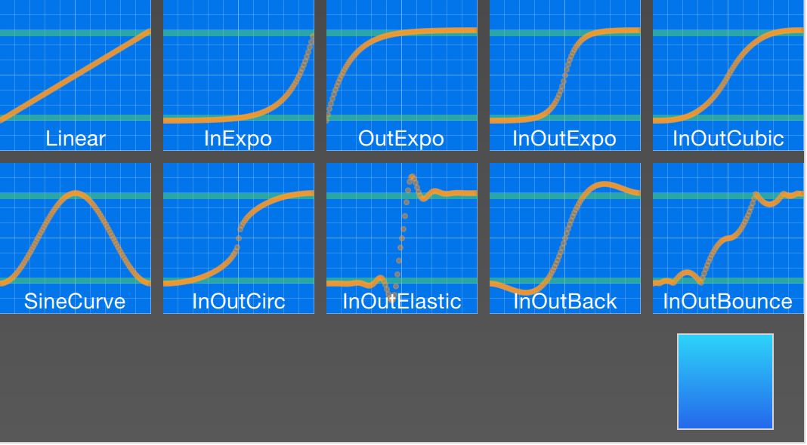

这个示例的代码稍微复杂一些。我们首先创建一个由 `EasingTypes` 组成的网格，以及一个由这些缓动类型控制的 `Box`。每个缓动类型只是显示 Box 在动画中将使用的曲线。当用户点击某条缓动曲线时，Box 就按照该缓动曲线向某个方向移动。动画本身是一个独立动画，target 设置为 Box，并配置为对 x 属性进行动画处理，持续时间为 2 秒。

::: tip
EasingType 的内部实现会实时渲染曲线，感兴趣的读者可以在 `EasingCurves` 示例中查看。
:::

<<< @/docs/ch05-fluid/src/easing/EasingCurves.qml#global

请动手试玩这个示例，观察动画过程中的速度变化。有些动画让对象的运动感觉更自然，有些则让人感觉不适。

除了 `duration` 和 `easing.type` 之外，你还可以对动画进行微调。例如，通用的 `PropertyAnimation` 类型（大多数动画都继承自它）还支持 `easing.amplitude`、`easing.overshoot` 和 `easing.period` 属性，可以让你微调特定缓动曲线的行为。

并非所有缓动曲线都支持这些参数。请查阅 `PropertyAnimation` 文档中的[缓动表格](http://doc.qt.io/qt-6/qml-qtquick-propertyanimation.html#easing-prop)，以确认某个缓动参数是否会影响某条缓动曲线。

::: tip 选择正确的动画

在用户界面的语境中为元素选择正确的动画，对最终效果至关重要。记住：动画应当支撑界面流程，而不是让用户感到不适。
:::

## 分组动画

动画往往比只对一个属性做动画更复杂。你可能希望同时运行多个动画，或者依次运行，甚至在两个动画之间执行一段脚本。

为此可以使用分组动画。顾名思义，可以把动画组合起来。分组有两种方式：并行或顺序。你可以使用 `SequentialAnimation` 或 `ParallelAnimation` 元素，它们充当其他动画元素的动画容器。这些分组动画本身就是动画，完全可以像动画一样使用。

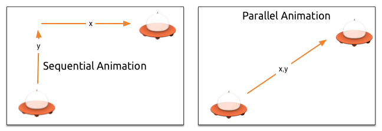

### 并行动画

并行动画的所有直接子动画在启动时都会并行运行。这让你可以同时对不同属性进行动画处理。

<<< @/docs/ch05-fluid/src/animation/ParallelAnimationExample.qml#global

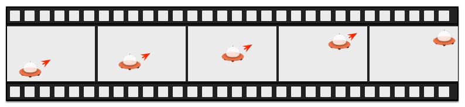

### 顺序动画

顺序动画按照声明的顺序运行每个子动画：从上到下。

<<< @/docs/ch05-fluid/src/animation/SequentialAnimationExample.qml#global

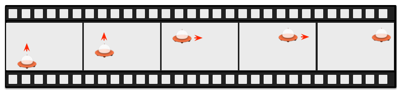

### 嵌套动画

分组动画还可以嵌套。例如，一个顺序动画可以有两个并行动画作为子动画，依此类推。我们可以用一个足球示例来直观说明。思路是把球从左抛到右，并对它的运动过程做动画。

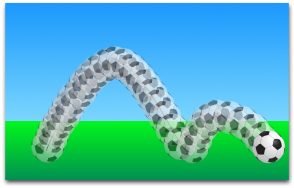

要理解这个动画，我们需要把它拆解为对象的各个基本变换。要记住，动画是对属性变化进行动画处理。以下是各项变换：

* 从左到右的 x 方向平移（`X1`）

* 先从下到上的 y 方向平移（`Y1`），然后是从上到下的平移（`Y2`），并带有一些弹跳

* 在整个动画持续时间内旋转 360 度（`ROT1`）

整个动画应当持续三秒。

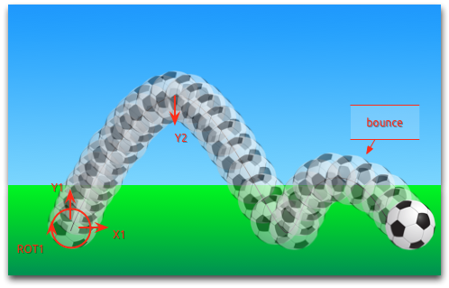

我们以一个空 Item 作为根元素开始，宽度为 480，高度为 300。

```qml
import QtQuick

Item {
    id: root

    property int duration: 3000

    width: 480
    height: 300

    // [...]
}
```

我们将总动画时长定义为一个引用，以便更好地同步各个动画部分。

下一步是添加背景，在我们的例子中是 2 个带有绿色和蓝色渐变的矩形。

<<< @/docs/ch05-fluid/src/animation/BouncingBallExample.qml#background

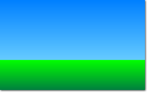

上方的蓝色矩形占据 200 像素的高度，下方的矩形则锚定到天空的底部以及根元素的底部。

让我们把足球放到绿色上面。球是一张图片，存储在“assets/soccer_ball.png”。一开始，我们想把它放在左下角，靠近边缘的位置。

<<< @/docs/ch05-fluid/src/animation/BouncingBallExample.qml#soccer-ball

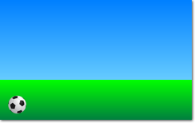

这张图片上附加了一个 MouseArea。点击球时，球的位置会被重置，动画会重新启动。

我们先用一个顺序动画来处理两个 y 方向的平移。

```qml
SequentialAnimation {
    id: anim
    NumberAnimation {
        target: ball
        properties: "y"
        to: 20
        duration: root.duration * 0.4
    }
    NumberAnimation {
        target: ball
        properties: "y"
        to: 240
        duration: root.duration * 0.6
    }
}
```

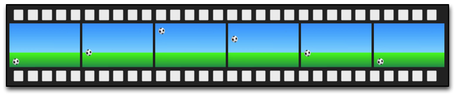

这指定了总动画时长的 40% 用于上升动画，60% 用于下降动画，两个动画按顺序依次运行。这些变换目前沿直线路径进行动画，还没有弯曲效果。稍后会用缓动曲线加入弯曲效果，眼下我们先专注于让这些变换产生动画。

接下来需要添加 x 方向的平移。x 平移应当与 y 平移并行运行，因此我们需要把 y 平移的序列与 x 平移一起封装进一个并行动画。

```qml
ParallelAnimation {
    id: anim
    SequentialAnimation {
        // ... our Y1, Y2 animation
    }
    NumberAnimation { // X1 animation
        target: ball
        properties: "x"
        to: 400
        duration: root.duration
    }
}
```

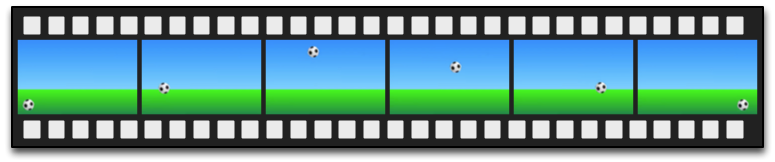

最后，我们希望球能够旋转。为此，需要向并行动画中再添加一个动画。我们选择 `RotationAnimation`，因为它专门用于旋转。

```qml
ParallelAnimation {
    id: anim
    SequentialAnimation {
        // ... our Y1, Y2 animation
    }
    NumberAnimation { // X1 animation
        // X1 animation
    }
    RotationAnimation {
        target: ball
        properties: "rotation"
        to: 720
        duration: root.duration
    }
}
```

这就是完整的动画序列。剩下的就是为球的运动提供正确的缓动曲线。对于 *Y1* 动画，我们使用 `Easing.OutCirc` 曲线，因为这样看起来更像圆弧运动。*Y2* 使用 `Easing.OutBounce` 来增强，赋予球弹跳效果，并且弹跳应当发生在最后（试试 `Easing.InBounce`，你会看到弹跳一开始就出现了）。

*X1* 和 *ROT1* 动画保持原样，使用线性曲线。

下面是最终的动画代码，供你参考：

<<< @/docs/ch05-fluid/src/animation/BouncingBallExample.qml#parallel-animation
