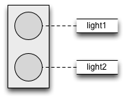
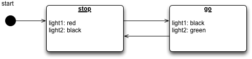
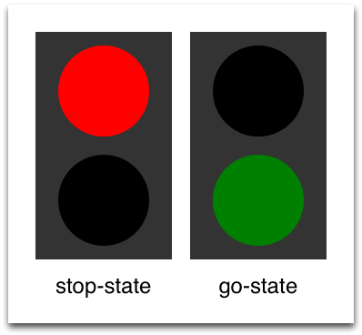
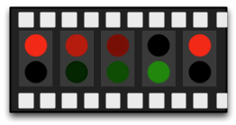

# 状态与过渡

用户界面的各个部分通常可以用状态来描述。一个状态定义一组属性更改，并且可以由某个条件触发。

此外，这些状态切换还可以附加一个过渡，它定义这些更改应当如何进行动画处理，或者应当应用哪些附加动作。进入某个状态时也可以执行动作。

## 状态

在 QML 中，你使用 `State` 元素定义状态，它需要绑定到任意 Item 元素的 `states` 数组上。

一个状态通过状态名来标识，其最简单的形式由元素上的一系列属性更改组成。默认状态由元素的初始属性定义，名为 `""`（空字符串）。

```qml
Item {
    id: root
    states: [
        State {
            name: "go"
            PropertyChanges { ... }
        },
        State {
            name: "stop"
            PropertyChanges { ... }
        }
    ]
}
```

通过给定义这些状态的元素的 `state` 属性赋一个新的状态名，即可切换状态。

::: tip 使用 when 控制状态
控制状态的另一种方式是使用 `State` 元素的 `when` 属性。`when` 属性可以设置为一个表达式，当该表达式求值为 true 时应用此状态。
:::

```qml
Item {
    id: root
    states: [
        ...
    ]

    Button {
        id: goButton
        ...
        onClicked: root.state = "go"
    }
}
```



例如，一个交通信号灯可能有两盏灯：上面的灯显示红色表示停止，下面的灯显示绿色表示通行。在这个示例中，两盏灯不应同时亮起。让我们来看一下状态图。



当系统开启时，它会自动进入作为默认状态的停止模式。停止状态将 `light1` 变为红色，将 `light2` 变为黑色（熄灭）。

现在，一个外部事件可以触发向 `"go"` 状态的切换。在 go 状态中，我们将 `light1` 的颜色属性改为黑色（熄灭），将 `light2` 改为绿色，表示行人现在可以过马路。

为了实现这一场景，我们先勾勒出两盏灯的用户界面。为简单起见，我们使用 2 个矩形，其半径设为宽度的一半（宽度与高度相同，也就是说这是一个正方形）。

<<< @/docs/ch05-fluid/src/animation/StatesExample.qml#lights

如状态图中所定义，我们希望有两个状态：一个是 `"go"` 状态，另一个是 `"stop"` 状态，每个状态将交通信号灯的相应颜色改为红色或绿色。我们将 `state` 属性设置为 `stop`，以确保交通信号灯的初始状态是 `stop` 状态。

::: tip 初始状态
我们也可以只用一个 `"go"` 状态而不显式定义 `"stop"` 状态来达到同样的效果：将 `light1` 的颜色设为红色，将 `light2` 的颜色设为黑色。由初始属性值定义的初始状态 `""` 将充当 `"stop"` 状态。
:::

<<< @/docs/ch05-fluid/src/animation/StatesExample.qml#states

在这些示例中，并非真正需要使用 `PropertyChanges { target: light2; color: "black" }`，因为 `light2` 的初始颜色已经是黑色。在一个状态中，只需描述属性应当如何从默认状态改变（而不是从上一个状态改变）。

状态更改由一个覆盖整个交通信号灯的 MouseArea 触发，点击时在 go 状态与 stop 状态之间切换。

<<< @/docs/ch05-fluid/src/animation/StatesExample.qml#interaction



现在我们已经能够成功更改交通信号灯的状态了。为了让 UI 更加美观自然，我们应当添加一些带有动画效果的过渡。过渡可以由状态更改触发。

::: tip 使用脚本
也可以使用脚本而不是 QML 状态来创建类似的逻辑。然而，在描述用户界面方面，QML 是比 JavaScript 更好的语言。在可能的情况下，应尽量编写声明式代码，而不是命令式代码。
:::


## 过渡

可以为每个项添加一系列过渡。过渡在状态更改时执行。

你可以使用 `from:` 和 `to:` 属性定义某个过渡应用于哪一次状态更改。这两个属性就像过滤器：当过滤条件为真时，就会应用该过渡。你也可以使用通配符“\*”，它表示“任意状态”。

例如，`from: "*"; to: "*"` 表示“从任意状态到任意其他状态”，这也是 `from` 和 `to` 的默认值。这意味着过渡将应用于每一次状态切换。

在这个示例中，我们希望对从“go”切换到“stop”时的颜色变化进行动画处理。对于相反的状态更改（“stop”到“go”），我们希望保留立即的颜色更改，不应用过渡。

我们通过 `from` 和 `to` 属性限制该过渡，使其只过滤出从“go”到“stop”的状态更改。在过渡内部，我们添加了两个颜色动画，每个灯一个，用来对状态描述中定义的属性更改进行动画处理。

<<< @/docs/ch05-fluid/src/animation/StatesExample.qml#transitions

你可以通过点击 UI 来更改状态。状态会立即应用，并且即使过渡正在运行也能更改状态。因此，请尝试在状态处于从“stop”到“go”的过渡期间点击 UI。你会看到更改会立即发生。



你可以试着玩一下这个 UI，例如将不亮的灯缩小，以突出亮着的灯。

为此，你需要在各状态中为缩放添加另一项属性更改，并在过渡中处理缩放属性的动画。

另一个选择是添加一个“attention”状态，让灯闪烁黄光。为此，你需要在该过渡中添加一个顺序动画：用一秒变为黄色（动画的“to”属性），再用一秒变为“黑色”。

也许你还想更换缓动曲线，使它在视觉上更吸引人。
