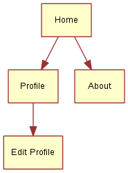
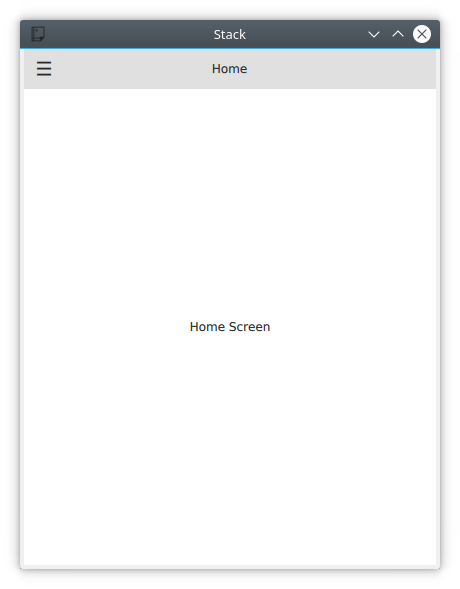
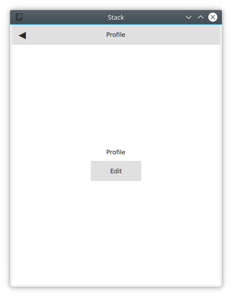
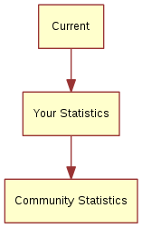
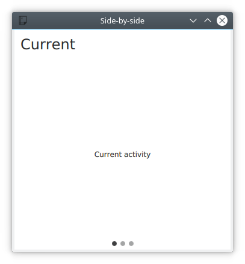
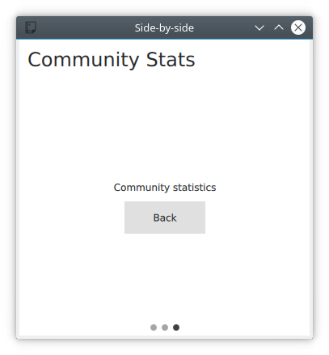
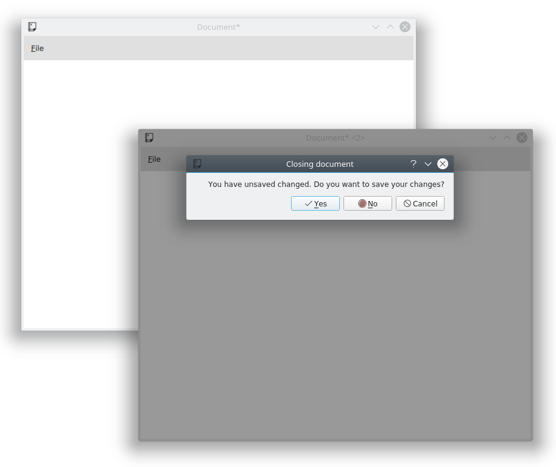
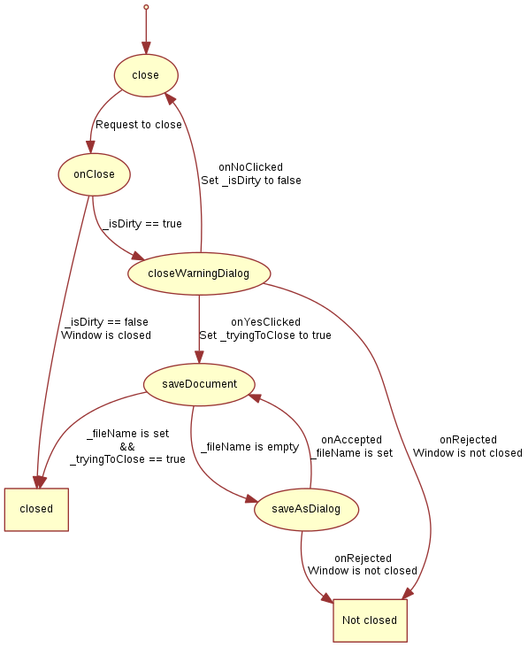

# 常见模式

有许多通用的用户界面模式可以用 Qt Quick Controls 实现。本节我们尝试演示如何构建其中一些比较常见的模式。

## 嵌套屏幕

在这个示例中，我们将创建一棵页面树，其中的页面可以从上一级屏幕进入。结构如下图所示。



这类用户界面的关键组件是 `StackView`。它允许我们把页面压入栈中，当用户想要返回时再弹出。下面的示例将展示如何实现这一点。

应用程序的初始主屏幕如下图所示。



应用程序从 `main.qml` 启动，其中有一个 `ApplicationWindow`，包含一个 `ToolBar`、一个 `Drawer`、一个 `StackView` 和主页面元素 `Home`。下面我们来逐一了解这些组件。


```qml
import QtQuick
import QtQuick.Controls

ApplicationWindow {

    // ...

    header: ToolBar {

        // ...

    }

    Drawer {

        // ...

    }

    StackView {
        id: stackView
        anchors.fill: parent
        initialItem: Home {}
    }
}
```

主页面 `Home.qml` 由一个 `Page` 组成，它是一种支持页眉和页脚的控件元素。在这个示例中，我们只是在页面上居中放置一个文本为 *Home Screen* 的 `Label`。这样做是可行的，因为 `StackView` 的内容会自动填充该 StackView，所以页面会有合适的尺寸。

<<< @/docs/ch06-controls/src/interface-stack/Home.qml

回到 `main.qml`，现在看抽屉部分。通往各页面的导航从这里开始。用户界面中可操作的部分是 `ÌtemDelegate` 项。在 `onClicked` 处理器中，下一个页面被压入 `stackView`。

如下面的代码所示，既可以压入一个 `Component`，也可以压入对某个 QML 文件的引用。无论哪种方式，都会创建一个新实例并压入栈中。

```qml
ApplicationWindow {

    // ...

    Drawer {
        id: drawer
        width: window.width * 0.66
        height: window.height

        Column {
            anchors.fill: parent

            ItemDelegate {
                text: qsTr("Profile")
                width: parent.width
                onClicked: {
                    stackView.push("Profile.qml")
                    drawer.close()
                }
            }
            ItemDelegate {
                text: qsTr("About")
                width: parent.width
                onClicked: {
                    stackView.push(aboutPage)
                    drawer.close()
                }
            }
        }
    }

    // ...

    Component {
        id: aboutPage

        About {}
    }

    // ...

}
```

另一部分是工具栏。思路是：当 `stackView` 包含多个页面时显示返回按钮，否则显示菜单按钮。其逻辑可以在 `text` 属性中看到，其中的 `"\\u..."` 字符串表示我们所需的 Unicode 符号。

在 `onClicked` 处理器中可以看到，当栈中有多于一个页面时，栈会弹出，即移除顶部的页面。如果栈中只有一个项（也就是主屏幕），则打开抽屉。

在 `ToolBar` 下方有一个 `Label`。该元素在页眉中央显示每个页面的标题。

```qml
ApplicationWindow {

    // ...

    header: ToolBar {
        contentHeight: toolButton.implicitHeight

        ToolButton {
            id: toolButton
            text: stackView.depth > 1 ? "\u25C0" : "\u2630"
            font.pixelSize: Qt.application.font.pixelSize * 1.6
            onClicked: {
                if (stackView.depth > 1) {
                    stackView.pop()
                } else {
                    drawer.open()
                }
            }
        }

        Label {
            text: stackView.currentItem.title
            anchors.centerIn: parent
        }
    }

    // ...

}
```

现在我们已经知道如何到达 *About* 和 *Profile* 页面，但我们还想从 *Profile* 页面进入 *Edit Profile* 页面。这通过 *Profile* 页面上的 `Button` 实现。点击按钮时，`EditProfile.qml` 文件会被压入 `StackView`。



<<< @/docs/ch06-controls/src/interface-stack/Profile.qml

## 并排屏幕

在这个示例中，我们创建一个由三个页面组成的用户界面，用户可以在这些页面之间切换。页面如下图所示。这可以是一个健康跟踪应用的界面，分别跟踪当前状态、用户统计和总体统计。



下图展示了 *Current* 页面在应用程序中的样子。屏幕的主体由一个 `SwipeView` 管理，正是它实现了并排屏幕的交互模式。图中显示的标题和文本来自 `SwipeView` 内部的页面，而 `PageIndicator`（底部的三个圆点）来自 `main.qml`，位于 `SwipeView` 下方。页面指示器向用户显示当前活动的是哪个页面，有助于导航。




深入看 `main.qml`，它由一个包含 `SwipeView` 的 `ApplicationWindow` 组成。

```qml
import QtQuick
import QtQuick.Controls

ApplicationWindow {
    visible: true
    width: 640
    height: 480

    title: qsTr("Side-by-side")

    SwipeView {

        // ...

    }

    // ...

}
```

在 `SwipeView` 内部，各子页面按它们出现的顺序实例化。它们是 `Current`、`UserStats` 和 `TotalStats`。

```qml
ApplicationWindow {

    // ...

    SwipeView {
        id: swipeView
        anchors.fill: parent

        Current {
        }

        UserStats {
        }

        TotalStats {
        }
    }

    // ...

}
```

最后，把 `SwipeView` 的 `count` 和 `currentIndex` 属性绑定到 `PageIndicator` 元素。这样就完成了页面周边的结构。

```qml
ApplicationWindow {

    // ...

    SwipeView {
        id: swipeView

        // ...

    }

    PageIndicator {
        anchors.bottom: parent.bottom
        anchors.horizontalCenter: parent.horizontalCenter

        currentIndex: swipeView.currentIndex
        count: swipeView.count
    }
}
```

每个页面由一个 `Page` 组成，其 `header` 包含一个 `Label` 和一些内容。对于 *Current* 和 *User Stats* 页面，内容只是一个简单的 `Label`；而 *Community Stats* 页面还包含一个返回按钮。

```qml
import QtQuick
import QtQuick.Controls

Page {
    header: Label {
        text: qsTr("Community Stats")
        font.pixelSize: Qt.application.font.pixelSize * 2
        padding: 10
    }

    // ...

}
```



返回按钮显式调用 `SwipeView` 的 `setCurrentIndex`，把索引设为零，直接把用户带回 *Current* 页面。在页面之间的每次切换过程中，`SwipeView` 都会提供过渡效果，所以即使显式更改索引，用户也能感受到方向感。

::: tip
在 `SwipeView` 中以编程方式导航时，注意不要在 JavaScript 中用赋值方式设置 `currentIndex`。因为这样做会破坏它所覆盖的所有 QML 绑定。应该改用 `setCurrentIndex`、`incrementCurrentIndex` 和 `decrementCurrentIndex` 方法，这样可以保留 QML 绑定。
:::

```qml
Page {

    // ...

    Column {
        anchors.centerIn: parent
        spacing: 10
        Label {
            anchors.horizontalCenter: parent.horizontalCenter
            text: qsTr("Community statistics")
        }
        Button {
            anchors.horizontalCenter: parent.horizontalCenter
            text: qsTr("Back")
            onClicked: swipeView.setCurrentIndex(0);
        }
    }
}
```

## 文档窗口

这个示例展示如何实现一个面向桌面、以文档为中心的用户界面。思路是每个文档对应一个窗口。打开新文档时，就会打开一个新窗口。对用户来说，每个窗口都是只包含一个文档的独立世界。




代码从一个带 *File* 菜单的 `ApplicationWindow` 开始，菜单包含标准操作：*New*、*Open*、*Save* 和 *Save As*。我们把它放在 `DocumentWindow.qml` 中。

我们导入 `Qt.labs.platform` 来使用原生对话框，并按上文原生对话框一节所述，对项目文件和 `main.cpp` 做了相应修改。

```qml
import QtQuick
import QtQuick.Controls
import Qt.labs.platform as NativeDialogs

ApplicationWindow {
    id: root

    // ...

    menuBar: MenuBar {
        Menu {
            title: qsTr("&File")
            MenuItem {
                text: qsTr("&New")
                icon.name: "document-new"
                onTriggered: root.newDocument()
            }
            MenuSeparator {}
            MenuItem {
                text: qsTr("&Open")
                icon.name: "document-open"
                onTriggered: openDocument()
            }
            MenuItem {
                text: qsTr("&Save")
                icon.name: "document-save"
                onTriggered: saveDocument()
            }
            MenuItem {
                text: qsTr("Save &As...")
                icon.name: "document-save-as"
                onTriggered: saveAsDocument()
            }
        }
    }

    // ...

}
```

为了启动程序，我们从 `main.qml`（应用程序的入口点）创建第一个 `DocumentWindow` 实例。

<<< @/docs/ch06-controls/src/interface-document-window/main.qml

在本章开头的示例中，每个 `MenuItem` 触发时都会调用相应的函数。我们先看 *New* 菜单项，它调用 `newDocument` 函数。

该函数又依赖 `createNewDocument` 函数，后者从 `DocumentWindow.qml` 文件动态创建一个新的元素实例，也就是一个新的 `DocumentWindow` 实例。之所以把这部分逻辑单独拆出来，是因为打开文档时也会用到它。

请注意，用 `createObject` 创建新实例时，我们没有提供父元素。这样创建的是新的顶层元素。如果把当前文档作为下一个文档的父对象，那么父窗口被销毁时会导致子窗口一起被销毁。

```qml
ApplicationWindow {

    // ...

    function createNewDocument()
    {
        var component = Qt.createComponent("DocumentWindow.qml");
        var window = component.createObject();
        return window;
    }

    function newDocument()
    {
        var window = createNewDocument();
        window.show();
    }

    // ...

}
```

再看 *Open* 菜单项，它调用 `openDocument` 函数。该函数只是打开 `openDialog`，让用户选择要打开的文件。由于我们没有文档格式、文件扩展名之类的概念，对话框的大部分属性都保持默认值。在真实的应用程序中，这里应该做更好的配置。

在 `onAccepted` 处理器中，用 `createNewDocument` 方法实例化一个新的文档窗口，并在显示窗口前设置文件名。在这个示例中，并没有真正执行加载。

::: tip
我们把 `Qt.labs.platform` 模块导入为 `NativeDialogs`。这是因为它提供的 `MenuItem` 与 `QtQuick.Controls` 模块提供的 `MenuItem` 同名冲突。
:::

```qml
ApplicationWindow {

    // ...

    function openDocument(fileName)
    {
        openDialog.open();
    }

    NativeDialogs.FileDialog {
        id: openDialog
        title: "Open"
        folder: NativeDialogs.StandardPaths.writableLocation(NativeDialogs.StandardPaths.DocumentsLocation)
        onAccepted: {
            var window = root.createNewDocument();
            window.fileName = openDialog.file;
            window.show();
        }
    }

    // ...

}
```

文件名属于描述文档的一对属性：`fileName` 和 `isDirty`。`fileName` 保存文档的文件名，`isDirty` 在文档有未保存的更改时被置位。保存和另存为的逻辑会用到它们，如下所示。

当试图保存一个没有名字的文档时，会调用 `saveAsDocument`。这会走一遍 `saveAsDialog` 的流程：设置文件名，然后在 `onAccepted` 处理器中再次尝试保存。

请注意，`saveAsDocument` 和 `saveDocument` 函数分别对应 *Save As* 和 *Save* 菜单项。

在 `saveDocument` 函数中保存文档后，会检查 `tryingToClose` 属性。如果这次保存是因为用户在窗口关闭时想要保存文档，该标志就会被置位。于是保存操作完成后窗口会被关闭。同样，本示例中并没有真正执行保存。

```qml
ApplicationWindow {

    // ...

    property bool isDirty: true        // Has the document got unsaved changes?
    property string fileName           // The filename of the document
    property bool tryingToClose: false // Is the window trying to close (but needs a file name first)?

    // ...

    function saveAsDocument()
    {
        saveAsDialog.open();
    }

    function saveDocument()
    {
        if (fileName.length === 0)
        {
            root.saveAsDocument();
        }
        else
        {
            // Save document here
            console.log("Saving document")
            root.isDirty = false;

            if (root.tryingToClose)
                root.close();
        }
    }

    NativeDialogs.FileDialog {
        id: saveAsDialog
        title: "Save As"
        folder: NativeDialogs.StandardPaths.writableLocation(NativeDialogs.StandardPaths.DocumentsLocation)
        onAccepted: {
            root.fileName = saveAsDialog.file
            saveDocument();
        }
        onRejected: {
            root.tryingToClose = false;
        }
    }

    // ...

}
```

接下来是窗口的关闭。窗口关闭时会调用 `onClosing` 处理器。在这里，代码可以选择不接受关闭请求。如果文档有未保存的更改，我们就打开 `closeWarningDialog`，并拒绝关闭请求。

`closeWarningDialog` 询问用户是否要保存更改，但用户也可以取消关闭操作。取消操作在 `onRejected` 中处理，这是最简单的情况，因为打开对话框时我们就已经拒绝了关闭。

当用户不想保存更改时（即在 `onNoClicked` 中），把 `isDirty` 标志设为 `false`，然后再次关闭窗口。这一次 `onClosing` 会接受关闭，因为 `isDirty` 为 false。

最后，当用户想要保存更改时，我们在调用保存之前把 `tryingToClose` 标志设为 true。这就进入了保存/另存为的逻辑。

```qml
ApplicationWindow {

    // ...

    onClosing: {
        if (root.isDirty) {
            closeWarningDialog.open();
            close.accepted = false;
        }
    }

    NativeDialogs.MessageDialog {
        id: closeWarningDialog
        title: "Closing document"
        text: "You have unsaved changed. Do you want to save your changes?"
        buttons: NativeDialogs.MessageDialog.Yes | NativeDialogs.MessageDialog.No | NativeDialogs.MessageDialog.Cancel
        onYesClicked: {
            // Attempt to save the document
            root.tryingToClose = true;
            root.saveDocument();
        }
        onNoClicked: {
            // Close the window
            root.isDirty = false;
            root.close()
        }
        onRejected: {
            // Do nothing, aborting the closing of the window
        }
    }
}
```

关闭与保存/另存为逻辑的完整流程如下图所示。系统从 *close* 状态进入，而 *closed* 和 *not closed* 状态是最终结果。

与用 `Qt Widgets` 和 C++ 实现相比，这看起来很复杂。这是因为对话框对 QML 来说不是阻塞的。也就是说，我们无法在 `switch` 语句中等待对话框的结果。相反，我们需要记住状态，并在相应的 `onYesClicked`、`onNoClicked`、`onAccepted` 和 `onRejected` 处理器中继续操作。



最后一块拼图是窗口标题。它由 `fileName` 和 `isDirty` 属性组成。

```qml
ApplicationWindow {

    // ...

    title: (fileName.length===0?qsTr("Document"):fileName) + (isDirty?"*":"")

    // ...

}
```

这个示例远非完整。例如，文档从未真正被加载或保存。另一个缺失的部分是处理一次性关闭所有窗口的情况，也就是退出应用程序。要实现这个功能，需要一个维护当前所有 `DocumentWindow` 实例列表的单例。不过，那只是触发窗口关闭的另一种方式，所以这里展示的逻辑流程仍然成立。

