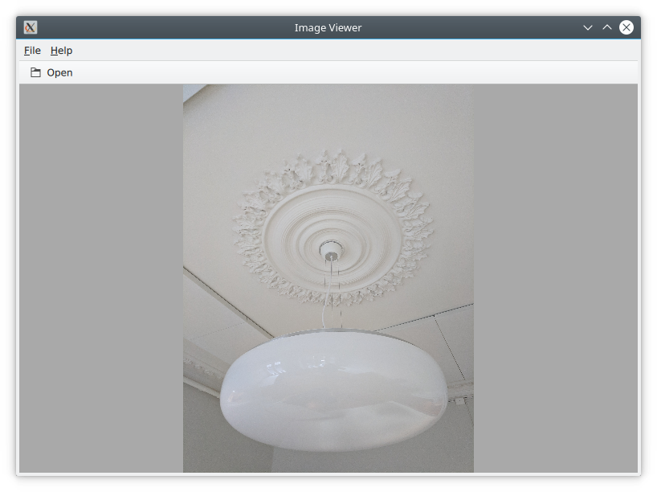
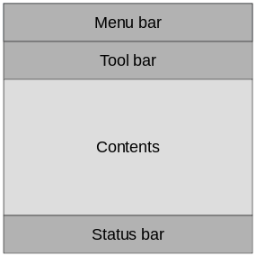
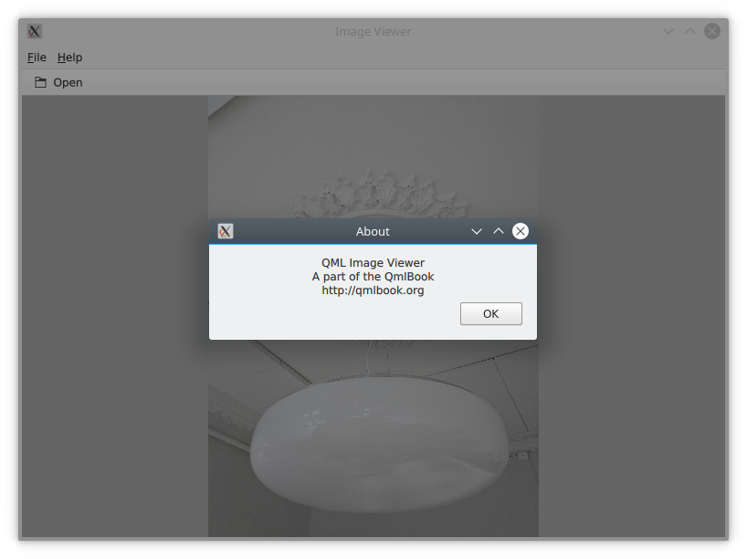
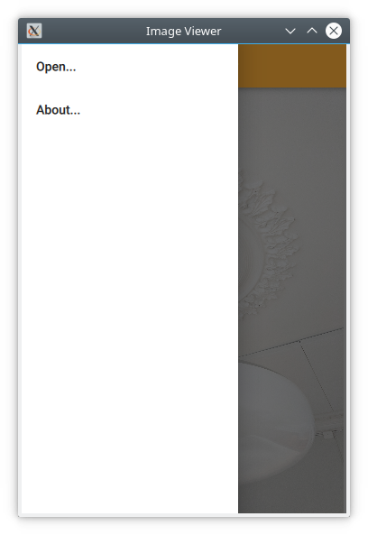
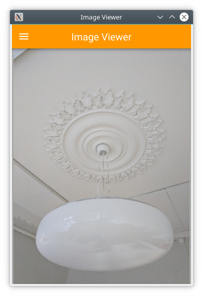
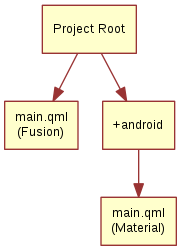

# 图像查看器

让我们通过一个更大的示例来看看 Qt Quick Controls 的用法。为此，我们将创建一个简单的图像查看器。

首先，我们使用 Fusion 样式为桌面平台创建它，然后将其重构为适合移动端的版本，最后再来看最终的代码库。

## 桌面版

桌面版围绕经典的应用程序窗口构建，包含菜单栏、工具栏和文档区域。下面可以看到该应用程序的实际运行效果。



我们以 Qt Creator 的空 Qt Quick 应用程序项目模板作为起点。不过，我们把模板中的默认 `Window` 元素替换成了 `QtQuick.Controls` 模块中的 `ApplicationWindow`。下面的代码展示了 `main.qml`，窗口在这里创建，并设置了默认的大小和标题。

```qml
import QtQuick
import QtQuick.Controls
import Qt.labs.platform as Platform

ApplicationWindow {
    visible: true
    width: 640
    height: 480

    // ...

}
```

`ApplicationWindow` 由四个主要区域组成，如下图所示。菜单栏、工具栏和状态栏通常由 `MenuBar`、`ToolBar` 或 `TabBar` 控件的实例填充，而内容区域则是窗口子对象所在的地方。请注意，图像查看器应用程序没有状态栏；所以它既不出现在这里展示的代码中，也不出现在上图中。



由于目标是桌面平台，我们强制使用 *Fusion* 样式。这可以通过配置文件、环境变量、命令行参数来完成，也可以在 C++ 代码中以编程方式完成。我们采用后一种方式，在 `main.cpp` 中添加以下一行：

```cpp
QQuickStyle::setStyle("Fusion");
```

然后我们开始在 `main.qml` 中构建用户界面，添加一个 `Image` 元素作为内容。用户打开图像时，该元素将承载这些图像，所以现在它只是个占位符。`background` 属性用于为窗口提供一个放置在内容之后的元素。没有加载图像时会显示它；当图像的宽高比使其无法填满窗口内容区域时，它会显示为图像周围的边框。

```qml
ApplicationWindow {
    
    // ...
    
    background: Rectangle {
        color: "darkGray"
    }

    Image {
        id: image
        anchors.fill: parent
        fillMode: Image.PreserveAspectFit
        asynchronous: true
    }

    // ...

}
```

接着添加 `ToolBar`。这通过窗口的 `toolBar` 属性完成。在工具栏内部，我们添加一个 `Flow` 元素，它会让内容先填满控件的宽度，再溢出到新的一行。然后在该 Flow 中放置一个 `ToolButton`。

`ToolButton` 有几个有趣的属性。`text` 很直观。而 `icon.name` 取自 [freedesktop.org 图标命名规范](https://specifications.freedesktop.org/icon-naming-spec/icon-naming-spec-latest.html)。该文档按名称列出了标准图标清单。引用这样的名称，Qt 就会从当前桌面主题中挑出正确的图标。

最后一段代码位于 `ToolButton` 的 `onClicked` 信号处理器中。它调用 `fileOpenDialog` 元素上的 `open` 方法。

```qml
ApplicationWindow {
    
    // ...
    
    header: ToolBar {
        Flow {
            anchors.fill: parent
            ToolButton {
                text: qsTr("Open")
                icon.name: "document-open"
                onClicked: fileOpenDialog.open()
            }
        }
    }

    // ...

}
```

`fileOpenDialog` 元素是 `Qt.labs.platform` 模块中的 `FileDialog` 控件。文件对话框可用于打开或保存文件。我们将 `Qt.labs.platform` 导入为 `Platform`，以免与 `QtQuick.Controls` 的导入产生命名冲突，因此用 `Platform.FileDialog` 来引用它。

在代码中，我们先为 `title` 赋值。然后用 `StandardsPaths` 类设置起始文件夹。`StandardsPaths` 类保存了指向常用文件夹的链接，比如用户的主目录、文档目录等。之后我们设置名称过滤器，控制用户在对话框中能看到和选择哪些文件。

最后是 `onAccepted` 信号处理器，承载窗口内容的 `Image` 元素在这里被设置为显示所选文件。此外还有 `onRejected` 信号，但在图像查看器应用程序中我们不需要处理它。

```qml
ApplicationWindow {
    
    // ...
    
    FileDialog {
        id: fileOpenDialog
        title: "Select an image file"
        folder: StandardPaths.writableLocation(StandardPaths.DocumentsLocation)
        nameFilters: [
            "Image files (*.png *.jpeg *.jpg)",
        ]
        onAccepted: {
            image.source = fileOpenDialog.fileUrl
        }
    }

    // ...

}
```

接下来是 `MenuBar`。要创建菜单，需要在菜单栏中放置 `Menu` 元素，然后用 `MenuItem` 元素填充每个 `Menu`。

在下面的代码中，我们创建了两个菜单：*File* 和 *Help*。*File* 下放置了 *Open*，它使用与工具栏中工具按钮相同的图标和动作。*Help* 下是 *About*，它会触发对 `aboutDialog` 元素 `open` 方法的调用。

请注意，`Menu` 的 `title` 属性和 `MenuItem` 的 `text` 属性中的“&”会把后面的字符变成键盘快捷键；例如，按 *Alt+F* 打开 File 菜单，再按 *Alt+O* 触发 Open 菜单项。

```qml
ApplicationWindow {
    
    // ...
    
    menuBar: MenuBar {
        Menu {
            title: qsTr("&File")
            MenuItem {
                text: qsTr("&Open...")
                icon.name: "document-open"
                onTriggered: fileOpenDialog.open()
            }
        }

        Menu {
            title: qsTr("&Help")
            MenuItem {
                text: qsTr("&About...")
                onTriggered: aboutDialog.open()
            }
        }
    }

    // ...

}
```

`aboutDialog` 元素基于 `QtQuick.Controls` 模块中的 `Dialog` 控件，它是自定义对话框的基础。我们要创建的对话框如下图所示。



`aboutDialog` 的代码可以分为三部分。首先，为对话框窗口设置标题。然后，为对话框提供一些内容——这里是一个 `Label` 控件。最后，我们选择用标准的 *Ok* 按钮关闭对话框。

```qml
ApplicationWindow {
    
    // ...
    
    Dialog {
        id: aboutDialog
        title: qsTr("About")
        Label {
            anchors.fill: parent
            text: qsTr("QML Image Viewer\nA part of the QmlBook\nhttp://qmlbook.org")
            horizontalAlignment: Text.AlignHCenter
        }

        standardButtons: StandardButton.Ok
    }

    // ...

}
```

这一切的最终成果，是一个可用但比较简单的桌面图像查看应用程序。

## 迁移到移动端

与桌面应用程序相比，移动设备上的用户界面在外观和行为上有许多不同。对我们的应用程序来说，最大的区别在于如何访问操作。我们将使用抽屉（drawer）让用户选择操作，而不是菜单栏和工具栏。抽屉可以从侧边滑出，同时我们还在页眉提供了一个汉堡按钮。打开抽屉后的应用程序如下所示。



首先，我们需要把 `main.cpp` 中设置的样式从 *Fusion* 改成 *Material*：

```cpp
QQuickStyle::setStyle("Material");
```

然后开始调整用户界面。首先用抽屉替换菜单。在下面的代码中，`Drawer` 组件作为子对象添加到 `ApplicationWindow` 中。抽屉内部放了一个包含 `ItemDelegate` 实例的 `ListView`。它还包含一个 `ScrollIndicator`，用于显示长列表当前显示的是哪一部分。由于我们的列表只有两项，该指示器在这个示例中不可见。

抽屉的 `ListView` 由一个 `ListModel` 填充，其中每个 `ListItem` 对应一个菜单项。每次点击某一项时，`onClicked` 方法会调用相应 `ListItem` 的 `triggered` 方法。这样，我们就能用同一个委托触发不同的动作。

```qml
ApplicationWindow {
    
    // ...
    
    id: window

    Drawer {
        id: drawer

        width: Math.min(window.width, window.height) / 3 * 2
        height: window.height

        ListView {
            focus: true
            currentIndex: -1
            anchors.fill: parent

            delegate: ItemDelegate {
                width: parent.width
                text: model.text
                highlighted: ListView.isCurrentItem
                onClicked: {
                    drawer.close()
                    model.triggered()
                }
            }

            model: ListModel {
                ListElement {
                    text: qsTr("Open...")
                    triggered: function() { fileOpenDialog.open(); }
                }
                ListElement {
                    text: qsTr("About...")
                    triggered: function() { aboutDialog.open(); }
                }
            }

            ScrollIndicator.vertical: ScrollIndicator { }
        }
    }

    // ...

}
```

下一处改动在 `ApplicationWindow` 的 `header` 中。我们不再使用桌面风格的工具栏，而是添加一个打开抽屉的按钮，以及一个显示应用程序标题的标签。



`ToolBar` 包含两个子元素：一个 `ToolButton` 和一个 `Label`。

`ToolButton` 控件用于打开抽屉。对应的 `close` 调用可以在 `ListView` 的委托中找到。选中某一项后，抽屉就会关闭。`ToolButton` 使用的图标来自 [Material Design Icons 页面](https://material.io/tools/icons/?style=baseline)。

```qml
ApplicationWindow {
    
    // ...
    
    header: ToolBar {
        ToolButton {
            id: menuButton
            anchors.left: parent.left
            anchors.verticalCenter: parent.verticalCenter
            icon.source: "images/baseline-menu-24px.svg"
            onClicked: drawer.open()
        }
        Label {
            anchors.centerIn: parent
            text: "Image Viewer"
            font.pixelSize: 20
            elide: Label.ElideRight
        }
    }

    // ...

}
```

最后，我们把工具栏的背景变漂亮一些——至少变成橙色。为此，我们修改 `Material.background` 附加属性。它来自 `QtQuick.Controls.Material` 模块，只影响 Material 样式。

```qml
import QtQuick.Controls.Material

ApplicationWindow {
    
    // ...
    
    header: ToolBar {
        Material.background: Material.Orange

    // ...

}
```

通过这几处改动，我们把桌面版图像查看器转换成了适合移动端的版本。

## 共享代码库

在前面两节中，我们先看了一个为桌面开发的图像查看器，然后把它适配到了移动端。

从代码库来看，大部分代码仍然是共享的。共享的部分大多与应用程序的文档（即图像）有关。改动则分别针对桌面和移动端不同的交互模式。很自然，我们会希望统一这些代码库。QML 通过使用*文件选择器*（file selectors）来支持这一点。

文件选择器让我们可以根据激活了哪些选择器来替换个别文件。Qt 文档在 `QFileSelector` 类的文档中维护了一份选择器列表（[链接](https://doc.qt.io/qt-5/qfileselector.html)）。在我们的例子中，桌面版作为默认版本，当遇到 *android* 选择器时替换选定的文件。开发期间，你可以把环境变量 `QT_FILE_SELECTORS` 设为 `android` 来模拟这种情况。

::: tip 文件选择器
文件选择器的工作方式是：当某个*选择器*存在时，用替代文件替换原文件。

在要替换的文件所在目录下创建一个名为 `+selector` 的目录（其中 `selector` 代表选择器的名称），然后把与要替换的文件同名的文件放进该目录。当该选择器存在时，就会选用目录中的文件，而不是原文件。

选择器基于平台，例如 android、ios、osx、linux、qnx 等。它们也可以包含所用 Linux 发行版的名称（如果能识别出来），例如 debian、ubuntu、fedora。此外，它们还包含区域设置，例如 en_US、sv_SE 等。

也可以添加你自己的自定义选择器。
:::

要进行这一改动，第一步是隔离共享代码。我们通过创建 `ImageViewerWindow` 元素来实现，两个变体都用它代替 `ApplicationWindow`。它将包含对话框、`Image` 元素和背景。为了把对话框的打开方法提供给平台特定的代码，我们需要通过 `openFileDialog` 和 `openAboutDialog` 函数将它们暴露出来。

```qml
import QtQuick
import QtQuick.Controls
import Qt.labs.platform as Platform

ApplicationWindow {
    function openFileDialog() { fileOpenDialog.open(); }
    function openAboutDialog() { aboutDialog.open(); }

    visible: true
    title: qsTr("Image Viewer")

    background: Rectangle {
        color: "darkGray"
    }

    Image {
        id: image
        anchors.fill: parent
        fillMode: Image.PreserveAspectFit
        asynchronous: true
    }

    Platform.FileDialog {
        id: fileOpenDialog

        // ...

    }

    Dialog {
        id: aboutDialog

        // ...

    }
}
```

接下来，我们为默认样式 *Fusion*（即用户界面的桌面版）创建一个新的 `main.qml`。

这里，用户界面基于 `ImageViewerWindow` 而不是 `ApplicationWindow`。然后我们为它添加平台特定的部分，例如 `MenuBar` 和 `ToolBar`。这些部分唯一的改动是：打开相应对话框时改为调用新函数，而不是直接调用对话框控件。

```qml
import QtQuick
import QtQuick.Controls

ImageViewerWindow {
    id: window
    
    width: 640
    height: 480
    
    menuBar: MenuBar {
        Menu {
            title: qsTr("&File")
            MenuItem {
                text: qsTr("&Open...")
                icon.name: "document-open"
                onTriggered: window.openFileDialog()
            }
        }

        Menu {
            title: qsTr("&Help")
            MenuItem {
                text: qsTr("&About...")
                onTriggered: window.openAboutDialog()
            }
        }
    }

    header: ToolBar {
        Flow {
            anchors.fill: parent
            ToolButton {
                text: qsTr("Open")
                icon.name: "document-open"
                onClicked: window.openFileDialog()
            }
        }
    }
}
```

接下来，我们要创建一个移动端专用的 `main.qml`。它基于 *Material* 主题。这里保留 `Drawer` 和移动端专用的工具栏。同样，唯一的改动是打开对话框的方式。

```qml
import QtQuick
import QtQuick.Controls
import QtQuick.Controls.Material

ImageViewerWindow {
    id: window

    width: 360
    height: 520

    Drawer {
        id: drawer

        // ...

        ListView {

            // ...

            model: ListModel {
                ListElement {
                    text: qsTr("Open...")
                    triggered: function(){ window.openFileDialog(); }
                }
                ListElement {
                    text: qsTr("About...")
                    triggered: function(){ window.openAboutDialog(); }
                }
            }

            // ...

        }
    }

    header: ToolBar {

        // ...

    }
}
```

两个 `main.qml` 文件在文件系统中的放置方式如下图所示。这样，QML 引擎自动创建的文件选择器就能挑选正确的文件。默认加载 *Fusion* 的 `main.qml`；如果存在 `android` 选择器，则改为加载 *Material* 的 `main.qml`。



到目前为止，样式一直是在 `main.cpp` 中设置的。我们可以继续这样做，用 `#ifdef` 表达式为不同平台设置不同的样式。但这里我们再次使用文件选择器机制，通过配置文件来设置样式。下面展示的是 *Material* 样式的文件，*Fusion* 的文件也同样简单。

```ini
[Controls]
Style=Material
```

这些改动让我们拥有了一个统一的代码库：所有与文档相关的代码都是共享的，只有用户交互模式上的差异被保留下来。实现方式不止一种，例如把文档放在一个特定的组件中，再把它包含进各平台特定的界面；或者像本例这样，创建一个公共基础，由各平台扩展。最佳方案需要结合你自己代码库的实际情况来确定，以便把公共部分和独有部分区分开。

## 原生对话框

使用图像查看器时，你会注意到它用的是非标准的文件选择对话框，看上去与系统格格不入。

`Qt.labs.platform` 模块可以帮助我们解决这个问题。它提供了对原生对话框的 QML 绑定，例如文件对话框、字体对话框和颜色对话框。它还提供了创建系统托盘图标，以及位于屏幕顶部的系统全局菜单（例如 OS X 中那样）的 API。代价是依赖 `QtWidgets` 模块，因为在缺少原生支持时会用基于窗口部件的对话框作为回退。

要把原生文件对话框集成到图像查看器中，我们需要导入 `Qt.labs.platform` 模块。由于该模块与它取代的 `QtQuick.Dialogs` 模块存在名称冲突，因此务必移除旧的导入语句。

在实际的文件对话框元素中，我们必须修改 `folder` 属性的设置方式，并确保 `onAccepted` 处理器使用 `file` 属性而不是 `fileUrl` 属性。除这些细节外，用法与 `QtQuick.Dialogs` 中的 `FileDialog` 完全相同。

```qml
import QtQuick
import QtQuick.Controls
import Qt.labs.platform as Platform

ApplicationWindow {
    
    // ...
    
    Platform.FileDialog {
        id: fileOpenDialog
        title: "Select an image file"
        folder: StandardPaths.writableLocation(StandardPaths.DocumentsLocation)
        nameFilters: [
            "Image files (*.png *.jpeg *.jpg)",
        ]
        onAccepted: {
            image.source = fileOpenDialog.file
        }
    }

    // ...

}
```

除了 QML 的改动，我们还需要修改图像查看器的项目文件，以包含 `widgets` 模块。

```
QT += quick quickcontrols2 widgets
```

我们还需要更新 `main.qml`，改为实例化 `QApplication` 对象而不是 `QGuiApplication` 对象。这是因为 `QGuiApplication` 类只包含图形应用程序所需的最小环境，而 `QApplication` 在 `QGuiApplication` 之上扩展了支持 `QtWidgets` 所需的功能。

```cpp
include <QApplication>

// ...

int main(int argc, char *argv[])
{
    QApplication app(argc, argv);

    // ...

}
```

经过这些改动，图像查看器在大多数平台上都会使用原生对话框。支持的平台有 iOS、Linux（带 GTK+ 平台主题）、macOS、Windows 和 WinRT。在 Android 上，它会使用 `QtWidgets` 模块提供的默认 Qt 对话框。

