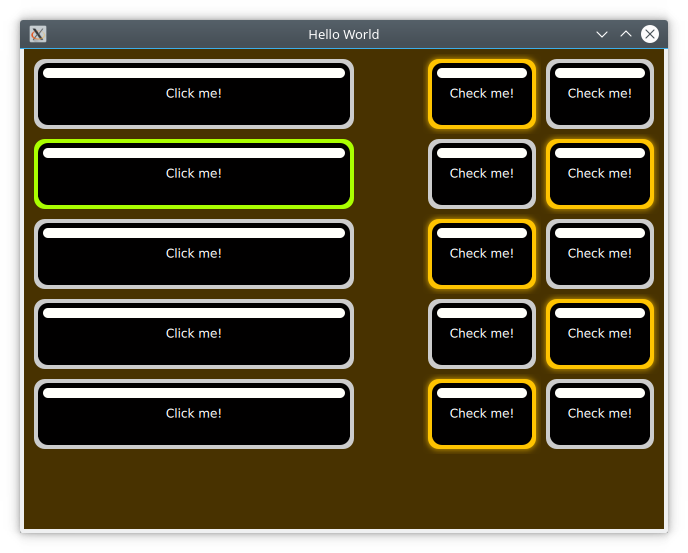
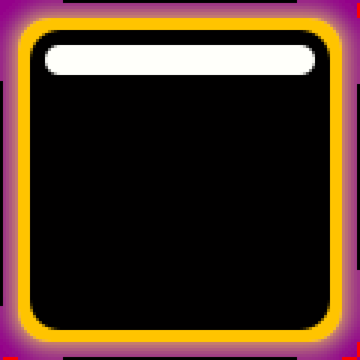

# Imagine 样式

Qt Quick Controls 的目标之一，是将控件的逻辑与外观分离。对大多数样式而言，外观的实现由 QML 代码和图形资源组合而成。而使用 *Imagine* 样式，则可以仅用图形资源来定制基于 Qt Quick Controls 的应用程序的外观。

Imagine 样式基于 [9-patch 图像](https://developer.android.com/guide/topics/graphics/drawables#nine-patch)。这类图像可以携带有关拉伸方式的信息，以及哪些部分属于元素本身、哪些部分在元素之外（例如阴影）。对于每个控件，该样式支持多个元素，而每个元素又提供大量状态。通过为元素与状态的某些组合提供资源，你就能细致地控制每个控件的外观。

9-patch 图像的细节，以及如何为每个控件设置样式，在 [Imagine 样式文档](https://doc.qt.io/qt-6/qtquickcontrols2-imagine.html) 中有非常详尽的介绍。这里，我们将为一个虚构的设备界面创建自定义样式，以演示该样式的用法。

该应用程序的样式定制了 `ApplicationWindow` 和 `Button` 控件。对于按钮，处理了常规状态以及 *pressed* 和 *checked* 状态。演示应用程序如下所示。

这段代码用 `Column` 放置可点击的按钮，用 `Grid` 放置可勾选的按钮。可点击的按钮还会随窗口宽度拉伸。

<<< @/docs/ch06-controls/src/imagine-style/main.qml

由于我们使用 *Imagine* 样式，所有想用的控件都需要用图形资源来设置样式。最简单的是 `ApplicationWindow` 的背景。这是一个定义背景颜色的单像素纹理。把文件命名为 `applicationwindow-background.png`，再通过 `qtquickcontrols2.conf` 文件将样式指向它，该文件就会被采用。

在下面展示的 `qtquickcontrols2.conf` 文件中，可以看到我们如何把 `Style` 设为 `Imagine`，然后为样式设置一个 `Path`，供其查找资源。最后我们还设置了一些调色板属性。可用的调色板属性可以在 [palette QML 基本类型](https://doc.qt.io/qt-6/qml-palette.html#qtquickcontrols2-palette) 页面找到。

<<< @/docs/ch06-controls/src/imagine-style/qtquickcontrols2.conf

`Button` 控件的资源是 `button-background.9.png`、`button-background-pressed.9.png` 和 `button-background-checked.9.png`。它们遵循 *control*-*element*-*state*（控件-元素-状态）的命名模式。不带状态的文件 `button-background.9.png` 用于所有没有专属资源的状态。根据 [Imagine 样式元素参考表](https://doc.qt.io/qt-6/qtquickcontrols2-imagine.html#element-reference)，按钮可以有以下状态：

* `disabled`
* `pressed`
* `checked`
* `checkable`
* `focused`
* `highlighted`
* `flat`
* `mirrored`
* `hovered`

需要哪些状态取决于你的用户界面。例如，hovered 样式在基于触摸的界面中根本用不到。

观察上面 `button-background-checked.9.png` 的放大版本，可以看到沿各边的 9-patch 参考线。紫色背景是为了便于观察而添加的。在示例所用的资源中，这个区域实际上是透明的。

图像边缘的像素可以是白色/透明、黑色或红色。它们各有不同的含义，下面逐一说明。

* 资源**左侧**和**顶部**边缘的**黑色**线条，标记图像的可拉伸部分。这意味着按钮被拉伸时，示例中的圆角和白色标记不会受到影响。

* 资源**右侧**和**底部**边缘的**黑色**线条，标记用于控件内容的区域。也就是说，示例中按钮上用于显示文本的部分。

* 资源**右侧**和**底部**边缘的**红色**线条，标记 *inset*（内嵌）区域。这些区域是图像的一部分，但不被视为控件的一部分。对于上面 checked 状态的图像，这部分用于实现延伸到按钮外部的柔和光晕。

`button-background.9.png`（下图）和 `button-background-checked.9.png`（上图）演示了 *inset* 区域的用法：图像看起来像是亮了起来，但并没有移动。

