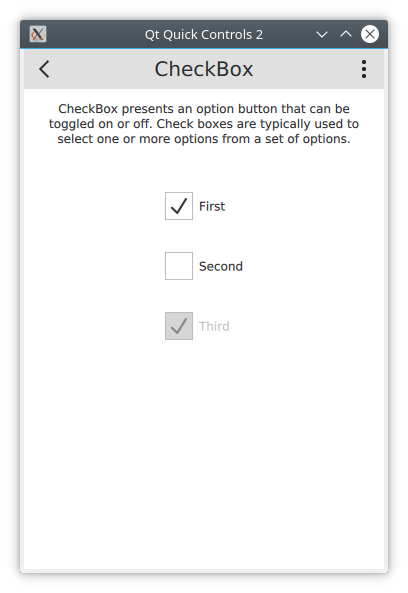
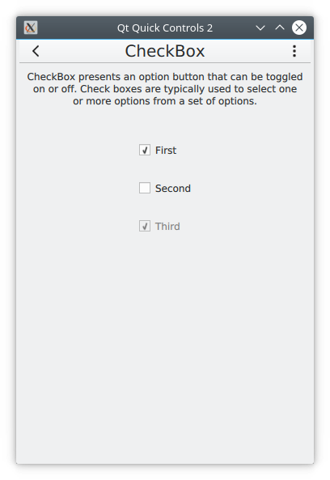
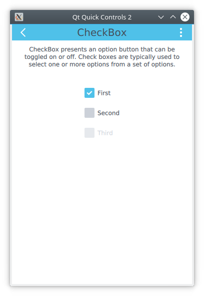
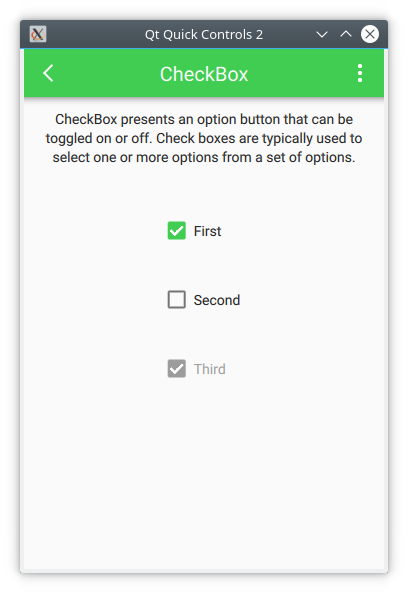
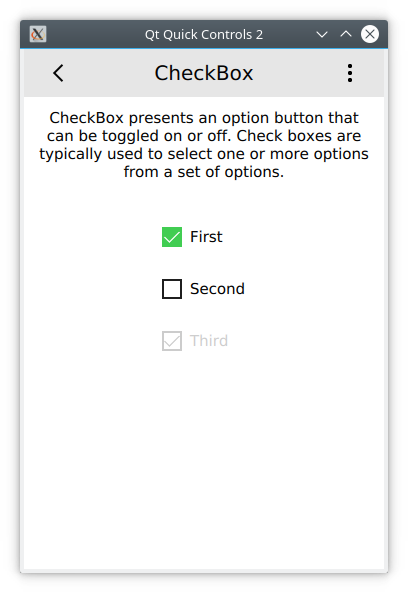

# 控件简介

从头使用 Qt Quick 时，你得到的是原始的图形元素和交互元素，以它们为基础构建用户界面。而使用 Qt Quick Controls，则可以从一组结构更完善的控件开始构建。

这些控件既包括简单的文本标签和按钮，也包括更复杂的滑块和旋钮。如果你想基于经典的交互模式创建用户界面，这些元素会非常顺手，因为它们提供了坚实的基础。

Qt Quick Controls 开箱即用地提供了多种样式，如下表所示。*Basic* 样式是一种基础的扁平样式。*Universal* 样式基于 Microsoft Universal Design Guidelines，*Material* 样式基于 Google 的 Material Design Guidelines，而 *Fusion* 样式则是一种面向桌面的样式。

其中一些样式可以通过修改调色板（palette）来微调。*Imagine* 样式基于图像资源（image assets），这使得图形设计师无需编写任何代码即可创建新样式，甚至不需要编写调色板颜色代码。

* Basic
    
    

* Fusion

    

* macOS

    

* Material

    

* Imagine

    

* Windows

    
    
* Universal
    
    

Qt Quick Controls 2 可以通过 `QtQuick.Controls` 导入使用。以下模块也值得关注：

* **`QtQuick.Controls`** - 基础控件。
* **`QtQuick.Templates`** - 为控件提供行为性、非可视的基类型。
* **`QtQuick.Controls.Imagine`** - Imagine 样式主题支持。
* **`QtQuick.Controls.Material`** - Material 样式主题支持。
* **`QtQuick.Controls.Universal`** - Universal 样式主题支持。
* **`Qt.labs.platform`** - 支持常见任务的平台原生对话框，例如选择文件、颜色等，还提供系统托盘图标和标准路径。

:::warning Qt.Labs
请注意，`Qt.labs` 模块是实验性的，这意味着它们的 API 在 Qt 版本之间可能发生不兼容的变更。
:::

