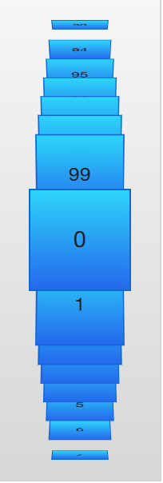
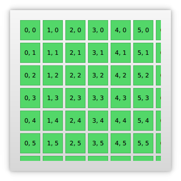
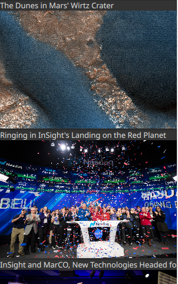
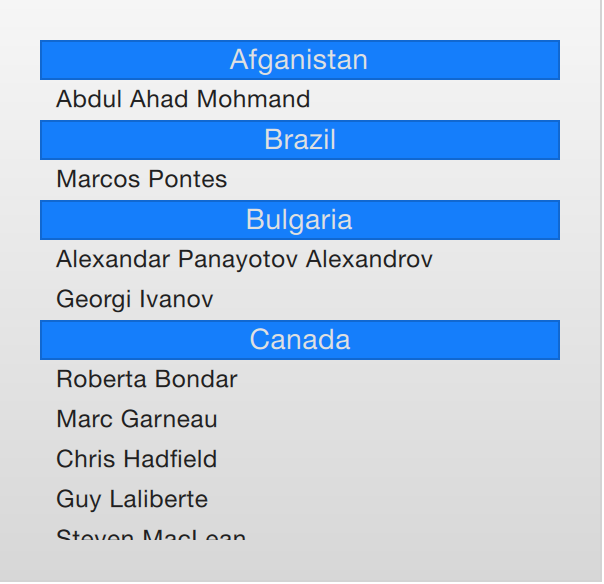
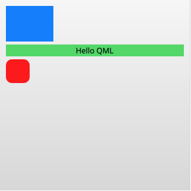

# 高级技巧

## PathView

`PathView` 元素是 Qt Quick 中提供的最灵活的视图，但它也是最复杂的。它使得创建沿任意路径排列项的视图成为可能。沿着同一条路径，还可以细致地控制缩放、不透明度等属性。

使用 `PathView` 时，必须定义一个委托和一条路径。除此之外，`PathView` 本身还可以通过一系列属性进行定制。最常见的有 `pathItemCount`（控制一次可见的项数）以及高亮范围控制属性 `preferredHighlightBegin`、`preferredHighlightEnd` 和 `highlightRangeMode`（控制当前项显示在路径上的哪个位置）。

在深入研究高亮范围控制属性之前，我们必须先看看 `path` 属性。`path` 属性需要一个 `Path` 元素，它定义 `PathView` 滚动时委托所遵循的路径。路径使用 `startX` 和 `startY` 属性结合路径元素（如 `PathLine`、`PathQuad` 和 `PathCubic`）来定义。这些元素连接在一起形成二维路径。

路径定义好之后，可以使用 `PathPercent` 和 `PathAttribute` 元素进一步调整。它们放置在路径元素之间，对路径及其上的委托提供更细粒度的控制。`PathPercent` 控制在每个元素之间覆盖了多大比例的路径。这进而控制委托沿路径的分布，因为它们按已推进的百分比成比例分布。

这时 `preferredHighlightBegin` 和 `preferredHighlightEnd` 这两个 `PathView` 的属性就派上用场了。它们都取 0 到 1 之间的实数。末端还应大于或等于起始。把这两个属性都设置为例如 0.5，当前项将显示在路径上百分之五十处的位置。

在 `Path` 中，`PathAttribute` 元素与 `PathPercent` 元素一样放置在元素之间。它们让你指定沿路径插值的属性值。这些属性附加到委托上，可以用来控制任何可以想到的属性。



下面的例子演示了如何使用 `PathView` 元素创建一个用户可以翻阅的卡片视图。它使用了若干技巧来实现这一点。路径由三个 `PathLine` 元素组成。使用 `PathPercent` 元素，中心元素被正确居中，并获得足够的空间而不被其他元素挤占。使用 `PathAttribute` 元素，控制旋转、大小和 `z` 值。

除了 `path` 之外，还设置了 `pathItemCount`，它是 `PathView` 的属性。它控制路径上分布的项目密度。`preferredHighlightBegin` 和 `preferredHighlightEnd`；`PathView.onPath` 用于控制委托的可见性。

<<< @/docs/ch07-modelview/src/pathview/coverview.qml#pathview

下面展示的委托使用了附加属性 `itemZ`、`itemAngle` 和 `itemScale`，它们来自 `PathAttribute` 元素。值得注意的是，委托的附加属性只能从 `wrapper` 中访问。因此定义了 `rotX` 属性，以便能够从 `Rotation` 元素内部访问该值。

`PathView` 特有的另一个值得注意的细节是附加的 `PathView.onPath` 属性的用法。把可见性绑定到它上面是常见做法，因为这允许 `PathView` 为了缓存目的保留不可见的元素。这通常无法通过裁剪来处理，因为 `PathView` 的项委托比 `ListView` 或 `GridView` 视图的项委托放置得更自由。

<<< @/docs/ch07-modelview/src/pathview/coverview.qml#delegate

在 `PathView` 中变换图像或其他复杂元素时，一个常用的性能优化技巧是把 `smooth`——`Image` 元素的属性——绑定到附加属性 `PathView.view.moving` 上。这意味着图像在移动时美观度较低，但静止时变换是平滑的。视图运动时在平滑缩放上花费处理能力毫无意义，因为用户根本看不到。

::: tip
鉴于 `PathAttribute` 的动态特性，QML 工具链（此处为 `qmllint`）并不知道 `itemZ`、`itemAngle` 和 `itemScale`。
:::

使用 `PathView` 并以编程方式更改 `currentIndex` 时，你可能想要控制路径移动的方向。这可以使用 `movementDirection` 属性完成。它可以设置为 `PathView.Shortest`，这是默认值。这意味着移动可以是任一方向，取决于哪条路是移动到目标值最近的。也可以通过把 `movementDirection` 设置为 `PathView.Negative` 或 `PathView.Positive` 来限制方向。

## 表模型

到目前为止讨论的所有视图都以某种方式呈现项的数组。即使是 `GridView` 也期望模型提供一维的项列表。对于二维数据表格，需要使用 `TableView` 元素。

`TableView` 与其他视图相似，它把 `model` 与 `delegate` 组合成网格。如果给定一个面向列表的模型，它只显示单列，这使它与 `ListView` 元素非常相似。不过，它也可以显示明确定义了列和行的二维模型。

在下面的例子中，我们设置了一个简单的 `TableView`，使用从 C++ 暴露的自定义模型。目前，无法直接从 QML 创建面向表格的模型，但这一概念将在“Qt 与 C++”一章中解释。运行中的示例如下图所示。



在下面的例子中，我们创建一个 `TableView`，并设置 `rowSpacing` 和 `columnSpacing` 以控制委托之间水平和垂直的间隙。其余属性的设置与任何其他类型的视图相同。

<<< @/docs/ch07-modelview/src/tableview/main.qml#tableview

委托本身可以通过 `implicitWidth` 和 `implicitHeight` 携带隐式尺寸。下面的示例就是这样做的。实际的数据内容，即从模型的 `display` 角色返回的数据。

<<< @/docs/ch07-modelview/src/tableview/main.qml#delegate

可以根据模型内容提供不同大小的委托，例如：

```qml
GreenBox {
    implicitHeight: (1 + row) * 10
    // ...
}
```

注意宽度和高度都必须大于零。

当委托提供隐式尺寸时，每一行中最高的委托和每一列中最宽的委托控制尺寸。如果项的宽度取决于行，或者高度取决于列，这会产生有趣的行为。这是因为并非所有委托在任何时候都被实例化，所以当用户滚动表格时，列宽可能会改变。

为避免使用委托隐式尺寸指定列宽和行高带来的问题，可以提供计算这些尺寸的函数。这通过 `columnWidthProvider` 和 `rowHeightProvider` 完成。这些函数分别返回列宽和行高，如下所示：

```qml
TableView {
    columnWidthProvider: function (column) { return 10 * (column + 1) }
    // ...
}
```

如果需要动态更改列宽或行高，必须通过调用 `forceLayout` 方法通知视图。这会让视图重新计算所有单元格的大小和位置。

## 来自 XML 的模型

由于 XML 是一种无处不在的数据格式，QML 提供了 `XmlListModel` 元素，把 XML 数据暴露为模型。该元素可以在本地或远程获取 XML 数据，然后使用 XPath 表达式处理数据。

下面的示例演示了从 RSS 流中获取图像。`source` 属性指向通过 HTTP 的远程位置，数据会被自动下载。



数据下载完成后，会被处理成模型项和角色。`query` 是 `XmlListModel` 的属性，它是一个 XPath，表示创建模型项的基础查询。在这个例子中，路径是 `/rss/channel/item`，因此对于 RSS 标签内 channel 标签内的每个 item 标签，都会创建一个模型项。

对于每个模型项，会提取若干角色（role）。它们由 `XmlListModelRole` 元素表示。每个角色被赋予一个名字，委托可以通过附加属性访问它。每个此类属性的实际值由该角色的 `elementName` 和（可选的）`attributeName` 属性决定。例如，`title` 属性对应 `title` XML 元素，返回 `<title>` 和 `</title>` 标签之间的内容。

`imageSource` 属性提取的是标签属性的值，而不是标签的内容。这里提取的是 `url` 属性（来自 `enclosure` 标签），作为字符串。`imageSource` 属性随后可以直接用作 `source`，用于 `Image` 元素，从给定 URL 加载图像。

<<< @/docs/ch07-modelview/src/xmllistmodel/images.qml#global

## 带分节的列表

有时，列表中的数据可以划分为若干分节（section）。这可以简单到把联系人列表按字母表的每个字母分节，或者把音乐曲目按专辑分节。使用 `ListView` 可以把扁平列表划分为类别，为体验提供更多层次。



要使用分节，必须设置 `section.property` 和 `section.criteria`。`section.property` 定义使用哪个属性把内容划分成分节。这里重要的是要知道，模型必须排序，使每个分节由连续的元素组成，否则同一个属性名可能出现在多个位置。

`section.criteria` 可以设置为 `ViewSection.FullString` 或 `ViewSection.FirstCharacter`。前者是默认值，可用于具有清晰分节的模型，例如音乐专辑的曲目。后者取属性的第一个字符，意味着任何属性都可以用于此目的。最常见的例子是电话簿中联系人的姓氏。

分节定义好之后，可以从每一项使用附加属性 `ListView.section`、`ListView.previousSection` 和 `ListView.nextSection` 访问它们。利用这些属性，可以检测分节的第一项和最后一项并做出相应处理。

也可以把分节委托组件赋给 `section.delegate`，它是 `ListView` 的属性。这会创建一个分节标题委托，插入到分节中任何项之前。该委托组件可以使用附加属性 `section` 访问当前分节的名字。

下面的例子通过展示一份按国籍分节的宇航员名单来演示分节概念。`nation` 用作 `section.property`。`section.delegate` 组件 `sectionDelegate` 为每个国家显示一个标题，展示国家的名字。在每个分节中，宇航员的名字使用 `spaceManDelegate` 组件显示。

<<< @/docs/ch07-modelview/src/listview/sections.qml#global

## ObjectModel

在某些情况下，你可能想把大量不同的项用在列表视图中。可以使用动态 QML 和 `Loader` 解决这个问题，但另一个选择是使用 `ObjectModel`，它来自 `QtQml.Models` 模块。对象模型与其他模型不同，它让你把实际的可视元素放在模型之中。这样，视图不需要任何 `delegate`。




在下面的例子中，我们把三个 `Rectangle` 元素放入 `ObjectModel`。不过，其中一个矩形有一个 `Text` 元素子对象，而最后一个有圆角。如果使用类似 `ListModel` 的东西，这会导致一种表格式的模型。还会导致模型中出现空的 `Text` 元素。

<<< @/docs/ch07-modelview/src/delegates/objectmodel.qml#global

`ObjectModel` 的另一个方面是，它可以使用 `get`、`insert`、`move`、`remove` 和 `clear` 方法动态填充。这样，模型的内容可以从各种来源动态生成，并且仍然可以轻松地在单个视图中显示。

## 带动作的模型

`ListElement` 类型支持把 JavaScript 函数绑定到属性。这意味着你可以把函数放进模型。这在构建带有动作的菜单及类似构造时非常有用。

下面的例子通过一个以不同方式向你问好的城市模型演示了这一点。`actionModel` 是四个城市的模型，但 `hello` 属性绑定到函数。每个函数接受一个参数 `value`，但你可以有任意数量的参数。

在委托 `actionDelegate` 中，`MouseArea` 把函数 `hello` 当作普通函数调用，这会导致对模型中相应 `hello` 属性的调用。

<<< @/docs/ch07-modelview/src/delegates/model-action.qml#global

## 性能调优

模型视图的感知性能很大程度上取决于准备新委托所需的时间。例如，当向下滚动 ListView 时，委托在视图底部外侧被添加，并在它们从视图顶部离开视野时被移除。如果 `clip` 属性设置为 `false`，这一点就会变得明显。如果委托初始化耗时过长，一旦视图滚动过快，用户就会察觉到。

要解决这个问题，可以调整滚动视图两侧的边距（以像素为单位）。这通过 `cacheBuffer` 属性完成。在上面描述的垂直滚动情况下，它控制 ListView 上下方多少像素范围内包含已准备好的委托。把它与异步加载的 `Image` 元素结合，例如可以让图像在进入视野之前有时间加载完成。

更多的委托以内存换取更流畅的体验，并且每个委托初始化需要稍多一点时间。这并不能解决复杂委托的问题。每当一个委托被实例化，其内容都会被求值和编译。这需要时间，如果耗时太长，会导致糟糕的滚动体验。委托中有很多元素也会降低滚动性能。移动许多元素就是要花费处理周期。

要解决后两个问题，建议使用 `Loader` 元素。它们可以在需要时实例化额外的元素。例如，一个展开的委托可以使用 `Loader` 把详细视图的实例化推迟到需要时。出于同样的原因，最好把每个委托中的 JavaScript 数量保持在最低限度。更好的做法是让它们调用驻留在每个委托之外的复杂 JavaScript 片段。这减少了每次创建委托时编译 JavaScript 所花费的时间。

::: tip
请注意，使用 `Loader` 推迟初始化所做的正是如此——它只是推迟了一个性能问题。这意味着滚动性能会得到改善，但实际内容仍然需要时间才会出现。
:::
