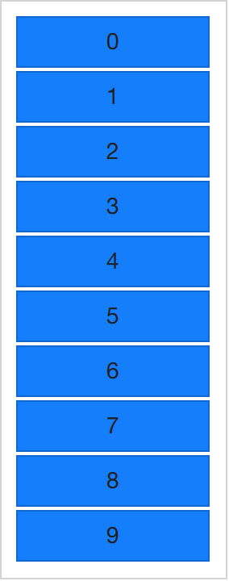
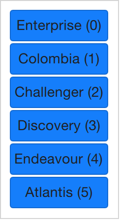
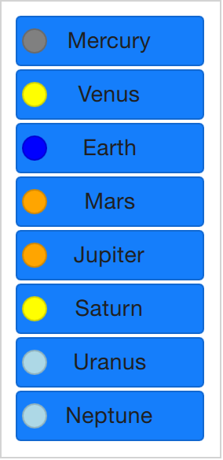

# 基础模型

可视化模型数据最基本的方式是使用 `Repeater` 元素。它用来实例化一组项，并且很容易与定位器（positioner）结合，填充用户界面的一部分。Repeater 使用一个模型，这个模型既可以是要实例化的项数，也可以是从互联网收集数据的完整模型。

## 使用数字

在最简单的形式中，repeater 可以用来实例化指定数量的项。每个项都可以访问一个附加属性，即变量 `index`，可以用它来区分各个项。

在下面的例子中，repeater 用来创建一个项的 10 个实例。项的数量通过 `model` 属性控制，它们的视觉表现通过 `delegate` 属性控制。模型中的每一项都会实例化一个委托（这里委托是一个 `BlueBox`，即一个自定义的 `Rectangle`，其中包含一个 `Text` 元素）。可以看出，`text` 属性被设置为 `index` 的值，因此这些项从零到九编号。

<<< @/docs/ch07-modelview/src/repeater/number.qml#global

## 使用数组

带编号的项列表固然不错，但有时展示更复杂的数据集会更有意思。把整数 `model` 值替换为 JavaScript 数组就能做到这一点。数组的内容可以是任何类型，无论是字符串、整数还是对象。下面的例子使用了一个字符串列表。我们仍然可以访问和使用 `index` 变量，同时还可以访问 `modelData`，它包含数组中每个元素的数据。

<<< @/docs/ch07-modelview/src/repeater/array.qml#global

## 使用 `ListModel`

能够暴露数组的数据之后，你很快就会遇到需要数组中每一项包含多份数据的场景。这时模型就派上用场了。最简单也最常用的模型之一是 `ListModel`。列表模型就是一组 `ListElement` 项的集合。在每个列表元素内部，可以把若干属性绑定到值上。例如，在下面的例子中，每个元素都提供了一个名字和一种颜色。

在每个元素内部绑定的属性，会由 repeater 附加到每个实例化出的项上。这意味着变量 `name` 和 `surfaceColor` 在 repeater 创建的每个 `Rectangle` 和 `Text` 项的作用域内都可用。这不仅让数据访问变得容易，也让源代码更易读。`surfaceColor` 是名字左侧圆圈的颜色，而不是什么晦涩的“列 `i`、行 `j` 的数据”。

<<< @/docs/ch07-modelview/src/repeater/model.qml#global

## 将委托用作默认属性

`delegate` 属性是 `Repeater` 的默认属性。这意味着示例 01 的代码也可以写成如下形式：

<<< @/docs/ch07-modelview/src/repeater/delegate.qml#global
