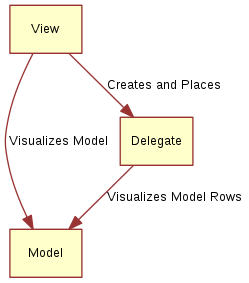

# 概念

开发用户界面时，一种常见的模式是把数据的表示与可视化分开。这样就能根据用户正在执行的任务，以不同方式展示相同的数据。例如，电话簿既可以排成一列竖直的文本条目，也可以排成联系人照片的网格。两种情况下数据都是相同的——都是电话簿——但可视化方式不同。这种划分通常被称为模型-视图模式（model-view pattern）。在这种模式中，数据称为模型，而可视化由视图处理。

在 QML 中，模型和视图通过委托衔接在一起。职责划分如下：模型提供数据。每个数据项可以有多个值。在上面的例子中，每个电话簿条目都有一个名字、一张照片和一个号码。数据被安排在一个视图中，其中每一项都通过委托来可视化。视图的任务是排列委托，而每个委托把各个模型项的值展示给用户。

这意味着委托了解模型的内容以及如何将其可视化。视图了解委托的概念以及如何排列它们。模型只知道它所表示的数据。

