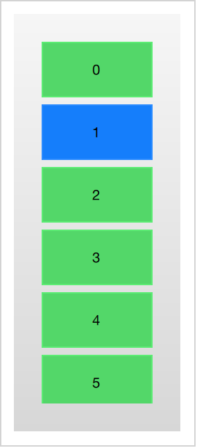
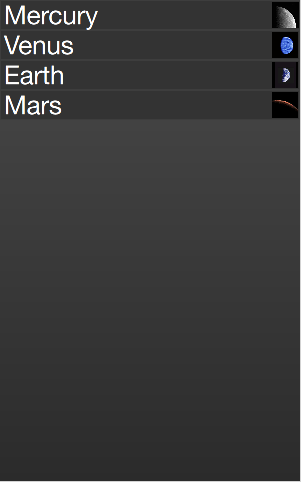
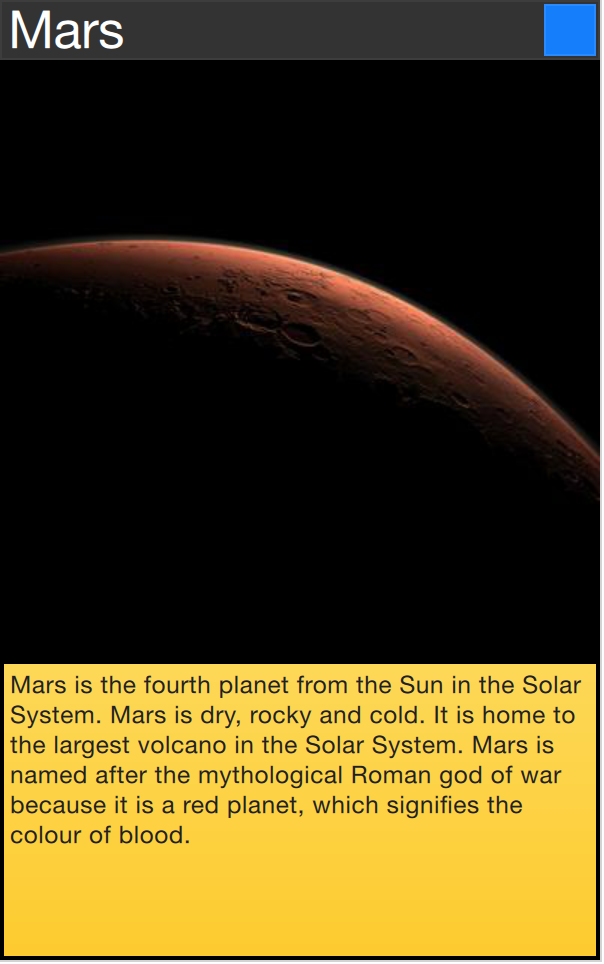

# 委托

在自定义用户界面中使用模型和视图时，委托在创造外观与行为方面扮演着重要角色。由于模型中的每一项都通过委托来可视化，用户实际看到的就是委托。

每个委托都可以访问若干附加属性，一些来自数据模型，另一些来自视图。来自模型的属性把每一项的数据传递给委托。来自视图的属性传递与委托在视图中相关的状态信息。让我们深入了解来自视图的属性。

视图附加的最常用属性是 `ListView.isCurrentItem` 和 `ListView.view`。前者是一个布尔值，指示该项是否为当前项；后者是对实际视图的只读引用。通过访问视图，可以创建通用的、可复用的委托，以适应包含它们的视图的大小和性质。在下面的例子中，每个委托的 `width` 绑定到视图的 `width`，而每个委托的背景 `color` 则取决于附加的 `ListView.isCurrentItem` 属性。

<<< @/docs/ch07-modelview/src/delegates/basic.qml#global

如果模型中的每一项都关联着一个动作——例如点击一项就对其执行操作——那么该功能就是每个委托的一部分。这样就把事件管理在视图和委托之间分开了：视图处理视图中项之间的导航，委托处理对特定项的操作。

最基本的做法是在每个委托内创建一个 `MouseArea`，并在 `onClicked` 信号处理器中执行相应动作。这将在本章下一节的示例中演示。

## 为添加和删除的项添加动画

在某些情况下，视图中显示的内容会随时间变化。随着底层数据模型的改变，项被添加和删除。在这些情况下，采用视觉提示往往是个好主意，它能给用户方向感，并帮助用户理解添加或删除的是哪些数据。

方便的是，QML 视图为每个项委托附加了 `onAdd` 和 `onRemove` 两个信号。通过由它们触发动画，很容易创建必要的移动效果，帮助用户识别正在发生什么。

下面的示例通过动态填充的 `ListModel` 演示这一点。屏幕底部显示一个用于添加新项的按钮。点击它时，使用 `append` 方法向模型添加一个新项。这会在视图中触发新委托的创建，并发出 `GridView.onAdd` 信号。由该信号启动 `SequentialAnimation`（名为 `addAnimation`），通过对委托的 `scale` 属性做动画让项缩放进入视野。

<<< @/docs/ch07-modelview/src/delegates/add-remove-effects.qml#add-animation

当视图中的某个委托被点击时，通过调用 `remove` 方法把该项从模型中删除。这会发出 `GridView.onRemove` 信号，启动 `removeAnimation` 这个 `SequentialAnimation`。不过这一次，委托的销毁必须推迟到动画完成之后。为此，使用 `PropertyAction` 元素在动画之前把 `GridView.delayRemove` 属性设置为 `true`，动画之后再设置为 `false`。这确保动画被允许在委托项被移除之前完成。

<<< @/docs/ch07-modelview/src/delegates/add-remove-effects.qml#remove-animation

以下是完整代码：

<<< @/docs/ch07-modelview/src/delegates/add-remove-effects.qml#global

## 变形委托

列表中一种常用的机制是，当前项在被激活时展开。这可以用来动态地让项展开以填满屏幕，进入用户界面的新部分；也可以用来在给定列表中为当前项提供稍多一些的信息。

在下面的例子中，每个项被点击时都展开到包含它的 `ListView` 的全部范围。多出的空间随后用来添加更多信息。用来控制这一点的机制是每个项委托都可以进入的 `expanded` 状态，在该状态下项被展开。在那个状态下，若干属性被改变。

首先，把 `height`（`wrapper` 的高度）设置为 `ListView` 的高度。然后缩略图被放大并向下移动，使其从小尺寸位置移动到大尺寸位置。除此之外，两个隐藏的项 `factsView` 和 `closeButton` 通过改变元素的 `opacity` 显示出来。最后，对 `ListView` 进行设置。

设置 `ListView` 包括把 `contentsY`（即视图可见部分的顶部）设置为委托的 `y` 值。另一处改动是把视图的 `interactive` 设置为 `false`。这阻止视图移动。用户不能再滚动列表或更改当前项。

当项第一次被点击时，它进入 `expanded` 状态，使项委托填满 `ListView`，内容重新排列。当点击关闭按钮时，状态被清除，使委托回到之前的状态，并重新启用 `ListView`。

<<< @/docs/ch07-modelview/src/delegates/expanding.qml#global

这里演示的把委托扩展以填满整个视图的技巧，可以用来让项委托以小得多的方式变形。例如，在浏览歌曲列表时，可以让当前项稍大一些，以容纳关于该特定项的更多信息。
