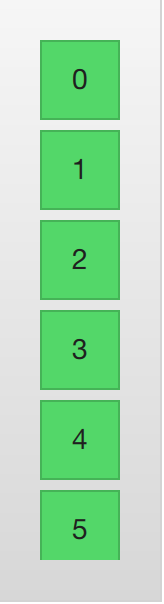
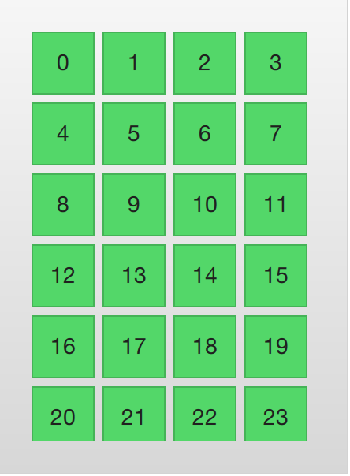
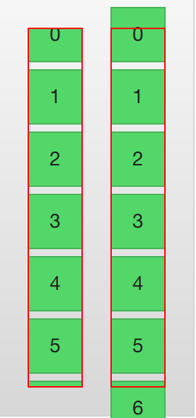
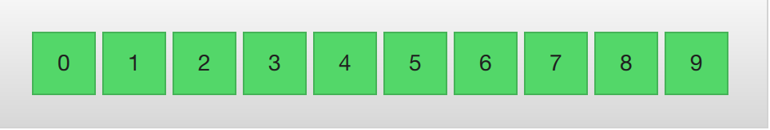
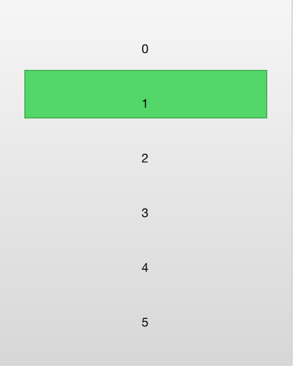
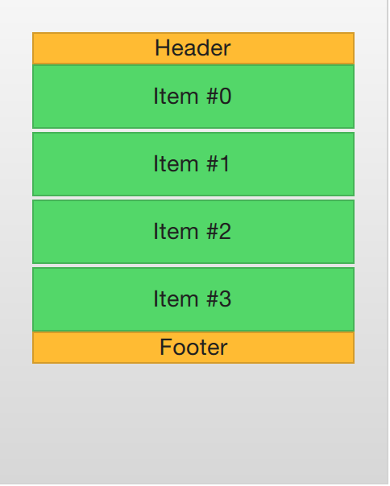

# 动态视图

Repeater 对于有限且静态的数据集很好用，但在真实世界中，模型通常更复杂——也更大。这里就需要更聪明的解决方案。为此，Qt Quick 提供了 `ListView` 和 `GridView` 元素。两者都基于 `Flickable` 区域，因此用户可以在更大的数据集中移动浏览。同时，它们限制了同时实例化的委托数量。对于大型模型，这意味着场景中同时存在的元素更少。

这两个元素的用法相似。我们先从 `ListView` 开始，然后以它为比较基准来描述 `GridView`。注意，`GridView` 会把一个项列表放入二维网格中，从左到右或从上到下排列。如果想展示数据表格，需要使用 `TableView`，它在“表模型”一节中介绍。

`ListView` 与 `Repeater` 元素相似。它使用 `model`，实例化 `delegate`，并且委托之间可以有 `spacing`。下面的清单展示了简单的设置是什么样子。

<<< @/docs/ch07-modelview/src/listview/basic.qml#global

如果模型包含的数据超出屏幕可以显示的范围，`ListView` 只会显示列表的一部分。然而，由于 Qt Quick 的默认行为，列表视图不限制委托显示的屏幕区域。这意味着委托可能在列表视图之外可见，并且列表视图之外委托的动态创建和销毁对用户是可见的。要防止这种情况，必须在 `ListView` 元素上通过把 `clip` 属性设置为 `true` 来激活裁剪（clipping）。下图展示了这样做的结果（左侧视图），与 `clip` 属性为 `false` 时（右侧视图）的对比。

对用户来说，`ListView` 是一个可滚动区域。它支持惯性滚动（kinetic scrolling），也就是说可以通过轻拂快速浏览内容。默认情况下，它还可以被拉伸到内容末尾之外，然后弹回，以向用户发出已经到达末尾的信号。

视图在末尾的行为通过 `boundsBehavior` 属性控制。这是一个枚举值，可以从默认行为 `Flickable.DragAndOvershootBounds`（视图既可以被拖动也可以被轻拂到边界之外）配置为 `Flickable.StopAtBounds`（视图永远不会移动到边界之外）。介于两者之间的 `Flickable.DragOverBounds` 允许用户把视图拖动到边界之外，但轻拂会在边界处停止。

可以限制视图允许停留的位置。这通过 `snapMode` 属性控制。默认行为 `ListView.NoSnap` 允许视图停在任意位置。把 `snapMode` 属性设置为 `ListView.SnapToItem` 后，视图总会让某个项的顶部与视图顶部对齐。最后，`ListView.SnapOneItem` 会在鼠标按键或触摸释放时，让视图停留在距离第一个可见项不超过一个项的位置。最后这种模式在翻页浏览时非常方便。

## 方向

列表视图默认提供垂直滚动的列表，但水平滚动同样有用。列表视图的方向通过 `orientation` 属性控制。它可以设置为默认值 `ListView.Vertical`，也可以设置为 `ListView.Horizontal`。下面展示了一个水平列表视图。

<<< @/docs/ch07-modelview/src/listview/horizontal.qml#global

可以看出，水平方向的流动默认从左到右。这可以通过 `layoutDirection` 属性控制，根据流动方向可以设置为 `Qt.LeftToRight` 或 `Qt.RightToLeft`。

## 键盘导航与高亮显示

在基于触摸的场景中使用 `ListView` 时，视图本身就够了。在有键盘、甚至只是用方向键选择项的场景中，就需要一种指示当前项（current item）的机制。在 QML 中，这称为高亮显示（highlighting）。

视图支持一个高亮委托（highlight delegate），它与委托一起显示在视图中。它可以被看作一个额外的委托，只不过它只实例化一次，并移动到与当前项相同的位置。

下面的示例演示了这一点。要实现这一效果涉及两个属性。首先，`focus` 属性设置为 true。这使 `ListView` 获得键盘焦点。其次，`highlight` 属性设置为指定要使用的高亮委托。高亮委托会被赋予当前项的 `x`、`y` 和 `height`。如果没有指定 `width`，则同样使用当前项的宽度。

在示例中，宽度使用了 `ListView.view.width` 附加属性。委托可用的附加属性将在本章的“委托”一节进一步讨论，不过值得了解的是，同样的属性对高亮委托同样可用。

<<< @/docs/ch07-modelview/src/listview/highlight.qml#global

在与 `ListView` 一起使用高亮时，可以使用若干属性控制其行为。`highlightRangeMode` 控制高亮如何受视图中所显示内容的影响。默认设置 `ListView.NoHighlightRange` 意味着高亮和视图中项的可见范围完全无关。

值 `ListView.StrictlyEnforceRange` 确保高亮始终可见。如果某个操作试图把高亮移出视图的可见部分，当前项会相应改变，从而使高亮保持可见。

折中方案是 `ListView.ApplyRange` 值。它尝试保持高亮可见，但不会为了强制这一点而改变当前项。相反，必要时允许高亮移出视图。

在默认配置中，视图负责把高亮移动到相应位置。移动和调整大小的速度可以控制，既可以按速度，也可以按持续时间。涉及的属性有 `highlightMoveSpeed`、`highlightMoveDuration`、`highlightResizeSpeed` 和 `highlightResizeDuration`。默认情况下，速度设置为每秒 400 像素，持续时间设置为 -1，表示由速度和距离控制持续时间。如果同时设置了速度和持续时间，则选择使动画更快的那个。

要更细致地控制高亮的移动，可以把 `highlightFollowCurrentItem` 属性设置为 `false`。这意味着视图不再负责高亮委托的移动。相反，移动可以通过 `Behavior` 或动画来控制。

在下面的例子中，高亮委托的 `y` 属性绑定到 `ListView.view.currentItem.y` 附加属性。这确保了高亮跟随当前项。然而，由于我们不让视图移动高亮，就可以控制元素如何移动。这通过 `Behavior on y` 完成。在下面的例子中，移动分为三步：淡出、移动，然后淡入。注意 `SequentialAnimation` 和 `PropertyAnimation` 元素如何与 `NumberAnimation` 结合使用，以创建更复杂的移动。

<<< @/docs/ch07-modelview/src/listview/highlight-custom.qml#highlight-component

## 页眉与页脚

在 `ListView` 内容的两端，可以插入 `header` 和 `footer` 元素。它们可以被看作放置在列表开头或结尾的特殊委托。对于水平列表，它们不会出现在列表的顶部或底部，而是出现在开头或结尾，具体取决于所使用的 `layoutDirection`。

下面的例子展示了如何用页眉和页脚增强对列表开始和结束的感知。这些特殊列表元素还有其他用途。例如，它们可以用来放置加载更多内容的按钮。

<<< @/docs/ch07-modelview/src/listview/header-footer.qml#global

::: tip
页眉和页脚委托不遵循 `spacing`（`ListView` 的属性），而是直接紧挨着列表中的下一个项委托放置。这意味着任何间距都必须成为页眉和页脚项的一部分。
:::

## GridView

使用 `GridView` 与使用 `ListView` 非常相似。唯一真正的区别在于，网格视图把委托放置在二维网格中，而不是线性列表中。

与列表视图相比，网格视图并不依赖委托之间的间距和委托自身的大小。相反，它使用 `cellWidth` 和 `cellHeight` 属性控制内容委托的尺寸。每个委托项随后被放置在每个此类单元格的左上角。

<<< @/docs/ch07-modelview/src/gridview/basic.qml#global

`GridView` 包含页眉和页脚，可以使用高亮委托，并支持吸附模式以及各种边界行为。它也可以采用不同的方向与取向。

取向通过 `flow` 属性控制。它可以设置为 `GridView.LeftToRight` 或 `GridView.TopToBottom`。前一个值从左到右填充网格，从上到下添加行。视图在垂直方向上可滚动。后一个值从上到下添加项，从左到右填充视图。这种情况下滚动方向是水平的。

除了 `flow` 属性之外，`layoutDirection` 属性可以把网格的方向调整为从左到右或从右到左的语言，具体取决于所使用的值。
