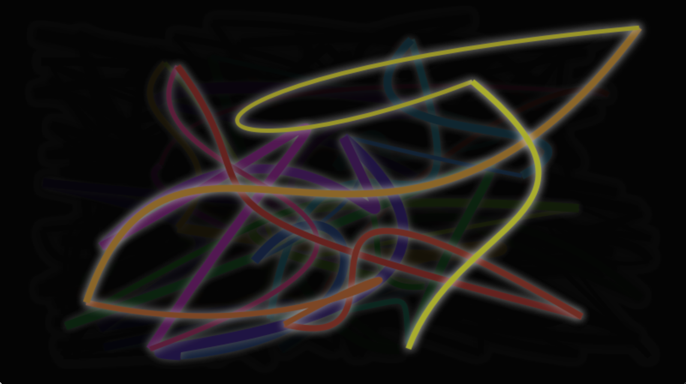
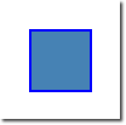

# Canvas 元素

QML 的一大优势是它与 JavaScript 生态系统的紧密联系。这让我们得以复用 Web 世界中已有的解决方案，并把它们与 QML 可视化的原生性能结合起来。不过，有时我们也想复用 Web 领域的图形解决方案。这时 `Canvas` 元素就派上用场了。画布元素提供的 API 与同名 HTML 元素的绘图 API 非常接近。



画布元素的基本思路是使用 2D 上下文（context）对象来渲染路径（path）。2D 上下文对象包含必要的图形函数，画布则充当绘制的画板。2D 上下文支持描边（stroke）、填充（fill）、渐变、文本以及一组不同的路径创建命令。

来看一个简单路径绘制的例子：

<<< @/docs/ch08-canvas/src/canvas/rectangle.qml#M1

这会生成一个起点在 50,50、大小为 100 的填充矩形，以及用作边框装饰的描边。



描边宽度设置为 4，并使用 `strokeStyle` 定义的蓝色。最终形状通过 `fillStyle` 填充为“steel blue”颜色。只有调用 `stroke` 或 `fill` 才会真正绘制路径，而且二者可以彼此独立使用。调用 `stroke` 或 `fill` 会绘制当前路径。无法存储路径以供以后重用，只有绘制状态可以存储和恢复。

在 QML 中，`Canvas` 元素充当绘图的容器。2D 上下文对象提供实际的绘制操作。实际绘制需要在 `onPaint` 事件处理器内部完成。

```qml
Canvas {
    width: 200; height: 200
    onPaint: {
        var ctx = getContext("2d")
        // setup your path
        // fill or/and stroke
    }
}
```

画布本身提供典型的二维笛卡尔坐标系，左上角是 (0,0) 点。y 值越大越向下，x 值越大越向右。

这种基于路径的 API 的典型命令顺序如下：

1. 设置描边和/或填充
2. 创建路径
3. 描边和/或填充

<<< @/docs/ch08-canvas/src/canvas/line.qml#M1

这会生成一条从点 `P1(50,50)` 到点 `P2(150,50)` 的水平描边线。


::: tip
通常，重置路径时你总会想设置一个起点，因此 `beginPath` 之后的第一个操作往往是 `moveTo`。
:::

