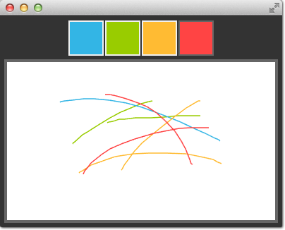

# Canvas 绘图

在这个示例中，我们将使用 `Canvas` 元素创建一个小绘图应用。

为此，我们使用行定位器在场景顶部排列四个颜色方块。颜色方块是一个内含鼠标区域的简单矩形，用于检测点击。

<<< @/docs/ch08-canvas/src/canvas/paint.qml#M1

这些颜色存储在一个数组中，而绘图颜色单独保存。当用户点击其中一个方块时，该方块的颜色会被赋给 `paintColor` 属性，也就是名为 `colorTools` 的行的属性。

为了跟踪画布上的鼠标事件，我们用一个 `MouseArea` 覆盖画布元素，并挂接了按下（pressed）和位置变化（position changed）处理器。

<<< @/docs/ch08-canvas/src/canvas/paint.qml#M2

鼠标按下会把初始鼠标位置存储到 `lastX` 和 `lastY` 属性中。鼠标位置的每次变化都会在画布上触发一个绘制请求，进而调用 `onPaint` 处理器。

为了最终画出用户的笔画，在 `onPaint` 处理器中我们开始一条新路径并移动到最后的位置。然后从鼠标区域获取新位置，并用选定的颜色向新位置画一条线。鼠标位置被存储为新的 `last` 位置。
