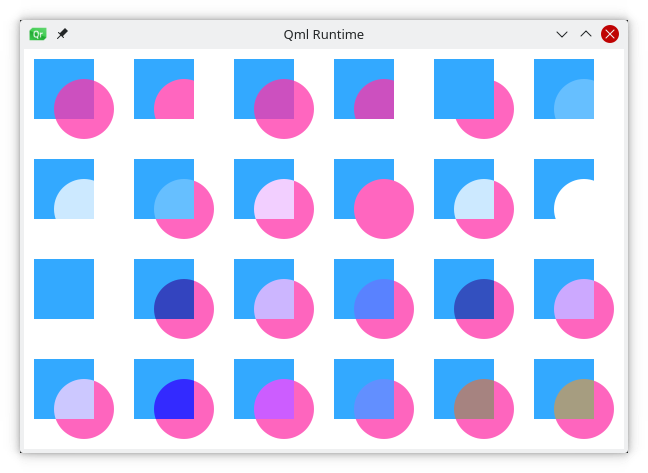

# 合成模式

合成（composition）允许你绘制一个形状并与现有像素混合。画布通过 `globalCompositeOperation(mode)` 操作支持多种合成模式。例如：

* `source-over`
* `source-in`
* `source-out`
* `source-atop`

让我们从一个演示异或（exclusive or）合成的简短示例开始：

<<< @/docs/ch08-canvas/src/canvas/composition.qml#M1

下面的示例通过遍历所有合成模式，并把一个矩形和一个圆形组合在一起，来演示全部合成模式。你可以在源代码下方看到输出结果。

<<< @/docs/ch08-canvas/src/canvas/compositeoperation.qml#M1

