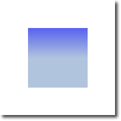

# 渐变

画布不仅可以用颜色填充形状，还可以用渐变或图像填充。

<<< @/docs/ch08-canvas/src/canvas/gradient.qml#M1

本例中的渐变沿起点 (100,0) 到终点 (100,200) 定义，得到画布中央的一条竖直线。色标（gradient-stop）可以定义为从 0.0（渐变起点）到 1.0（渐变终点）范围内的颜色。这里 `blue` 颜色位于 `0.0`（100,0），`lightsteelblue` 颜色位于 `0.5`（100,200）位置。渐变定义得比我们要绘制的矩形大得多，因此矩形会把渐变裁剪到它所定义的几何形状之内。

::: tip
渐变是在画布坐标系中定义的，而不是相对于要绘制的路径的坐标。画布没有相对坐标的概念，不像我们在 QML 中已经习惯的那样。
:::

