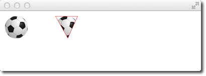

# 图像

QML 画布支持从若干来源绘制图像。要在画布内使用图像，需要先加载它。在下面的示例中，我们使用 `Component.onCompleted` 处理器来加载图像。

<<< @/docs/ch08-canvas/src/canvas/image.qml#M1

左图展示了在左上角 10x10 位置绘制的小球图像。右图展示了应用裁剪路径后的小球。图像和任何其他路径都可以用另一条路径来裁剪。裁剪的用法是定义一条路径并调用 `clip()` 函数。此后所有的绘制操作都会被这条路径裁剪。通过恢复之前的状态或将裁剪区域设置为整个画布，可以重新禁用裁剪。

