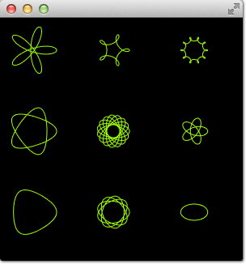
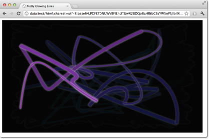
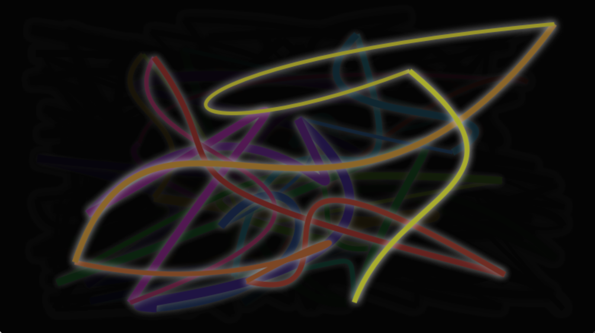

# 从 HTML5 Canvas 移植

把 HTML5 画布移植到 QML 画布相当容易。在本章中，我们将以下面的示例为例进行转换。

* [https://developer.mozilla.org/en-US/docs/Web/API/Canvas_API/Tutorial/Transformations](https://developer.mozilla.org/en-US/docs/Web/API/Canvas_API/Tutorial/Transformations)
* [http://en.wikipedia.org/wiki/Spirograph](http://en.wikipedia.org/wiki/Spirograph)

## 万花尺

我们以 Mozilla 项目中的一个[万花尺（Spirograph）](http://en.wikipedia.org/wiki/Spirograph)示例为基础。最初的 HTML5 示例是作为 [Canvas 教程](https://developer.mozilla.org/en-US/docs/Web/API/Canvas_API/Tutorial/Transformations)的一部分发布的。

有几行代码我们需要改动：


* Qt Quick 要求声明变量，因此我们需要添加一些 *var* 声明

    ```js
    for (var i=0;i<3;i++) {
        ...
    }
    ```


* 我们调整了 draw 方法，使其接收 Context2D 对象

    ```js
    function draw(ctx) {
        ...
    }
    ```


* 由于尺寸不同，我们需要调整每个万花尺图形的平移

    ```js
    ctx.translate(20+j*50,20+i*50);
    ```

最后，我们完成了 `onPaint` 处理器。在其中获取上下文并调用 draw 函数。

```qml
onPaint: {
    var ctx = getContext("2d");
    draw(ctx);
}
```

结果是一个使用 QML 画布运行的移植版万花尺图形。



如你所见，无需改动实际逻辑，只需对代码本身做相对较少的修改，就可以从 HTML5 移植到 QML。

## 发光线

这里是另一个来自 W3C 组织的、更复杂的移植示例。最初的[漂亮的发光线](http://www.w3.org/TR/2dcontext/#examples)（pretty glowing lines）有一些相当不错的特性，这让移植更具挑战性。



```html
<!DOCTYPE HTML>
<html lang="en">
<head>
    <title>Pretty Glowing Lines</title>
</head>
<body>

<canvas width="800" height="450"></canvas>
<script>
var context = document.getElementsByTagName('canvas')[0].getContext('2d');

// initial start position
var lastX = context.canvas.width * Math.random();
var lastY = context.canvas.height * Math.random();
var hue = 0;

// closure function to draw
// a random bezier curve with random color with a glow effect
function line() {

    context.save();

    // scale with factor 0.9 around the center of canvas
    context.translate(context.canvas.width/2, context.canvas.height/2);
    context.scale(0.9, 0.9);
    context.translate(-context.canvas.width/2, -context.canvas.height/2);

    context.beginPath();
    context.lineWidth = 5 + Math.random() * 10;

    // our start position
    context.moveTo(lastX, lastY);

    // our new end position
    lastX = context.canvas.width * Math.random();
    lastY = context.canvas.height * Math.random();

    // random bezier curve, which ends on lastX, lastY
    context.bezierCurveTo(context.canvas.width * Math.random(),
    context.canvas.height * Math.random(),
    context.canvas.width * Math.random(),
    context.canvas.height * Math.random(),
    lastX, lastY);

    // glow effect
    hue = hue + 10 * Math.random();
    context.strokeStyle = 'hsl(' + hue + ', 50%, 50%)';
    context.shadowColor = 'white';
    context.shadowBlur = 10;
    // stroke the curve
    context.stroke();
    context.restore();
}

// call line function every 50msecs
setInterval(line, 50);

function blank() {
    // makes the background 10% darker on each call
    context.fillStyle = 'rgba(0,0,0,0.1)';
    context.fillRect(0, 0, context.canvas.width, context.canvas.height);
}

// call blank function every 50msecs
setInterval(blank, 40);

</script>
</body>
</html>
```

在 HTML5 中，Context2D 对象可以随时在画布上绘制。在 QML 中，它只能在 `onPaint` 处理器内部绘制。HTML5 中与 `setInterval` 配合使用的计时器会触发线条描边或清空屏幕。由于 QML 的处理方式不同，不能直接调用这些函数，因为我们需要经过 `onPaint` 处理器。此外，颜色的表示方式也需要调整。让我们逐一查看这些改动。

一切都从画布元素开始。为简单起见，我们直接把 `Canvas` 元素用作 QML 文件的根元素。

```qml
import QtQuick

Canvas {
   id: canvas
   width: 800; height: 450

   ...
}
```

为了理清通过 `setInterval` 对函数的直接调用，我们用两个计时器替换 `setInterval` 调用，由它们请求重绘。`Timer` 会在短暂的间隔后触发，并允许我们执行一些代码。由于我们无法告诉绘制函数想触发哪一种操作，我们为每种操作定义一个布尔标志来请求该操作，然后再触发重绘请求。

下面是 line 操作的代码。blank 操作与之类似。

```qml
...
property bool requestLine: false

Timer {
    id: lineTimer
    interval: 40
    repeat: true
    triggeredOnStart: true
    onTriggered: {
        canvas.requestLine = true
        canvas.requestPaint()
    }
}

Component.onCompleted: {
    lineTimer.start()
}
...
```

现在我们就有了指示：在 `onPaint` 期间需要执行哪一种操作（line、blank，甚至两者都要）。由于每次绘制请求都会进入 `onPaint` 处理器，我们需要把变量的初始化提取到画布元素中。

```qml
Canvas {
    ...
    property real hue: 0
    property real lastX: width * Math.random();
    property real lastY: height * Math.random();
    ...
}
```

现在我们的绘制函数应该如下所示：

```qml
onPaint: {
    var context = getContext('2d')
    if(requestLine) {
        line(context)
        requestLine = false
    }
    if(requestBlank) {
        blank(context)
        requestBlank = false
    }
}
```

*line* 函数被提取出来，并以画布上下文作为参数。

```qml
function line(context) {
    context.save();
    context.translate(canvas.width/2, canvas.height/2);
    context.scale(0.9, 0.9);
    context.translate(-canvas.width/2, -canvas.height/2);
    context.beginPath();
    context.lineWidth = 5 + Math.random() * 10;
    context.moveTo(lastX, lastY);
    lastX = canvas.width * Math.random();
    lastY = canvas.height * Math.random();
    context.bezierCurveTo(canvas.width * Math.random(),
        canvas.height * Math.random(),
        canvas.width * Math.random(),
        canvas.height * Math.random(),
        lastX, lastY);

    hue += Math.random()*0.1
    if(hue > 1.0) {
        hue -= 1
    }
    context.strokeStyle = Qt.hsla(hue, 0.5, 0.5, 1.0);
    // context.shadowColor = 'white';
    // context.shadowBlur = 10;
    context.stroke();
    context.restore();
}
```

最大的变化是使用了 QML 的 `Qt.rgba()` 和 `Qt.hsla()` 函数，这要求把数值调整到 QML 所用的 0.0 到 1.0 范围。

*blank* 函数同理。

```qml
function blank(context) {
    context.fillStyle = Qt.rgba(0,0,0,0.1)
    context.fillRect(0, 0, canvas.width, canvas.height);
}
```

最终结果看起来与此类似。


