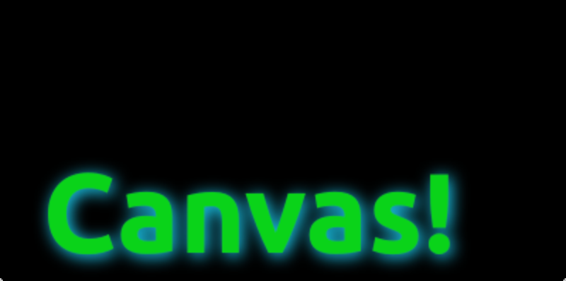

# 阴影

借助 2D 上下文对象，可以用阴影增强路径的视觉效果。阴影是路径周围带有偏移、颜色和指定模糊程度的区域。为此可以指定 `shadowColor`、`shadowOffsetX`、`shadowOffsetY` 和 `shadowBlur`。所有这些都需要通过 2D 上下文来定义。2D 上下文是你进行绘制操作的唯一 API。

阴影也可以用来在路径周围创建发光效果（glow effect）。在下一个示例中，我们创建一段周围带有白色光晕的文本“Canvas”。这一切都放在深色背景上，以获得更好的可见性。

首先，绘制深色背景：

<<< @/docs/ch08-canvas/src/canvas/shadow.qml#M1

然后定义阴影配置，它将用于下一条路径：

<<< @/docs/ch08-canvas/src/canvas/shadow.qml#M2

最后，我们使用 *Ubuntu* 字体家族的大号 80px 粗体绘制“Canvas”文本。

<<< @/docs/ch08-canvas/src/canvas/shadow.qml#M3

