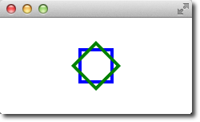

# 变换

画布允许你以多种方式变换坐标系。这与 QML 可视项提供的变换非常相似。你可以对坐标系进行缩放（`scale`）、旋转（`rotate`）和平移（`translate`）。与 QML 不同的是，变换原点始终是画布原点。例如，要围绕一条路径的中心缩放它，你需要把画布原点平移到路径的中心。也可以使用 transform 方法应用更复杂的变换。

<<< @/docs/ch08-canvas/src/canvas/transform.qml#M1



除了平移之外，画布还允许使用 `scale(x,y)` 围绕 x 轴和 y 轴缩放，使用 `rotate(angle)` 旋转，其中角度以弧度为单位（*360 degree = 2\*Math.PI*），以及使用 `setTransform(m11, m12, m21, m22, dx, dy)` 进行矩阵变换。

::: tip
要重置任何变换，可以调用 `resetTransform()` 函数，把变换矩阵恢复为单位矩阵：

```js
ctx.resetTransform()
```
:::
