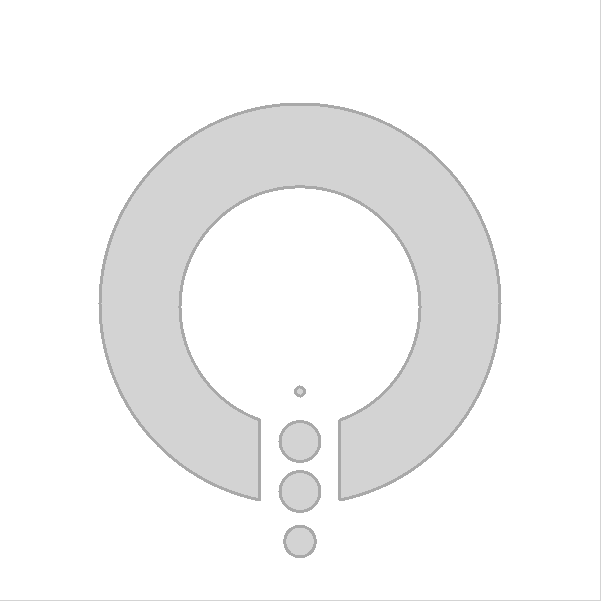

# 为形状添加动画

使用 Qt Quick Shapes 的一大好处是，所绘制的路径直接在 QML 中定义。这意味着它们的属性可以像 QML 中的任何其他属性一样进行绑定、过渡和动画。

在下面的示例中，我们复用了本章第一节中的基础形状，但引入了一个变量 ``t``，让它在 ``0.0`` 到 ``1.0`` 之间循环动画。然后使用该变量偏移小圆的位置，以及顶部和底部圆的大小。这就产生了一种动画效果：圆圈看起来从顶部出现，向底部消失。

<<< @/docs/ch09-shapes/src/shapes/animation.qml#global

注意，除了用 ``NumberAnimation`` 对 ``t`` 做动画，也可以使用任何其他绑定，例如绑定到滑块、外部状态等。唯一的限制是你的想象力。
