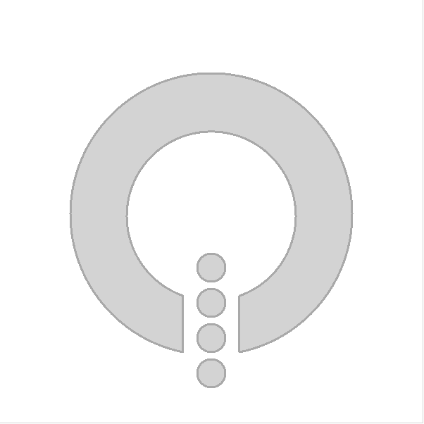

# 基础形状

形状模块可以创建任意路径，然后对轮廓进行描边并填充内部。路径的定义可以在其他使用路径的地方复用，例如与模型一起使用的 ``PathView`` 元素。不过，要绘制路径，需要使用 ``Shape`` 元素，并把各种路径元素放进 ``ShapePath`` 中。

在下面的示例中，创建了截图所示的路径。整个图形（全部五个填充区域）都由单条路径创建，然后对该路径进行描边和填充。

<<< @/docs/ch09-shapes/src/shapes/basic.qml#global

这条路径由 ``ShapePath`` 的子对象构成，即上例中的 ``PathArc``、``PathLine`` 和 ``PathMove`` 元素。下一节我们将仔细研究路径的构建块。
