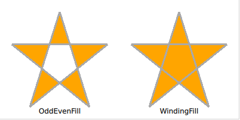
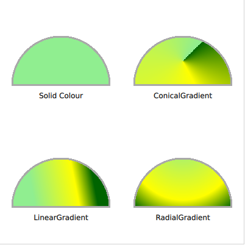

# 填充形状

形状可以用若干种不同的方式来填充。本节将介绍通用的填充规则，以及填充路径的各种方式。

Qt Quick Shapes 提供两种填充规则，通过 ``fillRule`` 属性来控制，该属性位于 ``ShapePath`` 元素上。不同规则的效果如下方截图所示。该属性可设置为 ``ShapePath.OddEvenFill``，这也是默认值——它分别填充路径的各个部分，也就是说，可以创建带孔洞的形状。另一种规则是 ``ShapePath.WindingFill``，它会填充形状中每条水平线上两个最外端点之间的所有区域。无论使用哪种填充规则，形状轮廓随后都会用画笔绘制，因此即使使用缠绕填充规则，轮廓也是绘制在形状内部的。

下面的示例演示了如何使用上图所示的两种填充规则。

<<< @/docs/ch09-shapes/src/shapes/fillmode.qml#oddeven
<<< @/docs/ch09-shapes/src/shapes/fillmode.qml#winding

确定填充规则后，填充轮廓的方式有若干种。各种选项如下方截图所示：要么是纯色，要么是 Qt Quick 提供的三种渐变之一。

要用纯色填充形状，可以使用 ``fillColor`` 属性，它位于 ``ShapePath`` 上。将其设置为颜色名称或颜色代码，形状即以该颜色填充。

<<< @/docs/ch09-shapes/src/shapes/gradients.qml#solid

如果不想使用纯色，也可以使用渐变。渐变通过 ``fillGradient`` 属性来应用，该属性位于 ``ShapePath`` 元素上。

我们首先介绍的渐变是 ``LinearGradient``。它在起点和终点之间创建线性渐变。端点可以按需放置，例如创建带角度的渐变。可以在端点之间插入一系列 ``GradientStop`` 元素。它们的 ``position`` 从 ``0.0``（即 ``x1, y1`` 位置）到 ``1.0``（即 ``x2, y2`` 位置）。每个渐变停止点都指定一种颜色，渐变由此在各颜色之间产生平滑过渡。

:::tip
如果形状超出端点范围，第一种或最后一种颜色会延续显示，或者渐变会重复或镜像。这一行为通过 ``spread`` 属性来指定，该属性属于 ``LinearGradient`` 元素。
:::

<<< @/docs/ch09-shapes/src/shapes/gradients.qml#linear

要创建围绕原点展开的渐变（有点像时钟），可以使用 ``ConicalGradient``。其中，中心点通过 ``centerX`` 和 ``centerY`` 属性指定，起始角度由 ``angle`` 属性给出。渐变停止点从给定角度开始沿顺时针方向铺开 360 度。

<<< @/docs/ch09-shapes/src/shapes/gradients.qml#conical

若要改为创建一圈圈圆形的渐变（有点像水面的涟漪），可以使用 ``RadialGradient``。为此需要指定两个圆：焦点圆和中心圆。渐变停止点从焦点圆延伸到中心圆，在这两个圆之外，最后一种颜色会延续、镜像或重复，具体取决于 ``spread`` 属性。

<<< @/docs/ch09-shapes/src/shapes/gradients.qml#radial

:::tip
高级用户可以使用片元着色器（fragment shader）来填充形状。这样就能完全自由地决定形状的填充方式。有关着色器的更多信息，请参阅特效（Effects）一章。
