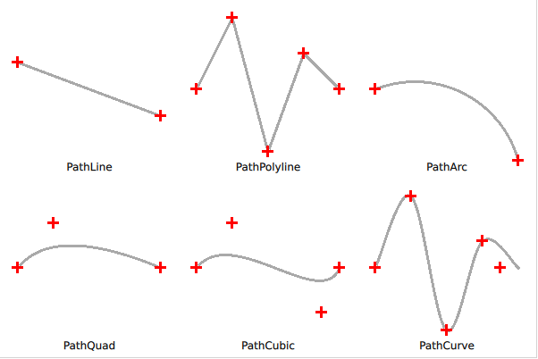

# 构建路径

如上一节所述，形状由路径构成，而路径又由路径元素构成。构建路径最常见的做法是将其闭合，即确保起点与终点重合。不过，也可以创建开放路径，例如仅用于描边。填充开放路径时，会用一条直线将其闭合，相当于添加一条 ``PathLine``——它只在填充路径时使用，描边时并不使用。

如下方截图所示，有几种基本形状可以用来构建路径：直线、弧和各种曲线。也可以使用 ``PathMove`` 元素移动位置而不绘制任何内容。除了这些元素，``ShapePath`` 元素还允许通过 ``startX`` 和 ``startY`` 属性指定起点。

直线使用 ``PathLine`` 元素绘制，如下所示。要创建多条互不相连的直线，可以使用 ``PathMultiline``。

<<< @/docs/ch09-shapes/src/shapes/paths.qml#line

创建折线（即由多条线段组成的线）时，可以使用 ``PathPolyline`` 元素。这能少写一些代码，因为上一条线的终点会被视为下一条线的起点。

<<< @/docs/ch09-shapes/src/shapes/paths.qml#polyline

要创建弧（即圆或椭圆的片段），需要使用 ``PathArc`` 和 ``PathAngleArc`` 元素。它们提供了创建弧所需的工具：已知起点和终点坐标时使用 ``PathArc``；想控制弧扫过的角度时使用 ``PathAngleArc``。这两个元素产生的输出相同，因此选择哪一个，取决于在你的应用中弧的哪些方面最为重要。

<<< @/docs/ch09-shapes/src/shapes/paths.qml#arc

直线和弧之后是各种曲线。Qt Quick Shapes 在这里提供了三种形式。首先来看 ``PathQuad``，它基于起点和终点（起点是隐含的）以及单个控制点创建二次贝塞尔曲线（Bezier curve）。

<<< @/docs/ch09-shapes/src/shapes/paths.qml#quad

``PathCubic`` 元素基于起点和终点（起点是隐含的）以及两个控制点创建三次贝塞尔曲线。

<<< @/docs/ch09-shapes/src/shapes/paths.qml#cubic

最后，``PathCurve`` 创建一条经过所提供的控制点列表的曲线。曲线由多个 ``PathCurve`` 元素构成，每个元素包含一个控制点。它使用 Catmull-Rom 样条创建经过各控制点的曲线。

<<< @/docs/ch09-shapes/src/shapes/paths.qml#curve

还有一个有用的路径元素 ``PathSvg``。该元素可以对 SVG 路径进行描边和填充。

:::tip
``PathSvg`` 元素并不总能与其他路径元素组合使用。这取决于所使用的绘制后端，因此在同一条路径中请只使用 ``PathSvg`` 或其他路径元素之一。如果把 ``PathSvg`` 与其他路径元素混用，效果可能因情况而异。
