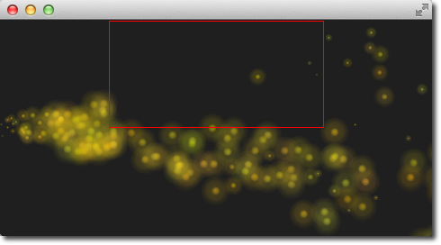
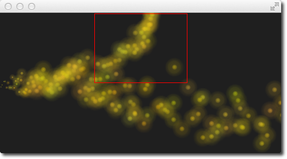
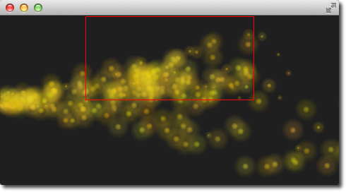
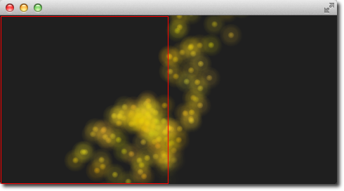
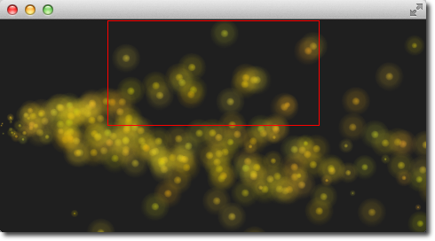
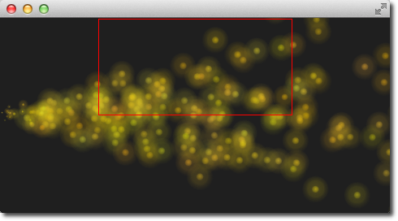

# 影响粒子

粒子由发射器发射。粒子被发射之后，发射器就无法再改变它。影响器允许你在粒子被发射之后影响它们。

每种类型的影响器都以不同的方式影响粒子：

* `Age` - 改变粒子在其生命周期中所处的阶段
* `Attractor` - 把粒子吸引向一个特定点
* `Friction` - 按与粒子当前速度成正比的方式减慢运动
* `Gravity` - 在某个角度上施加加速度
* `Turbulence` - 基于噪声图像的类似流体的力
* `Wander` - 随机改变轨迹
* `GroupGoal` - 改变粒子所属组的状态
* `SpriteGoal` - 改变精灵粒子的状态

## 老化（Age）

让粒子更快地老化。`lifeLeft` 属性指定粒子还应剩余多少生命。

<<< @/docs/ch10-effects/src/particles/age.qml#M1

在这个示例中，上部的粒子一旦到达该影响器，我们就把它们的寿命缩短为 1200 毫秒。由于我们把 `advancePosition` 设为 true，可以看到粒子出现在它还剩 1200 毫秒生命时本应处于的位置。

## 吸引器（Attractor）

吸引器把粒子吸引向一个特定的点。该点用 `pointX` 和 `pointY` 指定，相对于吸引器的几何形状。strength 指定吸引力的大小。在示例中我们让粒子从左向右行进。吸引器放置在顶部，一半粒子会经过吸引器。影响器只在粒子处于其边界框内时才影响粒子。这种划分让我们可以同时看到正常粒子流和受影响的粒子流。

<<< @/docs/ch10-effects/src/particles/attractor.qml#M1

很容易看出，上半部分的粒子受到了吸引，被拉向顶部。吸引点设置在吸引器的左上角（0/0 点），吸引力为 1.0。

## 摩擦（Friction）

摩擦影响器按一定的系数减慢粒子，直到达到某个阈值。

<<< @/docs/ch10-effects/src/particles/friction.qml#M1

在上方的摩擦区域中，粒子被以 0.8 的系数减慢，直到粒子速度达到每秒 25 像素。阈值就像一个过滤器。速度高于阈值的粒子会按给定系数减慢。

## 重力（Gravity）

重力影响器施加一个加速度。在示例中，我们使用角度方向让粒子从底部流向顶部。右侧不受影响，左侧则施加了重力效果。重力的角度为 90 度（向下方向），幅值为 50。

<<< @/docs/ch10-effects/src/particles/gravity.qml#M1

左侧的粒子试图向上攀升，但持续施加的向下加速度把它们拖向重力的方向。

## 湍流（Turbulence）

湍流影响器向粒子施加一张*混沌*力向量图。该混沌图由一幅噪声图像定义，可以用 *noiseSource* 属性定义。strength 定义向量施加到粒子运动上的强度。

<<< @/docs/ch10-effects/src/particles/turbulence.qml#M1

在示例的上部区域，粒子受到湍流的影响。它们的运动更加无规律。偏离原始路径的无规律程度由 strength 定义。

## 游移（Wander）

游移影响器操纵粒子的轨迹。通过 *affectedParameter* 属性可以指定哪个参数（速度、位置或加速度）受游移影响。*pace* 属性指定每秒属性变化的最大次数。yVariance 和 yVariance 指定对粒子轨迹 x 和 y 分量的影响。

<<< @/docs/ch10-effects/src/particles/wander.qml#M1

在顶部的游移影响器中，粒子被随机的轨迹变化搅得来回移动。在本例中，位置在 y 方向上每秒改变 200 次。

