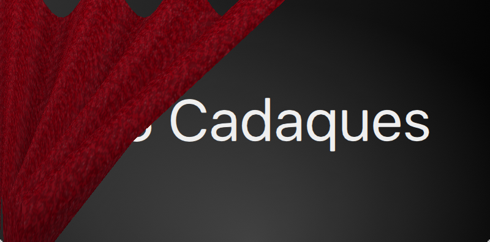
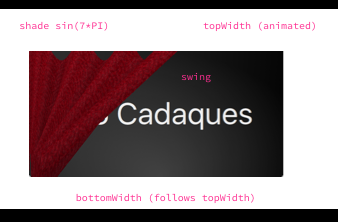

# 窗帘效果

在自定义着色器效果的最后一个示例中，我想为你带来窗帘效果。该效果最早于 2011 年 5 月作为 [Qt 实验室的着色器效果](http://labs.qt.nokia.com/2011/05/03/qml-shadereffectitem-on-qgraphicsview/) 的一部分发布。

当时我非常喜欢这些效果，而窗帘效果是其中我的最爱。我就是喜欢窗帘打开并遮住背景物体的样子。

对于本章，该效果已适配到 Qt 6。它还被略微简化，以便更好地展示。

窗帘图像名为 `fabric.png`。该效果使用顶点着色器让窗帘来回摆动，用片元着色器施加阴影以展现织物是如何折叠的。

下图展示了着色器的工作原理。波浪通过具有 7 个周期（7\*PI=21.99…）的正弦曲线计算。另一部分是摆动。窗帘的 `topWidht` 在窗帘打开或关闭时被动画驱动。`bottomWidth` 使用 `SpringAnimation` 跟随 `topWidth`。这就产生了窗帘下部自由摆动的效果。计算出的 `swing` 分量是基于顶点 y 分量的摆动强度。

窗帘效果在 `CurtainEffect.qml` 文件中实现，其中织物图像充当纹理源。在 QML 代码中，调整了 `mesh` 属性，以确保增加顶点数量，从而获得更平滑的结果。

<<< @/docs/ch10-effects/src/effects/curtain/CurtainEffect.qml#M1

下面所示的顶点着色器根据 `topWidth` 和 `bottomWidth` 属性重塑窗帘，并基于 y 坐标外推偏移量。它还计算 `shade` 值，该值在片元着色器中使用。`shade` 属性通过 `location` 1 处的附加输出传递。

<<< @/docs/ch10-effects/src/effects/curtain/curtain.vert#M1

在下面的片元着色器中，`shade` 作为 `location` 1 处的输入被接收，然后用于计算 `fragColor`，它被用来绘制相应像素。

<<< @/docs/ch10-effects/src/effects/curtain/curtain.frag#M1

QML 动画与从顶点着色器向片元着色器传值的结合，展示了 QML 和着色器如何协同构建复杂的动画效果。

该效果本身通过下面所示的 `curtaindemo.qml` 文件使用。

<<< @/docs/ch10-effects/src/effects/curtain/curtaindemo.qml#M1

窗帘通过窗帘效果上的自定义 `open` 属性打开。我们使用 `MouseArea` 在用户点击或轻触该区域时触发窗帘的开合。
