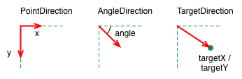
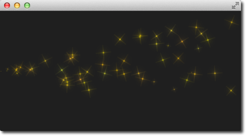
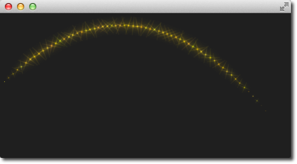
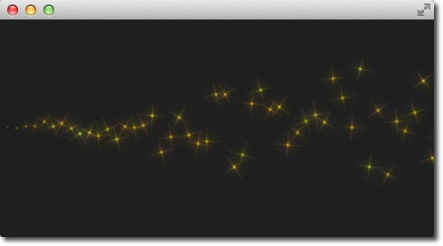
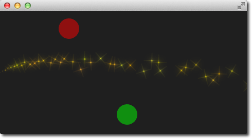

# 定向粒子

我们已经看到粒子可以旋转。但粒子还可以拥有轨迹。轨迹由粒子的速度或加速度指定，而速度或加速度由一个随机方向——也称为向量空间——来定义。

有多种向量空间可用于定义粒子的速度或加速度：

* `AngleDirection` - 角度发生变化的方向
* `PointDirection` - x 和 y 分量发生变化的方向
* `TargetDirection` - 指向目标点的方向



让我们试着利用速度方向，把粒子从场景的左侧移动到右侧。

我们先试试 `AngleDirection`。为此，需要把 `AngleDirection` 指定为发射器 velocity 属性的一个元素：

```qml
velocity: AngleDirection { }
```

粒子发射时的角度由 angle 属性指定。该角度以 0..360 度之间的值给出，0 指向右方。在我们的示例中，希望粒子向右移动，所以 0 已经是正确的方向。粒子应在 +/- 5 度的范围内扩散：

```qml
velocity: AngleDirection {
    angle: 0
    angleVariation: 15
}
```

现在方向已经设定，接下来要指定粒子的速度。速度由幅值定义。幅值的单位是每秒像素数。由于我们大约有 640 像素的路程要走，100 看起来是个不错的数值。这意味着在平均 6.4 秒的生命周期内，粒子将穿过这片开阔空间。为了让粒子的行进过程更有趣，我们用 `magnitudeVariation` 改变幅值，并把它设置为幅值的一半：

```qml
velocity: AngleDirection {
    ...
    magnitude: 100
    magnitudeVariation: 50
}
```



下面是完整的源代码，平均生命周期设为 6.4 秒。我们把发射器的宽度和高度都设为 1 像素。这意味着所有粒子都在同一位置发射，并从那里按照给定的轨迹行进。

<<< @/docs/ch10-effects/src/particles/angledirection.qml#M1

那么加速度又是做什么的呢？加速度为每个粒子添加一个加速度向量，它会随时间改变速度向量。例如，让我们做出一条由星星组成的弧形轨迹。为此，把速度方向改为 -45 度并去掉变化量，以便更清楚地看到一条连贯的弧线：

```qml
velocity: AngleDirection {
    angle: -45
    magnitude: 100
}
```

加速度方向应为 90 度（向下方向），这里我们取速度幅值的四分之一：

```qml
acceleration: AngleDirection {
    angle: 90
    magnitude: 25
}
```

结果是一条从左中延伸到右下的弧线。



这些数值是通过反复试错得到的。

下面是发射器的完整代码。

<<< @/docs/ch10-effects/src/particles/angledirection2.qml#M1

在下一个示例中，我们希望粒子再次从左向右行进，但这次使用 `PointDirection` 向量空间。

`PointDirection` 的向量空间由 x 和 y 分量导出。例如，如果希望粒子沿 45 度方向行进，就需要为 x 和 y 指定相同的值。

在我们的场景中，希望粒子从左向右行进，形成一个 15 度的锥形。为此，把 `PointDirection` 指定为速度向量空间：

```qml
velocity: PointDirection { }
```

为了达到每秒 100 像素的行进速度，我们把 x 分量设为 100。对于 15 度（即 90 度的 1/6），我们把变化量指定为 100/6：

```qml
velocity: PointDirection {
    x: 100
    y: 0
    xVariation: 0
    yVariation: 100/6
}
```

结果应该是粒子在一个 15 度的锥形中从右向左行进。



现在来看最后一位选手——`TargetDirection`。目标方向允许我们把目标点指定为相对于发射器或某个项的 x 和 y 坐标。当指定了某个项时，该项的中心将成为目标点。通过把目标变化量指定为 x 目标的 1/6，可以得到 15 度的锥形：

```qml
velocity: TargetDirection {
    targetX: 100
    targetY: 0
    targetVariation: 100/6
    magnitude: 100
}
```

::: tip
当你有一个具体的 x/y 坐标，希望粒子流向它发射时，目标方向非常有用。
:::

我就不展示图像了，因为它和上一张看起来一样；相反，我给你留了一道题。

在下图中，红圈和绿圈分别为 velocity 和 acceleration 属性的目标方向指定了一个目标项。两个目标方向的参数相同。问题来了：谁负责速度，谁负责加速度？


