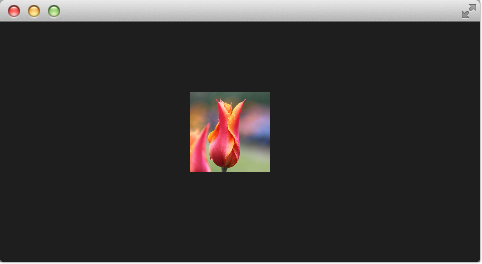
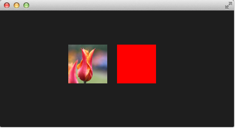
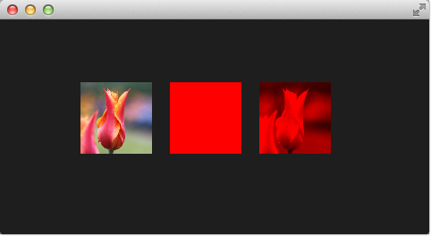
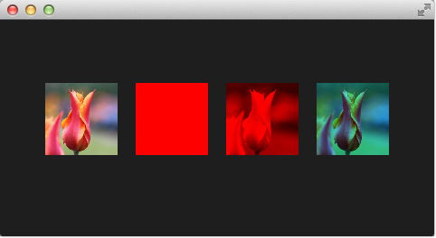
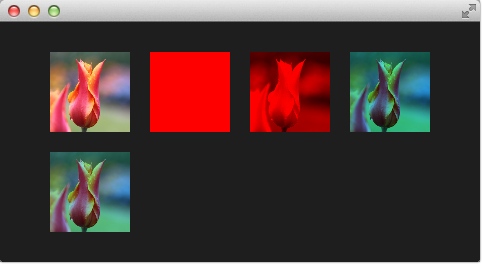

# 片元着色器

片元着色器为每个要渲染的像素调用。在本章中，我们将开发一个小小的红色透镜，它会提高源图像的红色通道值。

## 搭建场景

首先搭建场景：一个在画面中居中的网格，以及要显示的源图像。

<<< @/docs/ch10-effects/src/effects/redlense/1/redlense1.qml#M1



## 红色着色器

接下来，我们添加一个着色器，它为每个片元提供红色的颜色值，从而显示一个红色矩形。

<<< @/docs/ch10-effects/src/effects/redlense/2/red1.frag#M1{14-16}

在片元着色器中，我们只需为每个片元把 `vec4(1.0, 0.0, 0.0, 1.0)`（表示不透明度为满值（alpha=1.0）的红色）赋给 `fragColor`，就把每个像素变成纯红色。



## 带纹理的红色着色器

现在我们要把红色应用到每个纹理像素上。为此，我们需要把纹理放回顶点着色器中。由于我们在顶点着色器中不做任何其他事情，默认的顶点着色器就足够了。我们只需提供一个兼容的片元着色器。

<<< @/docs/ch10-effects/src/effects/redlense/2/red2.frag#M1{14-16}

完整的着色器现在又把我们的图像源作为变体（variant）属性包含回来，而我们省略了顶点着色器——如果不指定顶点着色器，使用的便是默认顶点着色器。

在片元着色器中，我们取得纹理片元 `texture(source, qt_TexCoord0)` 并对其应用红色。



## 红色通道属性

把红色通道值硬编码可不太好，所以我们希望能从 QML 一侧控制该值。为此，我们给着色器效果添加一个 *redChannel* 属性，同时在片元着色器的 uniform 缓冲区中声明一个 `float redChannel`。要让 QML 一侧的值对着色器代码可用，做这些就够了。

::: tip
注意，`redChannel` 在 uniform 缓冲区 `ubuf` 中必须位于隐式的 `qt_Matrix` 和 `qt_Opacity` 之后。`qt_` 参数之后的参数顺序由你决定，但 `qt_Matrix` 和 `qt_Opacity` 必须排在最前面，且保持这个顺序。
:::

<<< @/docs/ch10-effects/src/effects/redlense/2/red3.frag#M1{11}

为了让透镜真正成为透镜，我们把 *vec4* 颜色改为 *vec4(redChannel, 1.0, 1.0, 1.0)*，这样其他颜色乘以 1.0，只有红色部分乘以我们的 *redChannel* 变量。



## 红色通道动画

由于 *redChannel* 属性只是一个普通属性，它也可以像 QML 中的所有属性一样被动画驱动。因此我们可以用 QML 属性为 GPU 上的值制作动画，从而影响我们的着色器。这有多酷！

<<< @/docs/ch10-effects/src/effects/redlense/2/redlense2.qml#M1{7-9}

这里是最终结果。



第二行上的着色器效果以 4 秒的时长从 0.0 动画变化到 1.0。于是图像从没有红色信息（红色为 0.0）过渡到正常图像（红色为 1.0）。

## 烘焙

同样，我们需要烘焙着色器。在命令行中执行以下命令即可：

```
qsb --glsl 100es,120,150 --hlsl 50 --msl 12 -o red1.frag.qsb red1.frag
qsb --glsl 100es,120,150 --hlsl 50 --msl 12 -o red2.frag.qsb red2.frag
qsb --glsl 100es,120,150 --hlsl 50 --msl 12 -o red3.frag.qsb red3.frag
```
