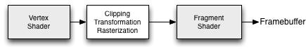

# 图形着色器

图形通过*渲染管线*（rendering pipeline）渲染，管线被划分为多个阶段。有多种 API 可以控制图形渲染。Qt 支持 OpenGL、Metal、Vulcan 和 Direct3D。观察简化的 OpenGL 管线，我们可以看到顶点着色器和片元着色器。这些概念在所有其他渲染管线中同样存在。

在管线中，顶点着色器接收顶点数据，即构成场景的每个元素各角点的位置，并计算 `gl_Position`。这意味着顶点着色器可以*移动*图形元素。在下一个阶段，顶点被裁剪、变换并光栅化为像素输出。然后这些像素——也称为*片元*——被传入片元着色器，后者计算每个像素的颜色。得到的颜色通过 `gl_FragColor` 变量返回。

总结一下：顶点着色器为多边形的每个角点调用一次（顶点 = 3D 中的点），负责对这些点进行任何 3D 操纵。片元（片元 = 像素）着色器为每个像素调用一次，决定该像素的颜色。

由于 Qt 不依赖于底层渲染 API，Qt 依赖一种标准语言来编写着色器。Qt Shader Tools 依赖于*Vulcan 兼容的 GLSL*。我们将在本章的示例中进一步了解这一点。
