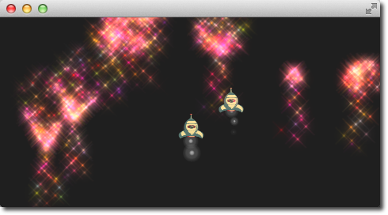
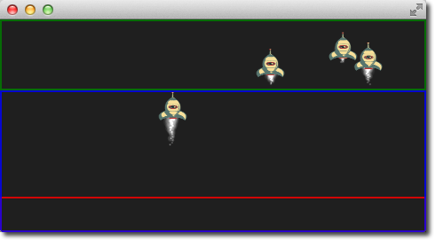
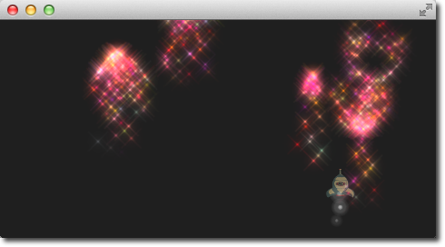

# 粒子组

在本章开头我们说过，粒子属于某个组，默认是空组（‘’）。使用 `GroupGoal` 影响器可以让粒子改变所属组。为了直观地展示这一点，我们要创建一个小小的烟花效果：火箭升入空中，在空中炸开成壮观的烟花。



该示例分为两部分。第一部分名为“点火升空”（Launch Time），负责搭建场景并介绍粒子组；第二部分名为“烟花盛开”（Let there be fireworks），重点介绍组的切换。

开始吧！

## 点火升空

首先创建一个典型的深色场景：

```qml
import QtQuick 2.5
import QtQuick.Particles 2.0

Rectangle {
    id: root
    width: 480; height: 240
    color: "#1F1F1F"
    property bool tracer: false
}
```

tracer 属性用于在整个场景范围内开关示踪器。接下来声明我们的粒子系统：

```qml
ParticleSystem {
    id: particleSystem
}
```

以及两个图像粒子（一个用于火箭，一个用于尾气烟雾）：

```qml
ImageParticle {
    id: smokePainter
    system: particleSystem
    groups: ['smoke']
    source: "assets/particle.png"
    alpha: 0.3
    entryEffect: ImageParticle.None
}

ImageParticle {
    id: rocketPainter
    system: particleSystem
    groups: ['rocket']
    source: "assets/rocket.png"
    entryEffect: ImageParticle.None
}
```

如代码所示，它们使用 *groups* 属性声明粒子属于哪个组。只需声明一个名称，Qt Quick 就会创建一个隐式组。

现在是时候向空中发射一些火箭了。为此，我们在场景底部创建一个发射器，并把速度设为向上方向。为模拟一些重力，设置一个向下的加速度：

```qml
Emitter {
    id: rocketEmitter
    anchors.bottom: parent.bottom
    width: parent.width; height: 40
    system: particleSystem
    group: 'rocket'
    emitRate: 2
    maximumEmitted: 4
    lifeSpan: 4800
    lifeSpanVariation: 400
    size: 32
    velocity: AngleDirection { angle: 270; magnitude: 150; magnitudeVariation: 10 }
    acceleration: AngleDirection { angle: 90; magnitude: 50 }
    Tracer { color: 'red'; visible: root.tracer }
}
```

该发射器属于 *'rocket'* 组，与火箭粒子绘制器相同。通过组名，它们绑定在一起。发射器把粒子发射到 'rocket' 组，火箭粒子绘制器会绘制它们。

对于尾气，我们使用轨迹发射器（TrailEmitter），它跟随火箭。它声明一个名为 'smoke' 的独立组，并跟随 'rocket' 组中的粒子：

```qml
TrailEmitter {
    id: smokeEmitter
    system: particleSystem
    emitHeight: 1
    emitWidth: 4
    group: 'smoke'
    follow: 'rocket'
    emitRatePerParticle: 96
    velocity: AngleDirection { angle: 90; magnitude: 100; angleVariation: 5 }
    lifeSpan: 200
    size: 16
    sizeVariation: 4
    endSize: 0
}
```

烟雾方向朝下，以模拟烟雾从火箭中喷出的力。*emitHeight* 和 *emitWidth* 指定被跟随粒子周围的区域，烟雾粒子从该区域发射。如果不指定，则取被跟随粒子的相应尺寸；但在本例中，我们想强化粒子源自火箭尾部附近某中心点的效果。

如果现在运行示例，你会看到火箭向上飞，有些甚至飞出了场景。这并不是我们想要的，因此需要在它们离开屏幕之前减慢它们。这里可以使用摩擦影响器把粒子减速到一个最小阈值：

```qml
Friction {
    groups: ['rocket']
    anchors.top: parent.top
    width: parent.width; height: 80
    system: particleSystem
    threshold: 5
    factor: 0.9
}
```

在摩擦影响器中，同样需要声明它影响哪些粒子组。摩擦会把屏幕顶部向下 80 像素范围内的所有火箭按 0.9 的系数减慢（试试 100，你会发现它们几乎立刻停下），直到速度降到每秒 5 像素。由于粒子仍施加着向下的加速度，火箭在到达寿命终点后会开始向地面下坠。

由于向空中爬升是件苦差事，而且状态很不稳定，我们想在火箭爬升时模拟一些湍流：

```qml
Turbulence {
    groups: ['rocket']
    anchors.bottom: parent.bottom
    width: parent.width; height: 160
    system: particleSystem
    strength: 25
    Tracer { color: 'green'; visible: root.tracer }
}
```

同样，湍流也需要声明它影响哪些组。湍流本身从底部向上延伸 160 像素（直到到达摩擦区域的边界）。两者也可以重叠。

现在运行示例，你会看到火箭向上爬升，然后被摩擦减慢，又因为仍施加着向下的加速度而落回地面。接下来就该让烟花绽放了。



::: tip
图中启用了示踪器以显示不同区域。火箭粒子在红色区域发射，然后在蓝色区域受到湍流影响。最后，它们在绿色区域被摩擦影响器减慢，并因持续施加的向下加速度而开始下落。
:::

## 烟花盛开

为了能把火箭变成美丽的烟花，我们需要添加一个 `ParticleGroup` 来封装这些变化：

```qml
ParticleGroup {
    name: 'explosion'
    system: particleSystem
}
```

我们使用 `GroupGoal` 影响器切换到该粒子组。组目标影响器放置在屏幕垂直中心附近，它会影响 'rocket' 组。通过 *groupGoal* 属性，我们把变更的目标组设为 'explosion'，即前面定义的粒子组：

```qml
GroupGoal {
    id: rocketChanger
    anchors.top: parent.top
    width: parent.width; height: 80
    system: particleSystem
    groups: ['rocket']
    goalState: 'explosion'
    jump: true
    Tracer { color: 'blue'; visible: root.tracer }
}
```

*jump* 属性表示组的切换应立即发生，而不是在一定时间之后发生。

::: tip
在 Qt 5 alpha 版本中，我们没能让组切换的 *duration* 生效。有谁有什么主意吗？
:::

由于火箭粒子进入组目标区域时，其组会变为 'explosion' 粒子组，我们需要把烟花效果加到该粒子组内部：

```qml
// inside particle group
TrailEmitter {
    id: explosionEmitter
    anchors.fill: parent
    group: 'sparkle'
    follow: 'rocket'
    lifeSpan: 750
    emitRatePerParticle: 200
    size: 32
    velocity: AngleDirection { angle: -90; angleVariation: 180; magnitude: 50 }
}
```

爆炸向 'sparkle' 组发射粒子。我们很快会为该组定义一个粒子绘制器。所用的轨迹发射器跟随火箭粒子，每个火箭发射 200 个粒子。粒子方向朝上，在 180 度范围内变化。

由于粒子被发射到 'sparkle' 组，我们还需要为这些粒子定义一个粒子绘制器：

```qml
ImageParticle {
    id: sparklePainter
    system: particleSystem
    groups: ['sparkle']
    color: 'red'
    colorVariation: 0.6
    source: "assets/star.png"
    alpha: 0.3
}
```

我们烟花的火花应是小小的红色星星，颜色近乎透明，以呈现出一些闪光效果。

为了让烟花更加壮观，我们还向粒子组添加第二个轨迹发射器，它以狭窄的锥形向下发射粒子：

```qml
// inside particle group
TrailEmitter {
    id: explosion2Emitter
    anchors.fill: parent
    group: 'sparkle'
    follow: 'rocket'
    lifeSpan: 250
    emitRatePerParticle: 100
    size: 32
    velocity: AngleDirection { angle: 90; angleVariation: 15; magnitude: 400 }
}
```

除此之外，设置与另一个爆炸轨迹发射器类似。大功告成。

下面是最终效果。




下面是火箭烟花的完整源代码。

<<< @/docs/ch10-effects/src/particles/firework.qml#M1
