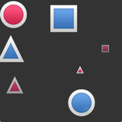

# 粒子绘制器

到目前为止，我们只使用了基于图像的粒子绘制器来可视化粒子。Qt 还提供了其他粒子绘制器：

* `ItemParticle`：基于委托的粒子绘制器
* `CustomParticle`：基于着色器的粒子绘制器

ItemParticle 可以用来把 QML 项作为粒子发射。为此，需要为粒子指定自己的委托。

<<< @/docs/ch10-effects/src/particles/itemparticle.qml#M2

在本例中，我们的委托是一幅随机图像（使用 *Math.random()*），带有白色边框和随机尺寸。

<<< @/docs/ch10-effects/src/particles/itemparticle.qml#M3

我们每秒发射 4 幅图像，每个粒子的寿命为 4 秒。粒子会自动淡入淡出。

对于更动态的场景，也可以自己创建一个项，然后用 `take(item, priority)` 让粒子接管它。这样，粒子模拟就控制了你的粒子，并像普通粒子一样处理该项。你可以用 `give(item)` 取回该项的控制权。你还可以用 `freeze(item)` 暂停项粒子的生命进程、用 `unfreeze(item)` 恢复其生命，从而进一步影响项粒子。
