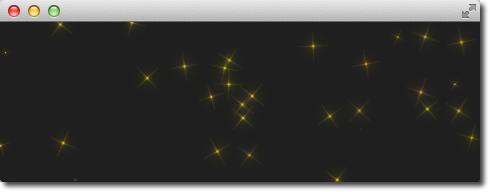

# 粒子参数

我们已经看到，如何通过改变发射器的行为来改变模拟结果。所使用的粒子绘制器则决定了每个粒子的图像如何被可视化。

回到我们的示例，我们来更新 `ImageParticle`。首先，把粒子图像换成一颗闪亮的小星星：

```qml
ImageParticle {
    ...
    source: 'assets/star.png'
}
```

粒子应染成金色，且每个粒子的金色在 +/- 20% 的范围内变化：

```qml
color: '#FFD700'
colorVariation: 0.2
```

为了让场景更加生动，我们让粒子旋转。每个粒子从顺时针 15 度开始，粒子之间在 +/-5 度范围内变化。此外，粒子应以每秒 45 度的速度持续旋转。该速度也应逐粒子在每秒 +/- 15 度的范围内变化：

```qml
rotation: 15
rotationVariation: 5
rotationVelocity: 45
rotationVelocityVariation: 15
```

最后同样重要的是，我们改变粒子的进入效果。这是粒子诞生时使用的效果。这里我们要使用缩放效果：

```qml
entryEffect: ImageParticle.Scale
```

这样，我们就有了到处出现的旋转金色星星。



下面是我们对图像粒子所做修改的完整代码。

<<< @/docs/ch10-effects/src/particles/particlevariation.qml#M1
