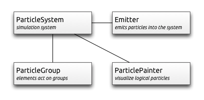

# 粒子概念

粒子模拟的核心是 `ParticleSystem`，它控制着共享的时间线。一个场景中可以有多个粒子系统，每个系统都有各自独立的时间线。粒子通过 `Emitter` 元素发射，并通过 `ParticlePainter` 可视化，后者可以是一幅图像、一个 QML 项或一个着色器项。
发射器还通过向量空间为粒子提供方向。粒子一旦发射，发射器就无法再操纵它。粒子模块提供了 `Affector`，它允许在粒子被发射之后操纵粒子的参数。

一个系统中的粒子可以通过 `ParticleGroup` 元素共享带时间的过渡。默认情况下，每个粒子都属于空组（‘’）。

* `ParticleSystem` - 管理发射器之间的共享时间线
* `Emitter` - 向系统中发射逻辑粒子
* `ParticlePainter` - 粒子由粒子绘制器可视化
* `Direction` - 用于已发射粒子的向量空间
* `ParticleGroup` - 每个粒子都是某个组的成员
* `Affector` - 在粒子被发射之后操纵粒子

