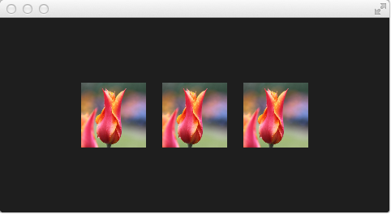

# 着色器元素

为了编写着色器，Qt Quick 提供了两个元素：`ShaderEffectSource` 和 `ShaderEffect`。着色器效果应用自定义着色器，着色器效果源则把一个 QML 项渲染成纹理并加以渲染。着色器效果可以对其矩形形状应用自定义着色器，并可以为着色器操作使用源。源可以是一幅图像（用作纹理）或一个着色器效果源。

默认着色器使用源并不加修改地渲染它。下面我们首先看带有两个 `ShaderEffect` 元素的 QML 文件。一个不指定任何着色器，另一个显式指定默认的顶点和片元着色器。我们稍后再来看这些着色器。

<<< @/docs/ch10-effects/src/effects/default/defaultshader.qml#M1



在上面的示例中，有一排 3 幅图像。第一幅是真实图像。第二幅使用默认着色器渲染，第三幅使用下面所示的片元和顶点着色器代码渲染。让我们来看看这些着色器。

顶点着色器接收纹理坐标 `qt_MultiTexCoord0`，并把它传递给 `qt_TexCoord0` 变量。它还接收 `qt_Vertex` 位置，将其与 Qt 的变换矩阵 `ubuf.qt_Matrix` 相乘，并通过 `gl_Position` 变量返回。这样纹理和顶点在屏幕上的位置保持不变。

<<< @/docs/ch10-effects/src/effects/default/default.vert#M1

片元着色器从 `source` 2D 采样器（即纹理）中取得坐标 `qt_TexCoord0` 处的纹理，并将其与 Qt 不透明度 `ubuf.qt_Opacity` 相乘，计算出 `fragColor`，也就是该像素要使用的颜色。

<<< @/docs/ch10-effects/src/effects/default/default.frag#M1

注意，这两个着色器可以作为你自己着色器的样板代码。这些变量、位置（location）和绑定，正是 Qt 所期望的。你可以在 [ShaderEffect 文档](https://doc-snapshots.qt.io/qt6-6.2/qml-qtquick-shadereffect.html#details)中阅读更多精确细节。

在能够使用这些着色器之前，需要对它们进行烘焙。如果着色器是一个更大的 Qt 项目的一部分并作为资源包含，那么烘焙可以自动完成。然而，当着色器与 `qml` 文件配合使用时，我们需要手动显式烘焙它们。这可以通过以下两条命令完成：

```
qsb --glsl 100es,120,150 --hlsl 50 --msl 12    -o default.frag.qsb default.frag 
qsb --glsl 100es,120,150 --hlsl 50 --msl 12 -b -o default.vert.qsb default.vert
```

`qsb` 工具位于 Qt 6 安装目录的 `bin` 目录中。

::: tip
如果你不想看到源图像、只想看到施加效果后的图像，可以把 *Image* 设为不可见（\`\` visible: false\`\`）。着色器效果仍会使用图像数据，只是 *Image* 元素不会被渲染。
:::

在接下来的示例中，我们将摆弄一些简单的着色器机制。首先关注片元着色器，然后再回来讨论顶点着色器。
