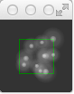

# 简单模拟

让我们先看一个非常简单的模拟作为入门。Qt Quick 其实让粒子渲染的上手变得非常简单。为此我们需要：

* 一个 `ParticleSystem`，把所有元素绑定到一个模拟中
* 一个 `Emitter`，向系统中发射粒子
* 一个派生自 `ParticlePainter` 的元素，用于可视化粒子

<<< @/docs/ch10-effects/src/particles/simple.qml#M1

该示例的结果如下所示：

我们从一个 80x80 像素的深色矩形开始，它既是根元素也是背景。我们在其中声明一个 `ParticleSystem`。这始终是第一步，因为该系统把所有其他元素绑定在一起。接下来的元素通常是 `Emitter`，它根据自身的边界框定义发射区域，以及被发射粒子的基本参数。发射器通过 `system` 属性绑定到系统。

本例中的发射器在整个发射器区域上每秒发射 10 个粒子（`emitRate: 10`），每个粒子的寿命为 1000 毫秒（`lifeSpan : 1000`），粒子之间的寿命变化为 500 毫秒（`lifeSpanVariation: 500`）。粒子的初始尺寸为 16 像素（`size: 16`），在其生命结束时为 32 像素（`endSize: 32`）。

带绿色边框的矩形是一个示踪元素，用来显示发射器的几何形状。这说明，虽然粒子是在发射器的边界框内发射的，但渲染并不局限于发射器的边界框。渲染位置取决于粒子的寿命和方向。当我们研究如何改变粒子方向时，这一点会更加清楚。

发射器发射的是逻辑粒子。逻辑粒子使用 `ParticlePainter` 可视化，本例中使用的是 `ImageParticle`，它通过 source 属性接收图像 URL。图像粒子还有若干其他属性，用于控制粒子的一般外观。

* `emitRate`：每秒发射的粒子数（默认每秒 10 个）
* `lifeSpan`：粒子持续存在的毫秒数（默认 1000 毫秒）
* `size`、`endSize`：粒子在生命开始和结束时的尺寸（默认 16 像素）

改变这些属性会对结果产生巨大的影响。

<<< @/docs/ch10-effects/src/particles/simple2.qml#M1

除了把发射速率提高到 40、把寿命提高到 2 秒之外，尺寸现在从 64 像素开始，在粒子寿命结束时减小 32 像素。

若进一步增大 `endSize`，背景几乎会变成白色。还请注意：即使粒子只在发射器定义的区域内发射，渲染也不受该区域约束。
