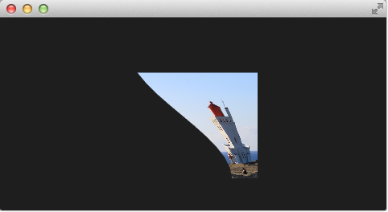
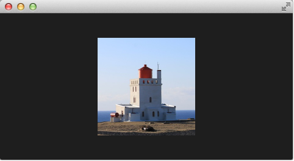
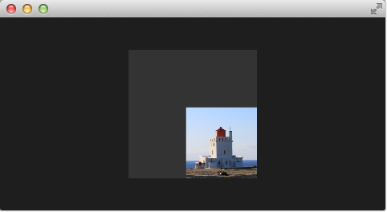
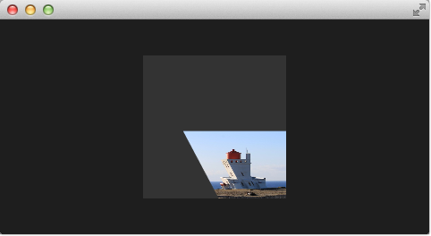
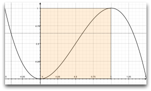
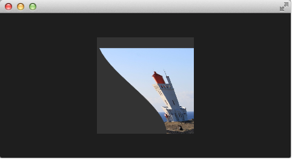
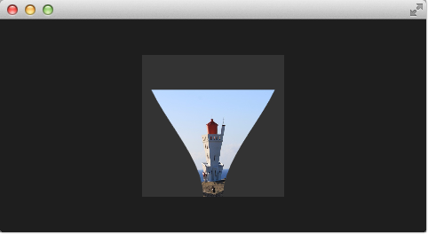

# 顶点着色器

顶点着色器可以用来操纵着色器效果提供的顶点。通常情况下，着色器效果有 4 个顶点（左上、右上、左下和右下）。每个顶点的报告类型都是 `vec4`。为了展示顶点着色器，我们将编写一个精灵效果（genie effect）。该效果让一个矩形窗口区域消失到一个点中，如同精灵钻进神灯一般。




## 搭建场景

首先，我们用一幅图像和一个着色器效果搭建场景。

<<< @/docs/ch10-effects/src/effects/genie/0/genie0.qml#M1

这提供了一个带深色背景的场景，以及一个以图像作为源纹理的着色器效果。在精灵效果生成的图像上看不到原始图像。另外，我们在与着色器效果相同几何形状的位置添加了一个深色矩形，以便更清楚地判断需要点击哪里来还原效果。



该效果通过点击图像触发，这由覆盖效果的鼠标区域定义。在 *onClicked* 信号处理器中，我们切换自定义布尔属性 *minimized*。稍后将用该属性切换效果。

## 最小化与复原

场景搭建好后，我们定义一个名为 *minimize* 的 real 类型属性，该属性保存当前最小化的进度值。值在 0.0 到 1.0 之间变化，由一个顺序动画控制。

<<< @/docs/ch10-effects/src/effects/genie/1/genie1.qml#M1

动画由 *minimized* 属性的切换触发。现在所有外围设置都已完成，我们终于可以来看顶点着色器了。

<<< @/docs/ch10-effects/src/effects/genie/1/genie1.vert#M1

顶点着色器为每个顶点调用一次，在我们的场景中即调用四次。Qt 定义的默认参数会被提供，例如 *qt_Matrix*、*qt_Vertex*、*qt_MultiTexCoord0*、*qt_TexCoord0*。这些变量我们前面已经讨论过。此外，我们把 *minimize*、*width* 和 *height* 变量从着色器效果链接到顶点着色器代码中。在 main 函数中，我们把当前纹理坐标存入 *qt_TexCoord0*，使其对片元着色器可用。然后复制当前位置并修改顶点的 x 和 y 位置：

```glsl
vec4 pos = qt_Vertex;
pos.y = mix(qt_Vertex.y, ubuf.height, ubuf.minimize);
pos.x = mix(qt_Vertex.x, ubuf.width, ubuf.minimize);
```

`mix(…)` 函数在前两个参数之间做线性插值，插值位置由第三个参数提供的点（0.0-1.0）决定。所以在我们的场景中，y 在当前 y 位置和高度之间根据当前 minimize 值插值，x 也类似。请注意，minimize 值由我们的顺序动画驱动，从 0.0 变化到 1.0（或反向）。



得到的效果其实还不是真正的精灵效果，但已经向它迈进了一大步。

## 初步弯曲

这样就最小化了顶点的 x 和 y 分量。现在我们想稍微改变 x 的操纵方式，让它取决于当前的 y 值。所需的改动很小。y 位置照旧计算。x 位置的插值现在取决于顶点的 y 位置：

```glsl
float t = pos.y / ubuf.height;
pos.x = mix(qt_Vertex.x, ubuf.width, t * minimize);
```

这使得 y 位置越大，x 位置越偏向宽度。换言之，上面两个顶点完全不受影响（它们的 y 位置为 0），而下面两个顶点的 x 位置都弯向宽度，因此它们弯向同一个 x 位置。



## 改进弯曲

由于目前的弯曲效果还不能令人满意，我们将增加几个部分来改善它。
首先，我们增强动画以支持一个独立的弯曲属性。这是必要的，因为弯曲应当立即发生，而 y 方向的最小化应当稍作延迟。两个动画的总时长相同（300+700+1000 和 700+1300）。

我们首先从 QML 添加 `bend` 并为其制作动画。

<<< @/docs/ch10-effects/src/effects/genie/3/genie3.qml#M1

然后把 `bend` 添加到 uniform 缓冲区 `ubuf` 中，并在着色器里使用它，以实现更平滑的弯曲。

<<< @/docs/ch10-effects/src/effects/genie/3/genie3.vert#M1

曲线从 0.0 处平滑开始，然后上升，并在接近 1.0 时平滑地停下。下面是该函数在指定区间上的图像。对我们来说，只有 0..1 的区间有意义。



我们还需要增加顶点数量。可以通过使用网格（mesh）来增加所用的顶点数。

```qml
mesh: GridMesh { resolution: Qt.size(16, 16) }
```

着色器效果现在拥有一个均匀分布的 16x16 顶点网格，而不是之前使用的 2x2 顶点。这使得顶点之间的插值看起来平滑得多。



你还能看到所用曲线的影响，因为弯曲在末尾很好地平滑了下来。这正是弯曲效果最强的地方。

## 选择边

作为最后一项增强，我们希望能切换边。边就是精灵效果消失到的那个点。到目前为止它总是朝宽度一侧消失。通过添加 `side` 属性，我们可以把该点修改为 0 到宽度之间的任意位置。

```qml
ShaderEffect {
    ...
    property real side: 0.5
    ...
}
```

<<< @/docs/ch10-effects/src/effects/genie/4/genie4.vert#M1



## 封装

最后要做的是把我们的效果优雅地封装起来。为此，把精灵效果代码提取到一个名为 `GenieEffect` 的独立组件中。它以着色器效果作为根元素。我们移除了鼠标区域，因为它不应位于组件内部——效果的触发可以通过 `minimized` 属性切换。

<<< @/docs/ch10-effects/src/effects/genie/demo/GenieEffect.qml#M1
<<< @/docs/ch10-effects/src/effects/genie/demo/genieeffect.vert#M1

现在你可以这样简单地使用该效果：

<<< @/docs/ch10-effects/src/effects/genie/demo/geniedemo.qml#M1

我们通过移除背景矩形简化了代码，并把图像直接赋给效果，而不是在一个独立的图像元素中加载它。
