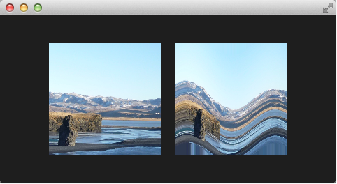

# 波浪效果

在这个更复杂的示例中，我们将用片元着色器创建一个波浪效果。波形基于正弦曲线，它影响用于取色的纹理坐标。

qml 文件定义属性和动画。

<<< @/docs/ch10-effects/src/effects/wave/wave.qml#M1

片元着色器接收这些属性，并根据属性计算每个像素的颜色。

<<< @/docs/ch10-effects/src/effects/wave/wave.frag#M1

波的计算基于一个脉冲和纹理坐标操纵。脉冲方程给出一个取决于当前时间和所用纹理坐标的正弦波：

```glsl
vec2 pulse = sin(ubuf.time - ubuf.frequency * qt_TexCoord0);
```

如果没有时间因子，我们得到的只是一个固定的扭曲，而不是像波浪那样行进的扭曲。

对于颜色，我们使用另一个纹理坐标处的颜色：

```glsl
vec2 coord = qt_TexCoord0 + ubuf.amplitude * vec2(pulse.x, -pulse.x);
```

纹理坐标受脉冲的 x 值影响。其结果就是一个移动的波浪。



在本例中我们使用的是片元着色器，这意味着我们移动的是矩形项纹理内部的像素。如果我们想让整个项像波浪一样移动，就必须使用顶点着色器。
